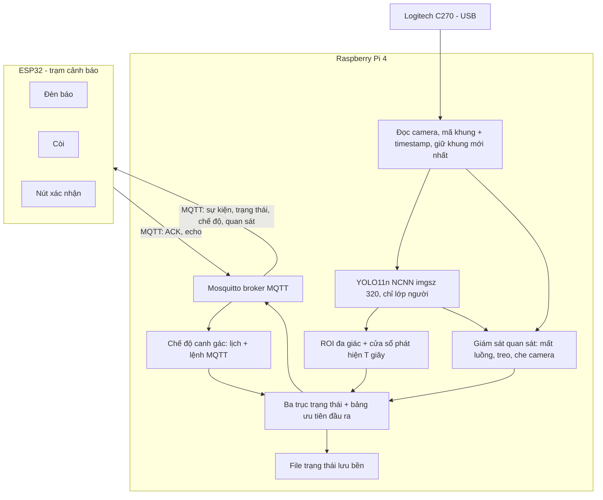
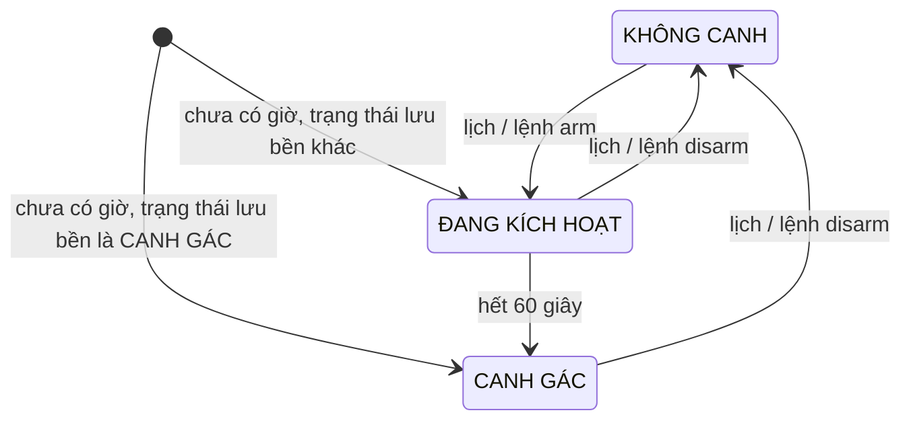
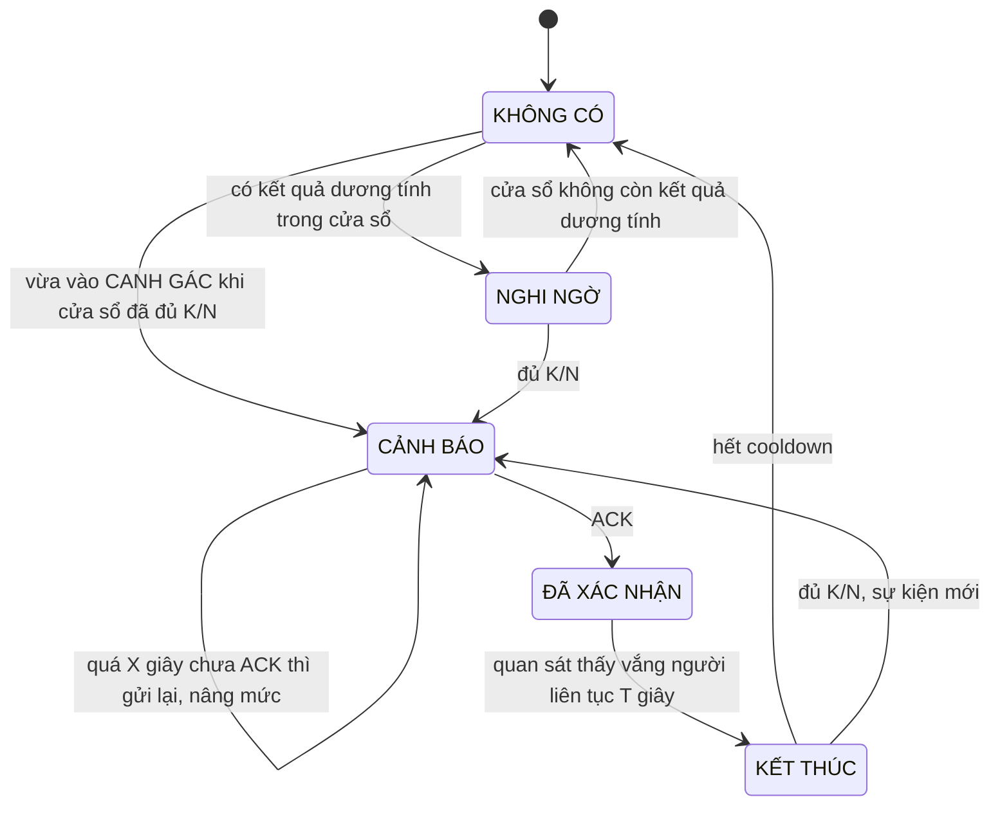
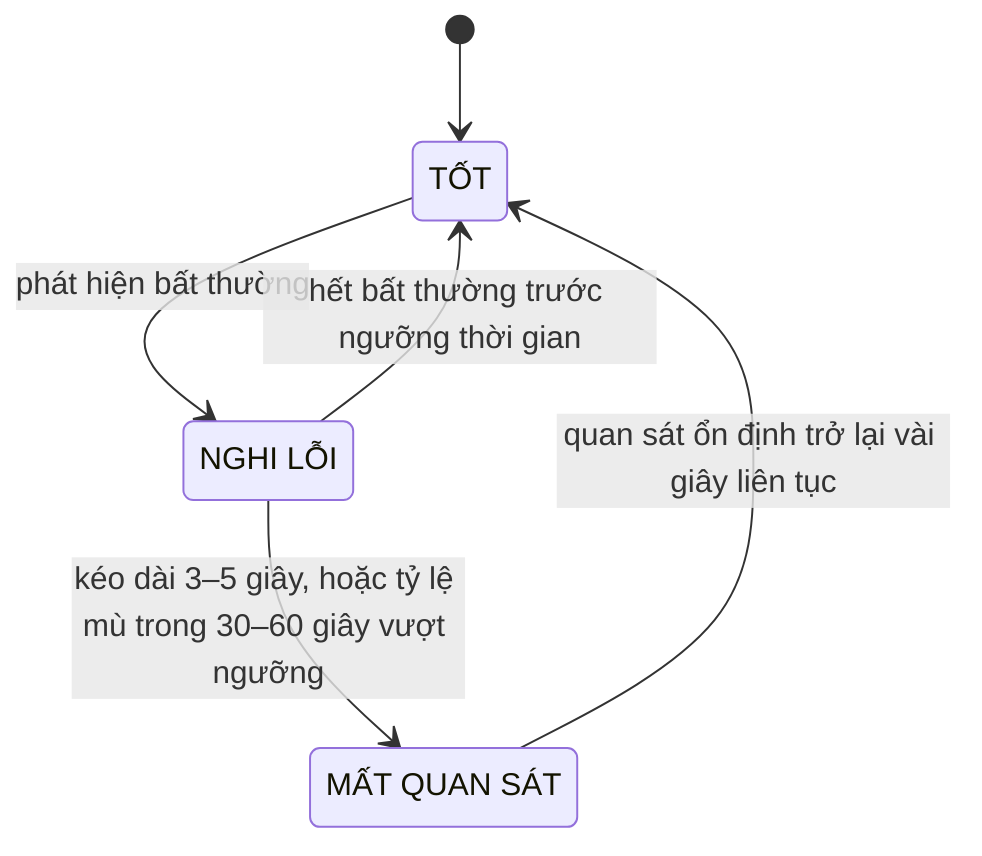
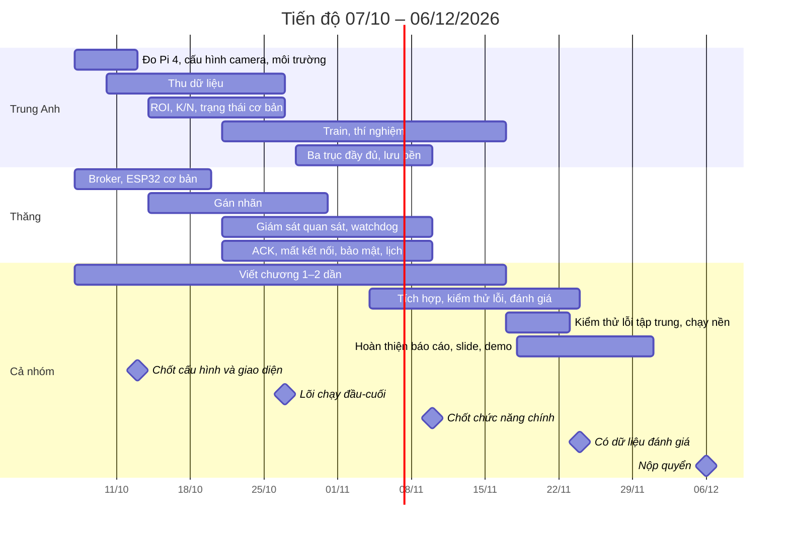

# Đề xuất triển khai ĐATN Nhóm 17 – Hệ thống giám sát phát hiện người xâm nhập

16/10/2026 · Hoàng Trung Anh · bản cập nhật sau phản biện kỹ thuật lần 2

## 1. Tổng quan và mục tiêu

Hệ thống phát hiện người xâm nhập vào vùng cấm bằng YOLO chạy trực tiếp trên Raspberry Pi 4, gửi sự kiện qua MQTT tới ESP32 để bật đèn, còi và nhận xác nhận của người trực. ESP32 đóng vai trạm cảnh báo đặt xa camera, tại vị trí người trực. Toàn bộ xử lý nằm trong mạng nội bộ, nên hệ thống vẫn cảnh báo được khi mất Internet, với điều kiện router nội bộ, Pi và ESP32 vẫn hoạt động. Nếu router mất điện, đường truyền cảnh báo mới từ Pi tới ESP32 cũng mất.

So với đề cương đã nộp, phương án triển khai bổ sung bốn điểm, đều nằm trong phạm vi các chương hiện có nên không cần đổi tên đề tài:

- **Tinh chỉnh mô hình cho điều kiện thiếu sáng** bằng dữ liệu tự thu tại hiện trường, và đánh giá mức cải thiện cùng sự đánh đổi so với mô hình gốc.
- **YOLO11n chạy NCNN, imgsz 320**, đo hiệu năng thực tế trên Raspberry Pi 4 ngay tuần 1.
- **Chế độ canh gác (arm/disarm)**: giờ hành chính không cảnh báo, ngoài giờ mới canh. Bật/tắt theo lịch tự động hoặc bằng lệnh MQTT.
- **Giám sát khả năng quan sát của camera**: phát hiện mất luồng hình, chương trình phát hiện bị treo và camera bị che toàn phần kéo dài. Phát hiện mờ, bẩn, xoay lệch là phần mở rộng.

**Giá trị của đồ án** nằm ở việc thiết kế, tối ưu và kiểm chứng một hệ thống nhúng IoT trong điều kiện thực tế: đáp ứng độ trễ trên Pi 4, giảm bỏ sót ở cùng mức báo động giả, và xử lý đúng khi nhiều sự cố xảy ra chồng lên nhau. Việc dùng YOLO11n thay YOLOv8n tự nó không phải đóng góp.

Mục tiêu đo được của hệ thống:

| Chỉ tiêu | Mục tiêu đề xuất |
| --- | --- |
| Độ trễ từ lúc người vào vùng cấm đến lúc còi kêu | Phân vị 95 dưới 2 giây, đo đầu-cuối bằng video trong điều kiện quan sát đã chốt (mục 3); báo cáo kèm trung vị, số lượt vượt 2 giây và tỷ lệ bỏ sót. Chưa có số đo trên thiết bị, nên mục tiêu này chỉ được khẳng định sau khi đo ở tuần 1 và trong giai đoạn đánh giá |
| Mô hình sau tinh chỉnh | Đánh giá mức cải thiện và sự đánh đổi: recall khi thiếu sáng đặt cạnh số báo động giả mỗi giờ, và kết quả khi đủ sáng sau tinh chỉnh |
| Báo động giả | Đo theo số lần mỗi giờ khi chạy liên tục |
| Xử lý sự cố chồng lên nhau | Tất cả kịch bản đánh số trong ma trận kiểm thử sự cố (mục 8) cho kết quả đúng, báo cáo đạt/không đạt từng kịch bản; không báo động nào bị mất do mất kết nối, camera lỗi hay khởi động lại |
| Khôi phục sau mất kết nối | Tự kết nối lại, không cần can thiệp tay; thời gian phát hiện mất kết nối và thời gian khôi phục được đo thực tế |

Các ngưỡng trên là đề xuất ban đầu; nhóm chốt lại sau khi có số đo trên Pi ở tuần 1.

## 2. Kiến trúc tổng thể

Raspberry Pi 4 làm toàn bộ việc phát hiện, giữ trạng thái và chạy broker MQTT; ESP32 nối WiFi cùng router nội bộ, chỉ thực thi đầu ra đèn, còi và gửi xác nhận.

Khung hình đi từ trên xuống trong Pi. Kết quả phát hiện, tình trạng quan sát và chế độ canh gác cùng đổ vào khối trạng thái; khối này lưu trạng thái ra file và publish ra broker, lệnh canh gác từ broker đi ngược vào.

Lý do chọn:

- **Broker đặt trên Pi**: mất Internet vẫn cảnh báo được, đúng lập luận trong đề cương; không cần thêm thiết bị; độ trễ thấp.
- **Router WiFi riêng** cho hệ thống: IP ổn định khi demo, không phụ thuộc hotspot điện thoại hay WiFi phòng bảo vệ.

## 3. Khối phát hiện trên Raspberry Pi

Pi chạy YOLO11n xuất sang NCNN ở kích thước ảnh 320, chỉ lấy lớp người, kiểm tra vị trí bằng điểm chân trong ROI đa giác.

**Camera: Logitech C270.** Nhóm dùng webcam USB Logitech C270: độ phân giải tối đa 720p, góc nhìn chéo 55° (theo trang Logitech hiện hành; một số tài liệu cũ ghi 60°), lấy nét cố định, đọc qua OpenCV với backend V4L2. Lấy nét cố định nghĩa là không có hiện tượng autofocus dò nét; với camera gắn cao nhìn xuống vùng cấm thì người luôn ở xa đủ để rõ nét. C270 là webcam giá rẻ, chất lượng ảnh thiếu sáng chỉ ở mức trung bình, nên mức sáng tối thiểu trong điều kiện quan sát (bên dưới) và phần tinh chỉnh cho thiếu sáng càng quan trọng. Cáp USB cho phép đặt camera cách Pi một khoảng; nếu cần xa hơn chiều dài cáp có sẵn thì dùng cáp nối dài USB có khuếch đại.

**Đọc camera.** Một luồng riêng đọc camera liên tục và chỉ giữ khung hình mới nhất; YOLO luôn xử lý ảnh mới nhất thay vì ảnh tồn trong bộ đệm. Nếu đọc và suy luận tuần tự, độ trễ cảnh báo sẽ tăng dần vài giây. Mỗi khung mang **mã khung tăng dần và timestamp**. Vòng suy luận chỉ xử lý khung có mã lớn hơn khung đã xử lý, nên không bao giờ đếm lại một ảnh cũ. Phần đọc camera nằm gọn trong một module, nên đổi camera không ảnh hưởng phần còn lại. Đây cũng là nơi duy nhất mở camera: các module khác, kể cả giám sát quan sát, nhận khung từ luồng này chứ không tự mở camera.

- **Định dạng và độ phân giải**: mở bằng `cv2.VideoCapture(<thiết bị>, cv2.CAP_V4L2)`, đặt `CAP_PROP_FOURCC` là MJPG, rồi đặt kích thước và 30 fps. Định dạng YUYV không nén thường không đạt 30 fps ở độ phân giải cao qua USB 2.0. Độ phân giải mặc định đề xuất là 640×480; so thêm với 1280×720 trong tuần 1, vì hai chế độ có thể khác góc nhìn và tỷ lệ khung. Chụp cùng một cảnh ở hai chế độ để so vùng nhìn (đưa ảnh vào quyển), rồi chọn chế độ cho chiều cao người ở mép xa ROI lớn nhất sau khi thu về 320. Kết quả `v4l2-ctl --list-formats-ext` và `v4l2-ctl --list-ctrls-menus` của chính C270 được đưa nguyên vào phụ lục. Sau khi đặt, đọc lại bằng `cap.get(...)` để biết giá trị camera thực sự chấp nhận.
- **Tên thiết bị cố định**: mở theo đường dẫn `/dev/v4l/by-id/...-video-index0` thay vì `/dev/video0`, vì số thứ tự có thể đổi sau khi khởi động lại hoặc cắm lại, và webcam UVC trên kernel mới thường tạo thêm một node metadata; kiểm tra bằng `v4l2-ctl --list-devices`.
- **Rút khung liên tục**: luồng đọc gọi `grab()` liên tục ở tốc độ camera để bộ đệm của driver luôn có khung mới, và chỉ gọi `retrieve()` (giải nén MJPG) khi vòng suy luận sẵn sàng nhận khung mới, để không tốn CPU giải nén các khung bị bỏ. Mức tiết kiệm cần đo xác nhận trên Pi. Backend V4L2 của OpenCV có hỗ trợ `CAP_PROP_BUFFERSIZE` (1–10, mặc định 4); có thể đặt giá trị nhỏ (1–2) rồi đọc lại bằng `cap.get` để kiểm tra, nhưng vòng `grab()` liên tục vẫn là cơ chế chính để luôn có khung mới nhất, vì không phụ thuộc phiên bản OpenCV, và đã có báo cáo việc đặt thuộc tính này làm giảm tốc độ thu khung trên một số cấu hình. Nếu đặt thì đo FPS trước và sau.
- **Mốc thời gian khung**: ghi cả hai mốc. (a) `time.monotonic()` ngay sau khi `grab()` trả về. (b) Mốc thời gian buffer của V4L2, đọc qua `CAP_PROP_POS_MSEC`, là thời điểm driver nhận khung; giá trị này có thể bằng 0 trên một số cấu hình và gốc đồng hồ phụ thuộc driver, nên phải kiểm tra trên Pi trước khi dùng. Cả hai mốc đều đến sau lúc cảm biến phơi sáng một khoảng bằng độ trễ bên trong camera, nên không thay thế được phép đo đầu-cuối bằng video (mục 8).
- **Tự kết nối lại**: khi `grab()` thất bại liên tục quá một ngưỡng (số lần hoặc thời gian), module báo mất luồng (mục 6), gọi `release()` rồi thử mở lại với thời gian chờ tăng dần, và áp lại toàn bộ control v4l2 sau khi mở.

**Cấu hình camera cố định.** Khi thiếu sáng, camera tự kéo dài thời gian phơi sáng, làm người đang đi bị nhòe. Nhóm giả thuyết rằng mờ chuyển động là một nguyên nhân bỏ sót quan trọng trong điều kiện thiếu sáng, bên cạnh độ tối; giả thuyết này được kiểm chứng bằng thí nghiệm so sánh cách phơi sáng ở mục 4. Mục tiêu là chặn trần thời gian phơi sáng và để camera bù bằng gain. Với C270, việc này làm qua các control v4l2; tên control khác nhau theo phiên bản kernel, nên kiểm tra bằng `v4l2-ctl -d <thiết bị> --list-ctrls`.

- **Phương án chính: phơi sáng tự động nhưng giữ cố định tốc độ khung.** Giữ chế độ phơi sáng tự động và tắt `exposure_dynamic_framerate` (tên cũ `exposure_auto_priority`), tức không cho camera hạ FPS khi tối. Khi phải giữ 30 fps, thời gian phơi sáng bị chặn ở khoảng một chu kỳ khung (khoảng 33 ms) và camera tăng gain để bù. Đây là cách chặn trần phổ biến trên webcam UVC; mức trần không chỉnh tùy ý được như với camera CSI. Phải kiểm chứng bằng cách quay ở mức sáng thấp nhất và xác nhận FPS thực vẫn khoảng 30.
- **Phương án dự phòng: phơi sáng thủ công.** Đặt chế độ phơi sáng thủ công với `exposure_time_absolute` (tên cũ `exposure_absolute`, đơn vị 100 µs) và gain cố định. Cách này chặn trần chính xác hơn nhưng không tự thích nghi khi ánh sáng đổi giữa ngày và đêm, nên chỉ dùng nếu phương án chính không giữ được FPS; khi đó cần vài bộ thông số theo khung giờ.
- **Các control tự động khác** (cân bằng trắng, bù ngược sáng) được chốt một trạng thái. Tần số điện lưới (chống nhấp nháy đèn) đặt 50 Hz theo lưới điện Việt Nam; trên C270, giá trị mặc định của control này có thể là 60 Hz nên phải đặt lại.

Toàn bộ thông số nằm trong một file cấu hình dùng chung, được áp dụng (ví dụ bằng `v4l2-ctl --set-ctrl`) mỗi lần mở camera, cho cả script thu dữ liệu và chương trình chính, để dữ liệu train giống hệt điều kiện triển khai. Webcam có thể không giữ control sau khi rút cắm hoặc khởi động lại, nên phải áp lại mỗi lần mở. Đây là lý do cần thử cấu hình ngay tuần 1, trước khi thu dữ liệu.

**Điều kiện quan sát.** Chốt trong tuần 1, cùng lúc với vị trí demo: chiều cao và góc gắn camera, khoảng cách xa nhất từ camera tới mép ROI, chiều cao nhỏ nhất của người trong ảnh (tính bằng pixel ở imgsz 320), và mức sáng thấp nhất cần hỗ trợ. Mọi chỉ tiêu về độ chính xác và độ trễ chỉ có nghĩa trong các điều kiện này. Nếu thiếu tốc độ, không giải quyết chỉ bằng cách giảm imgsz: ảnh nhỏ hơn làm người ở xa khó phát hiện hơn, nên mọi thay đổi imgsz phải đo lại độ chính xác, đặc biệt với người ở mép xa của ROI.

**Mô hình: YOLO11n.** Nhóm dùng duy nhất YOLO11n, xuất sang NCNN, chạy ở imgsz 320. Ultralytics khuyến nghị NCNN cho Raspberry Pi; lưu ý bảng benchmark trong hướng dẫn Raspberry Pi của Ultralytics đo trên Pi 5, không dùng để suy ra hiệu năng Pi 4. Lý do chọn YOLO11n: phiên bản ổn định, nhiều tài liệu và ví dụ, xuất NCNN không gặp vấn đề, và được đo trực tiếp trên Pi. Đây cũng là mô hình dùng để tinh chỉnh ở mục 4.

Số liệu tham khảo của Ultralytics: YOLO11n đạt mAP50-95 39,5 so với 37,3 của YOLOv8n; 2,6 so với 3,2 triệu tham số; 6,5 so với 8,7 tỷ FLOPs; thời gian suy luận CPU (ONNX) 56,1 so với 80,4 ms. Theo chú thích của Ultralytics, tốc độ được đo trên máy ảo Amazon EC2 P4d, tốc độ CPU đo bằng bản xuất ONNX (không nêu model CPU cụ thể), trên COCO val ở kích thước 640, truy cập ngày 15/10/2026; không phải trên Raspberry Pi 4 ở kích thước 320 trong hệ thống của nhóm, nên chỉ dùng để tham khảo. Báo cáo chỉ nêu "nhẹ hơn" hay "nhanh hơn" khi có số đo trên Pi xác nhận. Nguồn: [YOLOv8 vs YOLO11](https://docs.ultralytics.com/compare/yolov8-vs-yolo11).

YOLO26 là phiên bản mới hơn của Ultralytics (phát hành tháng 1/2026), hiện là mô hình mặc định trong tài liệu Ultralytics, và có thể được hội đồng hỏi tới. Nhóm giữ YOLO11n vì đã đo nó trên chính Pi 4 ở tuần 1 và mọi thí nghiệm fine-tune xây trên nó. Ultralytics báo YOLO26n nhanh hơn khoảng 15% so với YOLO11n trên Pi 5 (ONNX, 640), nhưng chưa có số đo trên Pi 4; nếu còn thời gian, nhóm đo YOLO26n NCNN imgsz 320 trên chính Pi 4 để so sánh, nếu không thì để ở hướng phát triển. Báo cáo ghi rõ phiên bản gói `ultralytics` đã dùng, vì tên tham số và tài liệu thay đổi nhanh.

**Đo trên Pi ở tuần 1.** Đo với **đủ các thành phần sẽ chạy lúc demo**: đọc camera, YOLO, giám sát quan sát, broker, ghi log và luồng hình. Chạy liên tục đủ lâu (ít nhất 30–60 phút) để thấy ảnh hưởng của nhiệt độ và hạ xung. Chỉ số: FPS suy luận thực (số khung khác nhau được suy luận mỗi giây, không phải FPS camera), thời gian suy luận, CPU, RAM, nhiệt độ, và một lượt đo độ trễ sơ bộ. FPS được đo cả khi bật và khi tắt luồng hình, vì việc vẽ khung và nén JPEG tốn CPU đáng kể. Tản nhiệt kèm quạt là bắt buộc, vì Pi 4 bắt đầu hạ xung ở khoảng 80°C. Số đo này quyết định các tham số của cửa sổ phát hiện (dựa trên FPS thấp nhất khi đã hạ xung) và việc mục tiêu 2 giây có khả thi hay không.

Trong lúc đo, ghi lại `vcgencmd get_throttled` và giải mã đủ các bit: 0, 1, 2 cho tình trạng hiện tại và 16, 17, 18 cho "đã từng xảy ra". Bit 0/16 là sụt áp, 1/17 là tần số Arm bị giới hạn, 2/18 là đang hạ xung. Pi 4 không định nghĩa soft limit, nên khi chạm 80°C sẽ bật bit 1/17 chứ không bật bit 3/19. Cũng trong lần đo này, so sánh nhanh bản NCNN FP32 với bản xuất `quantize=16` (FP16) để có số đo thay cho suy đoán (mục 11).

**ROI và điều kiện xâm nhập.**

- ROI là đa giác khai báo trong file cấu hình. Một script hiệu chỉnh chụp một ảnh từ camera, cho click các đỉnh trên laptop rồi ghi lại file cấu hình, xong trong khoảng một phút. Script này cần chạy lại mỗi khi camera bị dời hoặc đặt lại, đặc biệt ở phòng demo.
- Vị trí người là **điểm chân**, tức tâm cạnh dưới bbox. Điểm này phản ánh nơi người đứng chính xác hơn tâm bbox.
- Mỗi lượt suy luận cho một **kết quả**, gắn mốc thời gian của khung (`time.monotonic()` ngay sau khi lấy khung): dương tính nếu có ít nhất một người trong ROI với độ tin cậy trên ngưỡng. Chỉ tính các khung khác nhau đã được suy luận, không phải số khung camera thu được.
- **Cửa sổ phát hiện theo thời gian** gồm các kết quả trong T giây gần nhất (ví dụ T = 2–3 giây). Xâm nhập khi trong cửa sổ có **số kết quả dương tính ≥ K_min và tỷ lệ dương tính ≥ p**. Phát biểu theo thời gian để ý nghĩa của điều kiện không đổi khi FPS dao động theo nhiệt độ hay tải CPU. Trong tài liệu vẫn gọi tắt là "điều kiện K/N".
- **Số kết quả tối thiểu n_min**: nếu cửa sổ có ít hơn n_min kết quả (suy luận quá chậm hoặc ngừng), hệ thống không im lặng mà báo suy giảm quan sát qua trục 3 (mục 5.3 và 6). Thiếu điều kiện này, khi Pi hạ xung mạnh cửa sổ có thể không bao giờ đủ K_min và hệ thống bỏ sót mà không ai biết.
- **K_min chọn theo FPS thấp nhất đo được khi đã hạ xung** (phép đo 30–60 phút ở tuần 1), sao cho thời gian tích lũy đủ K_min kết quả cộng các độ trễ khác vẫn đạt chỉ tiêu. Ví dụ, nếu pipeline chỉ xử lý 2 khung mỗi giây thì với K_min = 3, riêng khoảng từ kết quả dương tính đầu tiên tới kết quả thứ ba đã khoảng 1 giây, chưa tính thời gian chờ lượt suy luận đầu tiên, suy luận, truyền và chấp hành. Các tham số này là đánh đổi giữa độ trễ và báo động giả, được phân tích trong chương 3; báo cáo ghi T, K_min, p, n_min và FPS thấp nhất.
- Ngưỡng độ tin cậy, T, K_min và p chọn bằng tập val hoặc video riêng, ưu tiên recall; **không chọn bằng tập test**.

## 4. Huấn luyện và tinh chỉnh mô hình

Mục tiêu là **đánh giá mức cải thiện và sự đánh đổi** khi thích nghi mô hình với điều kiện thực tế của camera giám sát: ánh sáng yếu, góc nhìn từ trên cao, người ở xa hoặc bị che. Fine-tune không được giả định trước là sẽ cải thiện; kết quả không cải thiện ở một số điều kiện vẫn có giá trị nếu nhóm giải thích được nguyên nhân. Hệ thống không cần hoạt động trong bóng tối hoàn toàn, nên dùng camera thường, không cần camera NoIR hay đèn hồng ngoại.

**Quy trình:**

1. **Làm quen**: train thử trên bộ `coco8` trong Google Colab để hiểu toàn bộ quy trình và các file kết quả.
2. **Thu dữ liệu**: quay bằng chính camera, đúng vị trí, góc, độ phân giải và cấu hình phơi sáng triển khai (mục 3). Quay nhiều mức sáng (đủ sáng, tắt bớt đèn, chạng vạng), có cả cảnh không người. Mỗi buổi quay một tên session. Cần khoảng **10 buổi ngắn trải trên nhiều ngày**, vì chia tập theo buổi; nếu chỉ có 3–4 buổi, tập test chỉ còn một buổi và số liệu sẽ rất nhiễu. Hình ảnh của cá nhân là dữ liệu cá nhân cơ bản theo Luật Bảo vệ dữ liệu cá nhân số 91/2025/QH15 và Nghị định 356/2025/NĐ-CP (thay thế Nghị định 13/2023/NĐ-CP từ 01/01/2026; cần trích nguyên văn từ văn bản gốc trên vbpl.vn hoặc chinhphu.vn). Vì vậy chỉ quay người trong nhóm hoặc tình nguyện viên có giấy đồng ý bằng văn bản ghi rõ mục đích (huấn luyện, đánh giá ĐATN), thời hạn lưu và quyền rút lại; xin phép đơn vị quản lý địa điểm quay; làm mờ mặt khi minh họa trong quyển.
3. **Trích khung**: lọc ảnh gần trùng bằng sai khác giữa các khung, thay vì lấy cố định 1 khung mỗi giây, vì cảnh tĩnh không người sẽ cho ra hàng trăm ảnh giống hệt nhau. Mục tiêu khoảng 1.000–2.000 ảnh tự thu đã gán nhãn. Số lượng này đủ để bắt đầu thích nghi với một hiện trường hẹp nhưng không bảo đảm khả năng tổng quát; **độ đa dạng** về người, trang phục, khoảng cách, mức sáng và số buổi quay quan trọng hơn việc trích thật nhiều ảnh từ vài đoạn video.
4. **Bổ sung dữ liệu công khai**: ảnh thiếu sáng có người (ExDark hoặc bộ tương đương trên Roboflow Universe) và vài trăm đến 1.000 ảnh người từ COCO để mô hình không quên khả năng nhận diện ban ngày. Kiểm tra giấy phép từng bộ; ExDark phát hành theo giấy phép BSD-3, dùng cho mục đích thương mại phải liên hệ tác giả; nhãn ở định dạng riêng, cần mở một file nhãn để kiểm tra định dạng trước khi viết script chuyển sang định dạng YOLO. Giữ riêng một phần ExDark không dùng khi train làm tập test ngoài.
5. **Gán nhãn bán tự động**: cho một mô hình lớn hơn (ví dụ YOLO11m, chạy trên laptop hoặc Colab) gán nhãn sơ bộ (`save_txt=True`) cho tập train và val, rồi sửa lại trên CVAT hoặc Label Studio. Khi sửa, phải **tìm cả những người mô hình gán sơ bộ bỏ sót**, không chỉ chỉnh các box nó đã vẽ; nếu không, nhãn sẽ thiên về những gì mô hình đó đã thấy. **Tập test gán tay toàn bộ**, không dùng nhãn sơ bộ, để nhãn test không thiên về mô hình nào. Viết quy tắc gán nhãn trước khi bắt đầu và áp dụng nhất quán cho cả nhóm.
6. **Chia tập theo buổi quay**, không theo từng ảnh, để tránh rò rỉ dữ liệu. Tập test gồm `test_normal`, `test_lowlight` (ảnh camera Pi) và `test_external` (phần ExDark giữ riêng).
7. **Khóa tập test**: tập test chỉ dùng cho lần đánh giá cuối của mỗi thí nghiệm. Ngưỡng, K/N và việc khai thác mẫu âm khó đều dùng train/val hoặc dữ liệu riêng, không nhìn vào kết quả test.
8. **Đo baseline**: đánh giá mô hình gốc trên ba tập test (precision, recall, mAP50, mAP50-95), **cùng imgsz 320 và chỉ lấy lớp người (`classes=[0]`)** để so sánh công bằng với mô hình fine-tune. Lớp người đặt là `0` để khớp COCO. Cách chỉ đánh giá lớp người không phụ thuộc đối số: tập đánh giá chỉ có nhãn person mang id 0, file YAML khai báo đủ 80 tên lớp COCO, rồi lấy chỉ số riêng của lớp person; nếu dùng đối số `classes=[0]` thì phải kiểm tra phiên bản `ultralytics` có hỗ trợ cho chế độ val. Ghi rõ cách làm trong quyển.
9. **Fine-tune trên GPU** (Colab/Kaggle), imgsz bằng kích thước chạy trên Pi, early stopping, lưu kết quả lên Google Drive.
10. **Khai thác mẫu âm khó**: chạy mô hình trên video không người thuộc tập train hoặc quay riêng (không thuộc tập test), đưa các ảnh bị báo nhầm vào tập train dưới dạng ảnh nền, rồi train lại.
11. **Xuất NCNN và kiểm tra lại trên Pi**: đo độ chính xác sau chuyển đổi và FPS.

**Địa điểm demo.** Mô hình fine-tune thích nghi với hiện trường thu dữ liệu. Nếu demo ở một phòng khác, bước thiếu sáng trong kịch bản demo có thể không thể hiện được lợi thế, thậm chí kém hơn mô hình gốc. Vì vậy chốt địa điểm demo ngay tuần 1. Thu ít nhất vài buổi ở chính địa điểm đó hoặc bối cảnh giống nó, trong đó dành ít nhất một buổi cho tập test.

**Thí nghiệm so sánh:**

| Thí nghiệm | Câu hỏi cần trả lời | Mức ưu tiên |
| --- | --- | --- |
| Mô hình gốc và mô hình fine-tune | Recall thay đổi bao nhiêu ở cùng mức báo động giả; kết quả khi đủ sáng có bị giảm không | Bắt buộc |
| Trước và sau khi thêm mẫu âm khó | Báo động giả giảm bao nhiêu, recall có bị ảnh hưởng không | Bắt buộc |
| Tăng sáng bằng xử lý ảnh (gamma/CLAHE) và fine-tune | Xử lý ảnh đơn giản có thay được train lại không | Nên làm |
| imgsz 320, 416, 640 | Đánh đổi độ chính xác (đặc biệt với người ở xa) và tốc độ | Nên làm |
| Phơi sáng tự động giữ 30 fps (trần khoảng 33 ms) và phơi sáng thủ công ngắn hơn (khoảng 20 ms, gain cao), quay cùng kịch bản đêm | Đánh đổi giữa mờ chuyển động và nhiễu: recall ban đêm ở từng cách | Nếu còn thời gian |
| Mô hình gốc và fine-tune trên tập test ngoài (`test_external`) | Cải thiện là do thích nghi hiện trường hay do nhìn thiếu sáng tốt hơn nói chung | Nên làm |
| Dữ liệu thiếu sáng thật, giả lập và kết hợp | Dữ liệu giả lập có giúp ích không | Nếu còn thời gian |

Thí nghiệm mô hình gốc và mô hình fine-tune: mô hình fine-tune được train 3 lần với seed khác nhau, báo cáo trung bình và độ lệch chuẩn; mô hình gốc không train nên chỉ đánh giá một lần. Các thí nghiệm "Nên làm" và "Nếu còn thời gian" chỉ chạy 1 seed, để tiết kiệm quỹ GPU. Ba seed chỉ đo độ dao động của quá trình train; chúng không thay thế được việc kiểm thử hệ thống trên nhiều phiên độc lập (mục 8). Vì tập test chỉ gồm khoảng 2 buổi quay, báo cáo thêm khoảng tin cậy bootstrap trên ảnh của tập test, và ghi rõ giới hạn này.

## 5. Quản lý trạng thái: ba trục độc lập

Pi là nơi duy nhất giữ trạng thái; ESP32 chỉ thực thi đầu ra và gửi xác nhận. Trạng thái được tách thành **ba trục độc lập**: chế độ canh gác, sự kiện xâm nhập và tình trạng quan sát của camera. Mỗi trục có máy trạng thái riêng; một **bảng ưu tiên** quyết định đèn và còi từ tổ hợp của ba trục. Cách tách này tránh lỗi gộp chung, ví dụ camera lỗi vô tình đóng một sự kiện xâm nhập chưa được giải quyết, và cho phép chứng minh hệ thống xử lý đúng khi các sự cố chồng lên nhau.

### 5.1. Trục 1 – Chế độ canh gác

Hai nguồn điều khiển:

- **Lịch tự động**: khai báo khung giờ canh gác trong file cấu hình, ví dụ ngày thường từ 17:30 đến 07:30, cả ngày thứ Bảy và Chủ nhật.
- **Lệnh MQTT**: gửi `arm`, `disarm` hoặc `auto` (trở lại theo lịch) lên topic lệnh. Lệnh thủ công chỉ có hiệu lực đến mốc chuyển tiếp kế tiếp của lịch, rồi hệ thống tự quay về `auto`. Riêng `disarm` thủ công có thời hạn tối đa (ví dụ 2–4 giờ) hoặc hết ở mốc lịch kế tiếp, **tùy cái nào đến trước**; nếu không, một lệnh tắt lúc 19:00 sẽ làm cả đêm không canh gác. Trong thời gian này ESP32 hiển thị rõ "đang tắt canh gác thủ công". Mọi lệnh thủ công được ghi log kèm tài khoản gửi (lấy từ username MQTT).

Quy tắc:

- **ĐANG KÍCH HOẠT (khoảng 60 giây)**: mọi lần bật canh gác, bằng lịch hay bằng lệnh, đều qua khoảng chờ này để người còn trong khu vực kịp rời đi. YOLO vẫn chạy và cửa sổ K/N vẫn cập nhật nhưng không phát cảnh báo. Hết 60 giây, trục 2 và trục 3 được xét ngay (xem bên dưới): còn người trong ROI thì báo động, camera vẫn mất quan sát thì phát cảnh báo quan sát. Đây là cách hệ thống báo trộm thật xử lý: hết thời gian chờ mà còn người là báo động.
- **Tắt canh gác** đóng mọi cảnh báo đang mở (xâm nhập và quan sát), ghi log "tắt bởi lệnh" hoặc "tắt theo lịch" kèm nguồn. Trục 3 vẫn tiếp tục đo.
- Mỗi lần đổi chế độ, Pi publish chế độ hiện tại (retained) để ESP32 và các thiết bị khác cập nhật.

**Lưu ý đồng hồ.** Raspberry Pi 4 không có đồng hồ thời gian thực (RTC); khi mất Internet và khởi động lại, giờ hệ thống có thể sai và lịch canh gác chạy sai theo. Hai biện pháp đi cùng nhau:

- Gắn module RTC DS3231 qua I2C (rẻ, phổ biến).
- Thứ tự xác định giờ khi khởi động: NTP → RTC hợp lệ. "RTC hợp lệ" được định nghĩa thao tác được: cờ OSF (dừng dao động) của DS3231 chưa bật, năm nằm trong khoảng hợp lý, và giờ không lùi so với mốc lưu bền gần nhất. Lưu ý `fake-hwclock` có thể làm hệ thống tưởng có giờ trong khi đó là giờ cũ, nên không tính là nguồn giờ hợp lệ.
- Khi có giờ: chế độ theo lịch, hoặc theo lệnh thủ công còn hiệu lực đã lưu bền (mục 5.6).
- Khi chưa có giờ: nếu trạng thái lưu bền trước khi tắt là CANH GÁC thì vào CANH GÁC ngay (kẻ xâm nhập cắt điện không làm hệ thống mất canh gác); nếu không thì đi qua ĐANG KÍCH HOẠT 60 giây rồi vào CANH GÁC. Đây là đánh đổi có chủ ý: vẫn ưu tiên canh gác khi không biết giờ, nhưng tránh hú còi ngay với người hợp lệ đang ở trong vùng khi Pi có điện lại giữa giờ làm việc. Khi đồng hồ chưa được đồng bộ, `state` mang cờ `clock_unsynced` để ESP32 hiển thị chỉ báo.
- ESP32 không dùng giờ tuyệt đối; nó thực thi `state` theo cặp (`boot_id`, `seq`) (mục 5.6).

Để thử lịch canh gác khi đánh giá và demo, file cấu hình có tham số **giờ giả lập** (độ lệch thời gian cộng vào giờ dùng cho lịch). Tham số này chỉ dùng để thử, không đụng vào đồng hồ hệ thống, để không xung đột với NTP, RTC và không làm sai mốc thời gian trong log.

### 5.2. Trục 2 – Sự kiện xâm nhập

Trục này chỉ tạo sự kiện mới khi trục 1 ở CANH GÁC.

| Trạng thái | Ý nghĩa |
| --- | --- |
| KHÔNG CÓ | Cửa sổ K/N không có kết quả dương tính |
| NGHI NGỜ | Có kết quả dương tính trong cửa sổ, chưa đủ K |
| CẢNH BÁO | Đủ điều kiện xâm nhập, lưu ảnh bằng chứng, chờ ACK |
| ĐÃ XÁC NHẬN | Người trực đã ACK, chờ quan sát thấy ROI vắng |
| KẾT THÚC | Đã vắng người T giây, đang cooldown |

Quy tắc:

- **Điều kiện ra khỏi NGHI NGỜ.** Cửa sổ trượt không có thời điểm "thất bại", nên điều kiện quay về là trong cửa sổ (các kết quả trong T giây gần nhất) không còn kết quả dương tính nào.
- **Cảnh báo chỉ kết thúc khi có người xác nhận.** Nếu người xâm nhập đã rời ROI mà chưa ai ACK, hệ thống vẫn giữ CẢNH BÁO, giống hệ thống báo trộm thật. Ngoại lệ duy nhất là tắt canh gác.
- **Xâm nhập trong cooldown**: ở KẾT THÚC, bộ lọc K/N vẫn chạy bình thường. Nếu đủ K/N thì chuyển thẳng sang CẢNH BÁO với `event_id` mới, ghi log là tái xâm nhập kèm `event_id` của sự kiện trước. Cooldown chỉ dùng để tách sự kiện và tránh đèn trạng thái nhấp nháy, không phải khoảng hệ thống ngừng canh.

### 5.3. Trục 3 – Tình trạng quan sát của camera

Trục này chỉ phản ánh tình trạng vật lý: hệ thống còn quan sát được vùng cấm hay không (chi tiết cách phát hiện ở mục 6). Đi kèm là một **cảnh báo quan sát** có vòng đời riêng:

**Tỷ lệ mù.** Ngoài điều kiện bất thường liên tục 3–5 giây, trục 3 còn chuyển sang MẤT QUAN SÁT khi tỷ lệ thời gian không ở TỐT trong cửa sổ trượt 30–60 giây vượt ngưỡng (ví dụ 50%). Điều kiện này chặn kiểu che camera ngắn lặp lại (che 2 giây, bỏ nửa giây, che tiếp), vốn làm trục 3 dao động giữa TỐT và NGHI LỖI mà không bao giờ tới MẤT QUAN SÁT.

- Bật khi trục 3 vào MẤT QUAN SÁT trong lúc trục 1 ở CANH GÁC, hoặc khi hết 60 giây kích hoạt mà camera vẫn mất quan sát.
- Chỉ tắt bằng ACK hoặc tắt canh gác. Camera hồi phục trước khi có ACK thì cảnh báo vẫn giữ.
- Khi trục 1 ở KHÔNG CANH, MẤT QUAN SÁT chỉ là lỗi thiết bị: đèn cam và bíp ngắn, không hú còi, không cần ACK.

### 5.4. Quy tắc tương tác giữa các trục

1. **Khung không quan sát được không bao giờ được hiểu là "không có người".** Nếu không, che camera sẽ làm hệ thống tưởng ROI đã vắng. Cụ thể:
   - Ở NGHI LỖI, YOLO vẫn chạy; kết quả dương tính hợp lệ vẫn được cộng vào cửa sổ K/N, còn kết quả âm tính không được cộng vào mẫu số.
   - Ở MẤT QUAN SÁT, máy trạng thái bỏ qua kết quả YOLO.
   - Cửa sổ K/N chỉ bị xóa khi trục 3 đi qua MẤT QUAN SÁT rồi trở về TỐT; chuyển từ NGHI LỖI về TỐT thì không xóa. Nhờ vậy, khi bị che ngắn lặp lại, các kết quả dương tính giữa các lần che vẫn được cộng dồn.
2. **Mất quan sát không đóng sự kiện xâm nhập.** Trục 2 giữ nguyên trạng thái hiện có: đang CẢNH BÁO thì vẫn CẢNH BÁO và vẫn chờ ACK.
3. **Mọi bộ đếm dựa vào quan sát chỉ chạy khi trục 3 ở TỐT.** Ở ĐÃ XÁC NHẬN, bộ đếm "vắng người T giây" dừng khi mất quan sát và đặt lại về 0 khi quan sát trở lại: hệ thống phải thực sự thấy ROI vắng đủ T giây liên tục mới kết thúc sự kiện.
4. **Một lần bấm ACK xác nhận tất cả cảnh báo đang hiển thị trên ESP32.** ACK luôn mang danh sách `event_id` cụ thể mà ESP32 đang hiển thị lúc bấm. Pi chỉ xác nhận các `event_id` còn mở và bỏ qua `event_id` không tồn tại, nên một cảnh báo mới phát sinh sau thời điểm bấm không bị xác nhận nhầm. Xử lý ACK phía Pi là idempotent: ACK trùng không gây tác dụng phụ.
5. **Xâm nhập ngay khi camera hồi phục.** Khi trục 3 vừa từ MẤT QUAN SÁT về TỐT mà những khung đầu tiên đã có người trong ROI, điều kiện K/N được rút ngắn (ví dụ cửa sổ 1 giây) và sự kiện được gắn nhãn "xâm nhập sau mất quan sát", để không phải chờ đủ T giây với trường hợp kẻ xâm nhập che camera, đi vào rồi bỏ che.

Ví dụ chuỗi trong nhận xét: đang CẢNH BÁO xâm nhập → camera bị che → cảnh báo quan sát bật → ACK (xác nhận cả hai) → camera hồi phục. Kết quả: trục 2 ở ĐÃ XÁC NHẬN và chỉ chuyển sang KẾT THÚC khi camera thấy ROI vắng đủ T giây; sự kiện xâm nhập không bị mất.

### 5.5. Bảng ưu tiên đầu ra

Pi tính đầu ra từ ba trục và publish trong `state`; ESP32 chỉ làm theo. Còi chạy theo nhịp của mục có ưu tiên cao nhất đang hoạt động; các đèn hiển thị đồng thời mọi mục đang hoạt động.

| Ưu tiên | Điều kiện | Đèn | Còi |
| --- | --- | --- | --- |
| 1 | Trục 2 ở CẢNH BÁO | Đỏ nháy | Nhịp xâm nhập |
| 2 | MẤT GIÁM SÁT: ESP32 không nhận heartbeat từ Pi (do ESP32 tự xác định) | Cam và đỏ nháy xen kẽ | Bíp ngắn định kỳ |
| 3 | Cảnh báo quan sát chưa ACK | Cam nháy nhanh | Nhịp quan sát, khác nhịp xâm nhập |
| 4 | Trục 2 ở ĐÃ XÁC NHẬN | Đỏ sáng | Tắt |
| 5 | Trục 3 ở MẤT QUAN SÁT (đã ACK, hoặc đang không canh) | Cam sáng; khi không canh thêm bíp ngắn | Tắt |
| 6 | Trục 1 ở ĐANG KÍCH HOẠT, hoặc đang tắt canh gác thủ công | Vàng nháy chậm | Tắt |
| 7 | Trục 1 ở CANH GÁC, không có mục nào ở trên | Vàng | Tắt |
| 8 | Trục 1 ở KHÔNG CANH, không có mục nào ở trên | Xanh | Tắt |

Quá X giây ở mục 1 hoặc 3 mà chưa có ACK thì Pi gửi lại sự kiện và nâng mức (nháy nhanh hơn). Mức 2 là mức duy nhất do ESP32 tự tính, vì lúc đó không còn thông tin từ Pi: ESP32 giữ nguyên báo động đang có và chồng thêm chỉ báo mất giám sát, để người trực không thấy đèn vàng "bình thường" trong khi Pi đã ngừng giám sát. ESP32 phân biệt hai trường hợp: mất kết nối WiFi/broker, và broker còn nhưng Pi không gửi heartbeat.

### 5.6. Lưu bền và khởi động lại

Retain chỉ giúp thiết bị nhận lại trạng thái khi kết nối lại; nó không tự phục hồi máy trạng thái của chương trình trên Pi. Vì vậy:

- Mỗi lần trạng thái thay đổi, Pi ghi ba trục (kể cả lệnh thủ công còn hiệu lực), các sự kiện đang mở và cảnh báo quan sát ra một file trạng thái. Ghi theo trình tự: ghi file tạm → `flush` → `os.fsync` file tạm → `os.replace` sang tên chính → `fsync` thư mục chứa. Chỉ đổi tên (`rename`) thì bảo đảm tính nguyên tử của tên file nhưng không bảo đảm dữ liệu đã xuống thẻ nhớ; thiếu `fsync`, sau mất điện có thể nhận file rỗng hoặc bản cũ.
- Khi khởi động, chương trình đọc lại file: sự kiện chưa ACK được khôi phục nguyên trạng và publish lại, ESP32 tiếp tục báo.
- Trong khoảng thời gian khởi động đầu (ví dụ 60 giây), trục 3 chưa xác định và không phát cảnh báo quan sát mới, tránh báo nhầm khi camera đang khởi tạo. Nhưng nếu hết 60 giây mà trục 3 chưa lần nào đạt TỐT, cảnh báo quan sát được phát ngay, không chờ thêm 3–5 giây; nếu không, kẻ xâm nhập có thể gây khởi động lại rồi che camera ngay để có một cửa sổ mù.
- **`boot_id` và `seq`.** Mỗi lần chương trình khởi động, `boot_id` tăng một (bộ đếm lưu bền) và `seq` bắt đầu lại từ 0. ESP32 chấp nhận `state` nếu `boot_id` khác lần trước, hoặc cùng `boot_id` và `seq` lớn hơn. Nếu chỉ dùng `seq` trong RAM, sau khi Pi khởi động lại ESP32 sẽ bỏ qua mọi `state` mới cho đến khi `seq` vượt giá trị cũ, tức là im lặng đúng lúc cần báo động. Khi thấy `boot_id` đổi, ESP32 hiển thị chỉ báo "Pi vừa khởi động lại".
- Mosquitto bật `persistence true` để giữ các thông điệp retained khi broker khởi động lại.
- Ngay khi khởi động, chương trình publish lại `state` với `boot_id` mới, để ESP32 không làm theo bản retained cũ mà broker còn giữ.

### 5.7. Lưu trữ ảnh bằng chứng, log và quyền riêng tư

Hình ảnh của cá nhân là dữ liệu cá nhân cơ bản (Luật 91/2025/QH15, Nghị định 356/2025/NĐ-CP), và thẻ SD không chịu được ghi liên tục: hướng dẫn Raspberry Pi của Ultralytics khuyến nghị dùng SSD khi chạy 24/7 vì thẻ SD có thể hỏng. Chính sách:

- Ảnh bằng chứng chỉ lưu khi có sự kiện CẢNH BÁO, không ghi video liên tục. Ảnh nằm trong thư mục riêng, giữ tối đa N ngày hoặc một giới hạn dung lượng; ảnh cũ hơn tự xóa.
- Chỉ tài khoản quản trị trên Pi đọc được thư mục ảnh; luồng hình demo không được lưu lại.
- Log CSV quay vòng theo kích thước; trong giai đoạn đánh giá, log được chép ra máy khác định kỳ. journald đặt `Storage=volatile` hoặc giới hạn dung lượng để giảm ghi.
- File trạng thái (mục 5.6) nhỏ và chỉ ghi khi trạng thái đổi.
- Nếu còn thời gian: chạy hệ thống từ SSD USB, hoặc dùng overlay chỉ đọc cho phân vùng hệ thống.

## 6. Giám sát khả năng quan sát của camera

Một camera RGB có thể nhận ra hình ảnh bị suy giảm, nhưng không phải lúc nào cũng phân biệt được nguyên nhân: cảnh quá tối đến mất hết chi tiết có thể giống camera bị che; mất nét có thể do lấy nét hoặc chuyển động. Vì vậy chức năng này được gọi là **giám sát khả năng quan sát** và chỉ cam kết các tình huống được liệt kê dưới đây. Cảnh tối đến mức không còn quan sát được bị xếp vào MẤT QUAN SÁT là hành vi đúng, vì khi đó hệ thống thật sự bị mù; điều kiện bắt buộc là các cảnh thiếu sáng còn làm việc được (trong điều kiện quan sát đã chốt ở mục 3) không bị báo nhầm.

**Giao diện module.** Đầu vào là khung hình kèm mã khung và timestamp từ luồng đọc camera (mục 3), cùng timestamp của kết quả suy luận cuối. Module không tự mở camera. Đầu ra là trạng thái trục 3 và loại lỗi. Các phép đo hình ảnh chạy 1–2 lần mỗi giây để tiết kiệm CPU; kiểm tra thời gian của khung và kết quả suy luận chạy liên tục vì rất rẻ. Module độc lập nên được giao trọn cho một thành viên (mục 10).

**Phạm vi bắt buộc:**

| Tình huống | Dấu hiệu | Cách đo |
| --- | --- | --- |
| Mất luồng hình, camera treo | Không có khung mới, hoặc ảnh đứng yên tuyệt đối | Thời gian từ khung cuối vượt ngưỡng; sai khác giữa các khung bằng 0 trong thời gian dài |
| Chương trình phát hiện treo hoặc quá chậm | Có khung mới nhưng không có kết quả suy luận mới, hoặc có quá ít kết quả | Thời gian từ kết quả suy luận cuối vượt ngưỡng (ví dụ 3 giây), hoặc cửa sổ T giây có ít hơn n_min kết quả (mục 3). Kết nối MQTT còn sống không chứng minh YOLO còn chạy |
| Camera bị che toàn phần kéo dài | Mất gần hết chi tiết, ảnh gần như đồng màu | Chủ yếu dựa vào độ mất chi tiết: độ lệch chuẩn điểm ảnh và mật độ cạnh rất thấp, kéo dài 3–5 giây. Độ sáng giảm chỉ là điều kiện phụ, vì tay che camera trong phòng sáng chưa chắc làm ảnh tối |

Khi chương trình phát hiện bị treo hoàn toàn, chính khối trạng thái cũng có thể dừng theo. Vì vậy có hai lớp watchdog, cần gọi đúng tên. **Watchdog dịch vụ** (`WatchdogSec=` trong unit systemd của chương trình, unit đặt `Type=notify` và `NotifyAccess` phù hợp nếu thông báo gửi từ luồng khác): chương trình gửi `sd_notify("WATCHDOG=1")` chỉ khi kết quả suy luận còn mới; nếu không, systemd khởi động lại **chương trình**. **Watchdog phần cứng** (`RuntimeWatchdogSec=` trong cấu hình systemd, xem mục 12) bảo vệ khi chính kernel hoặc systemd treo. Chi tiết cấu hình cần đối chiếu man page systemd trước khi viết vào quyển. Khi watchdog dịch vụ khởi động lại chương trình, và trạng thái được khôi phục từ file (mục 5.6). Nếu chương trình bị crash mà broker vẫn chạy, LWT `cam01/status` báo cho ESP32. Trong lúc watchdog chưa kịp khởi động lại chương trình, ESP32 vẫn biết hệ thống đang mù nhờ heartbeat ứng dụng (mục 7).

**Tránh báo nhầm** trong phạm vi bắt buộc:

- **Tắt đèn đột ngột** làm ảnh tối đi ngay, nhưng khung cảnh tối vẫn còn cấu trúc (cạnh, vật thể), còn camera bị che thì mất hết. Đây là lý do điều kiện "bị che" dựa vào độ mất chi tiết chứ không dựa vào độ sáng.
- **Ảnh thiếu sáng nhiều nhiễu** làm độ lệch chuẩn và mật độ cạnh dao động. Ngưỡng được hiệu chỉnh trên dữ liệu các buổi quay thiếu sáng, không đặt theo cảm tính.
- **Người đi sát ống kính** che camera trong chốc lát. Điều kiện phải kéo dài liên tục 3–5 giây mới tính.
- **Phân biệt "tối thật" và "bị che"** (cải tiến ở tuần 3–4), thêm hai tín hiệu rẻ. Tốc độ thay đổi: che làm chi tiết sụt đột ngột trong dưới 1 giây, còn chạng vạng thay đổi từ từ trong nhiều phút. Lịch sử độ sáng: C270 không trả metadata độ sáng như camera CSI, nên dùng độ sáng trung bình của ảnh theo thời gian. Ảnh tối dần đều cả khung trong khi phơi sáng tự động đã ở mức tối đa là tối thật; chi tiết mất đột ngột trong khi độ sáng ngay trước đó bình thường là nghi bị che. Lịch sử độ sáng dùng làm đường nền.

**Phần mở rộng (chỉ làm sau mốc 10/11 nếu lõi đã ổn định):**

- **Mờ, bẩn ống kính**: phương sai Laplacian sau khi làm mờ Gaussian để giảm ảnh hưởng của nhiễu, so với ảnh tham chiếu cùng mức sáng thay vì dùng ngưỡng tuyệt đối. Giữ ảnh tham chiếu theo từng mức sáng.
- **Xoay hoặc dịch camera**: tỷ lệ điểm ORB khớp không đủ để kết luận, vì ORB bất biến với phép quay nên ảnh bị xoay vẫn có thể khớp nhiều điểm. Phải dùng các cặp điểm khớp để ước lượng biến đổi hình học, ví dụ `cv2.estimateAffinePartial2D` với RANSAC, rồi đọc ra góc quay, độ dịch và tỷ lệ điểm phù hợp. Nếu có quá ít điểm đặc trưng (thường gặp khi tối) thì trả về "không đủ thông tin" thay vì báo lỗi. `phaseCorrelate` cơ bản chỉ đo dịch chuyển tịnh tiến nên không thay được phép đo góc xoay.
- **Camera đã bị xoay thì ROI cũ không còn ứng với vùng cấm trên sàn.** Ảnh ổn định trở lại không có nghĩa hệ thống đã khôi phục đúng. Trạng thái MẤT QUAN SÁT do xoay không tự hết; chỉ hết khi camera được đặt về vị trí cũ (khớp lại ảnh tham chiếu gốc) hoặc ROI được hiệu chỉnh lại.

**Ảnh tham chiếu không được tự chấp nhận thay đổi lớn.** Ảnh tham chiếu chỉ được cập nhật chậm, khi khung cảnh ổn định, không có người và sai khác so với tham chiếu nhỏ (do ánh sáng thay đổi dần). Một thay đổi lớn kéo dài, như camera bị dời góc, không được hấp thụ vào ảnh tham chiếu.

## 7. Thiết kế MQTT

Broker Mosquitto chạy trên Pi. Pi publish bằng QoS 1; trạng thái hiện tại được giữ bằng retain. Nhóm chốt bảng topic này, cùng với thư viện MQTT trên ESP32, cách ACK và định dạng `state`, ngay tuần đầu (mốc 13/10), vì đây là điểm giao giữa phần Pi và phần ESP32.

| Topic | Chiều | QoS / retain | Nội dung |
| --- | --- | --- | --- |
| `safecam/cam01/event` | Pi → ESP32 | 1 | `event_id`, loại (`intrusion`/`observation`), trạng thái, thời gian, vùng, số người, độ tin cậy |
| `safecam/cam01/state` | Pi → ESP32 | 1, retain | `boot_id` và số thứ tự `seq`, ba trục trạng thái, danh sách sự kiện đang mở, đầu ra đèn và nhịp còi theo bảng ưu tiên, cờ `clock_unsynced` |
| `safecam/cam01/hb` | Pi → ESP32 | 0 | Heartbeat ứng dụng khoảng mỗi 2 giây: `boot_id`, `seq` hiện tại, tuổi của kết quả suy luận mới nhất; phát từ vòng suy luận, chỉ gửi khi kết quả còn mới |
| `safecam/cam01/mode` | Pi → tất cả | 1, retain | Chế độ hiện tại, nguồn (lịch hay lệnh), thời điểm hết hiệu lực của lệnh thủ công |
| `safecam/cam01/cmd/mode` | Thiết bị được phép → Pi | 1 | `arm`, `disarm` hoặc `auto` |
| `safecam/cam01/observation` | Pi → ESP32 | 1, retain | Tình trạng quan sát (trục 3), loại lỗi, thời điểm |
| `safecam/alarm01/ack` | ESP32 → Pi | 0, gửi lặp lại | Danh sách `event_id` đang hiển thị được xác nhận |
| `safecam/alarm01/echo` | ESP32 → Pi | 0 | Phản hồi tức thì, chỉ dùng để đo độ trễ |
| `safecam/cam01/status` | LWT | 1, retain | `online` / `offline` của chương trình phát hiện trên Pi |
| `safecam/alarm01/status` | LWT | 1, retain | `online` / `offline` của ESP32 |

Nguyên tắc thiết kế:

- **QoS 1 và `event_id`**: thông điệp từ Pi tới ít nhất một lần; nhận trùng không gây hậu quả vì xử lý theo `event_id`.
- **ACK xác nhận ở tầng ứng dụng.** Thư viện PubSubClient, phổ biến nhất trên Arduino, chỉ publish được QoS 0 (subscribe thì được QoS 1). ESP32 gửi lặp lại ACK khoảng mỗi giây cho đến khi thấy `state` (retained) báo các `event_id` đó đã được xác nhận. Cách này chắc chắn hơn QoS 1: QoS 1 chỉ bảo đảm thông điệp tới broker, còn cách này bảo đảm Pi đã xử lý ACK. Nó chạy được với mọi thư viện; nếu muốn dùng QoS 1 thật thì chuyển sang esp-mqtt của ESP-IDF (khi đó đặt `session.keepalive` khoảng 10 giây, vì mặc định của esp-mqtt là 120 giây).
- **Retain** cho trạng thái, chế độ và tình trạng quan sát: ESP32 vừa kết nối lại nhận ngay tình hình hiện tại. Mosquitto bật `persistence true` để retained còn sau khi broker khởi động lại. Chính vì retained còn lại, chương trình trên Pi phải publish lại `state` với `seq` mới ngay khi khởi động (mục 5.6).
- **LWT và keepalive, phạm vi tác dụng.**
  - Broker chạy trên Pi, nên khi cả Pi chết thì broker cũng chết và LWT của Pi không bao giờ được gửi. ESP32 chỉ biết qua việc chính nó mất kết nối tới broker.
  - LWT `cam01/status` chỉ có tác dụng khi chương trình phát hiện bị crash mà broker vẫn chạy. Chương trình bị treo nhưng chưa crash thì được phát hiện bằng watchdog (mục 6).
  - Quy tắc 1,5 lần keepalive là quy tắc để **broker** phát hiện một client im lặng, ví dụ để phát LWT của ESP32. Nó không bảo đảm ESP32 phát hiện broker chết sau một khoảng cố định; thời gian đó còn phụ thuộc thư viện, vòng lặp chương trình và kiểu mất mạng, nên được **đo thực tế**. Keepalive ban đầu đặt khoảng 10 giây cho cả hai phía, chỉnh sau khi thử; không đặt quá ngắn vì WiFi chập chờn dễ gây ngắt kết nối giả.
- **Heartbeat ứng dụng, khác với keepalive.** Keepalive chỉ chứng minh kết nối tới broker còn sống, mà broker chạy trên Pi nên vẫn sống khi chương trình phát hiện chết. LWT của chương trình Pi chỉ phát khi kết nối MQTT của chương trình đứt; nếu vòng suy luận treo mà luồng mạng của client MQTT vẫn chạy (ví dụ `loop_start()` của paho) thì keepalive vẫn được trả lời và LWT không bao giờ phát. Vì vậy Pi publish `hb` khoảng mỗi 2 giây **từ chính vòng suy luận** (không phải từ luồng mạng), theo cùng điều kiện "kết quả suy luận còn mới" như watchdog systemd (mục 6). ESP32 lỡ khoảng 3 nhịp liên tiếp (khoảng 6 giây) thì vào trạng thái **mất giám sát**, có chỉ báo riêng khác với mất kết nối broker; nếu đang có báo động thì giữ nguyên báo động.
- **ESP32 khi mất kết nối không bao giờ xóa báo động đang mở.** Nếu đang hú còi mà mất kết nối, ESP32 giữ nguyên đầu ra và thêm chỉ báo mất kết nối. Nút bấm vẫn tắt còi tại chỗ; ESP32 ghi nhớ lần bấm đó cùng danh sách `event_id` và (`boot_id`, `seq`) đã thấy lúc bấm. Lần bấm khi mất kết nối **chỉ tắt còi cục bộ**: khi kết nối lại, ESP32 chỉ gửi ACK cho đúng các `event_id` đã hiển thị lúc bấm, rồi đọc `state` retained để đồng bộ. Nếu trong lúc mất kết nối Pi đã mở sự kiện mới, sự kiện đó không được coi là đã ACK và ESP32 báo động lại cho nó. Nếu không có báo động nào đang mở, mất kết nối chỉ bật chỉ báo lỗi kết nối, không hú còi.
- **Bảo mật**: tắt kết nối ẩn danh, mỗi thiết bị một tài khoản, ACL giới hạn ai được publish lên topic nào. Đặc biệt topic `cmd/mode` chỉ cho thiết bị được phép gửi, vì ai gửi được lệnh `disarm` là vô hiệu hóa được cả hệ thống. ACL cũng phải cấp quyền ghi cho topic LWT của từng thiết bị (`cam01/status`, `alarm01/status`); nếu không, broker bỏ LWT một cách im lặng lúc giao. Thêm TLS nếu còn thời gian.
- Mosquitto 2.x mặc định chỉ nghe localhost, nên cần khai báo `listener 1883` trong file cấu hình để ESP32 kết nối được.

## 8. Kế hoạch đánh giá (chương 3)

Chương 3 đánh giá ở hai mức: mô hình (độ chính xác trên ảnh) và hệ thống (người dùng thực sự gặp gì). Pi ghi log CSV từ ngày đầu: mã khung, timestamp, thời gian suy luận từng khung, FPS suy luận, CPU, RAM, nhiệt độ, trạng thái `get_throttled`, các mốc thời gian của mỗi sự kiện và mọi lần chuyển trạng thái của ba trục. Một **lượt xâm nhập** là một khoảng thời gian liên tục có người trong ROI; các phát hiện cách nhau dưới X giây được gộp làm một lượt.

| Nhóm | Chỉ số | Cách đo |
| --- | --- | --- |
| Mô hình | Precision, recall, mAP50, mAP50-95 theo từng điều kiện | Tập `test_normal`, `test_lowlight`, `test_external` đã khóa; baseline cùng imgsz 320, `classes=[0]` |
| Phát hiện xâm nhập | Tỷ lệ bỏ sót theo lượt xâm nhập, đặt cạnh số báo động giả mỗi giờ; cả đủ sáng và thiếu sáng; trước và sau fine-tune | Video kịch bản có đáp án + chạy liên tục nhiều giờ, trên nhiều phiên kiểm thử độc lập |
| Hiệu năng trên Pi | FPS suy luận, thời gian suy luận, CPU, RAM, nhiệt độ, có bị hạ xung hay không | Log CSV, `vcgencmd get_throttled` (giải mã đủ các bit, gồm sụt áp); chạy đủ các thành phần như lúc demo, ít nhất 30–60 phút; đo khi bật và khi tắt luồng hình |
| Độ trễ cảnh báo | Trung vị, phân vị 95, số lượt vượt 2 giây, tỷ lệ bỏ sót | Video slow-motion và phân tách thành phần (xem bên dưới) |
| Chế độ canh gác | Chuyển đúng giờ, lệnh MQTT có hiệu lực, tự về `auto`, thời gian chờ 60 giây, xâm nhập trong cooldown | Kịch bản thử với giờ giả lập, gửi lệnh, khởi động lại khi mất Internet |
| Giám sát quan sát (bắt buộc) | Tỷ lệ và thời gian phát hiện; số lần báo nhầm, đặc biệt trong các buổi thiếu sáng bình thường | Rút cáp camera, giả lập chương trình treo, che bằng tay và giấy kéo dài; tắt đèn đột ngột; chạy liên tục trong điều kiện thiếu sáng |
| Sự cố chồng lên nhau | Hành vi đúng theo bảng kịch bản bên dưới | Mỗi kịch bản lặp lại nhiều lần, ghi log ba trục |
| Độ ổn định | Thời gian ESP32 phát hiện mất broker (đo, so với keepalive), thời gian khôi phục, không mất báo động đang mở | Tắt router, kill broker, kill và treo chương trình phát hiện, rút nguồn ESP32, khởi động lại Pi |

**Kịch bản sự cố chồng lên nhau** (phần chứng minh hệ thống xử lý lỗi nhất quán):

| # | Kịch bản | Kết quả đúng |
| --- | --- | --- |
| K1 | Đang CẢNH BÁO xâm nhập → che camera → ACK → bỏ che | Sự kiện xâm nhập vẫn mở ở ĐÃ XÁC NHẬN, chỉ kết thúc khi camera thấy ROI vắng đủ T giây |
| K2 | ĐÃ XÁC NHẬN, người còn đứng trong ROI → che camera vài phút → bỏ che | Bộ đếm vắng người không chạy trong lúc che; sự kiện không kết thúc vì người vẫn còn |
| K3 | Đang CANH GÁC, người đi vào ROI trong khi camera bị che ngắn lặp lại (che 2 giây, bỏ nửa giây) | Kết quả dương tính giữa các lần che vẫn được cộng; có CẢNH BÁO xâm nhập hoặc cảnh báo quan sát theo tỷ lệ mù, không im lặng |
| K4 | Che camera, đi vào ROI, bỏ che khi đang đứng trong ROI | CẢNH BÁO với cửa sổ rút ngắn, nhãn "xâm nhập sau mất quan sát" |
| K5 | Đang CẢNH BÁO → tắt router → bấm nút trên ESP32 → bật router | Còi tắt tại chỗ, đèn giữ, có chỉ báo mất giám sát; kết nối lại thì ACK được Pi ghi nhận và `state` đồng bộ |
| K6 | Đang mất kết nối, bấm nút; trong lúc đó Pi mở sự kiện mới → kết nối lại | Chỉ sự kiện cũ được ACK; sự kiện mới vẫn báo động |
| K7 | Đang CẢNH BÁO → khởi động lại Pi | Sự kiện được khôi phục từ file; ESP32 chấp nhận `state` mới nhờ `boot_id` đổi, tiếp tục báo đến khi ACK |
| K8 | Khởi động lại Pi rồi che camera ngay | Hết 60 giây khởi động mà chưa đạt TỐT thì phát cảnh báo quan sát ngay |
| K9 | Mất điện giữa giờ làm việc, có người hợp lệ trong ROI, có điện lại khi chưa có giờ | Vào ĐANG KÍCH HOẠT 60 giây (trạng thái lưu bền là KHÔNG CANH), không hú còi ngay |
| K10 | Bật canh gác khi camera đang bị che | Hết 60 giây phát cảnh báo quan sát, cần ACK |
| K11 | Đang có cả cảnh báo xâm nhập và cảnh báo quan sát → tắt canh gác | Cả hai đóng, log ghi rõ nguồn lệnh và tài khoản |
| K12 | `disarm` thủ công lúc 19:00 | Tự canh gác lại sau thời hạn tối đa, không đợi đến mốc lịch sáng hôm sau |
| K13 | Vòng suy luận treo trong khi kết nối MQTT vẫn sống, đang canh gác | ESP32 vào MẤT GIÁM SÁT sau khoảng 3 nhịp heartbeat lỡ; watchdog dịch vụ khởi động lại chương trình, trạng thái được khôi phục |
| K14 | Rút cáp camera khi đang canh gác, cắm lại | MẤT QUAN SÁT và cảnh báo quan sát; camera tự mở lại, control v4l2 được áp lại |
| K15 | Mất điện đột ngột ngay sau khi trạng thái đổi | File trạng thái là bản cũ hoặc bản mới hoàn chỉnh, không bao giờ rỗng hoặc hỏng |

Ma trận này được mở rộng dần (mục tiêu khoảng 15–25 kịch bản) khi cài đặt.

**Độ trễ cảnh báo.** Chỉ tiêu được định nghĩa là **phân vị 95 dưới 2 giây** trên tập lượt thử trong điều kiện quan sát đã chốt (mục 3), mỗi mức sáng một số lượt đủ lớn (ví dụ khoảng 30 lượt). Báo cáo kèm trung vị, số lượt vượt 2 giây và tỷ lệ bỏ sót; lượt bỏ sót không có độ trễ nên được báo riêng chứ không bị lặng lẽ loại khỏi thống kê.

**Đo đầu-cuối bằng video slow-motion** là con số chính để so với mục tiêu. Quay bằng điện thoại ở 120–240 fps, khung hình thấy cả vạch băng dính ranh giới ROI và đèn trên ESP32. Đếm số khung từ lúc chân qua vạch đến lúc đèn sáng, độ phân giải khoảng 4–8 ms. Còi được quan sát qua một LED mắc song song với còi trên cùng chân điều khiển, nằm trong khung hình; không dựa vào âm thanh, vì nhiều điện thoại không ghi âm khi quay slow-motion và độ lệch đồng bộ âm thanh–hình chưa biết. Cách đánh dấu khung "chân qua vạch" được quy định thống nhất trước khi đếm, vì đây là nguồn sai số do người đánh dấu.

**Phân tách thành phần** dùng để giải thích tổng đo bằng video và chỉ ra thành phần chiếm phần lớn độ trễ. Mỗi thành phần đo trên đồng hồ của chính một thiết bị, nên không cần đồng bộ đồng hồ giữa Pi và ESP32.

| Thành phần | Từ … đến … | Cách đo |
| --- | --- | --- |
| Phát hiện đầu tiên | Người qua ranh giới → khung đầu tiên có người được suy luận | Gồm độ trễ bên trong camera (phơi sáng, nén MJPG, truyền USB) và thời gian chờ lượt suy luận kế tiếp. Do cơ chế bỏ khung giữ ảnh mới nhất, khoảng này có thể lớn hơn một chu kỳ camera, tới cỡ một chu kỳ suy luận. Độ trễ nội tại của C270 chưa có số liệu công bố đáng tin, nên không giả định trước con số nào. Trong hệ thống, thành phần này được suy ra bằng tổng đo qua video trừ các thành phần còn lại. Đo riêng phần camera ở tuần 1: một LED do Pi bật qua GPIO đặt trong khung hình C270; thời điểm bật LED (log Pi) so với thời điểm khung đầu tiên thấy LED sáng cho độ trễ camera, không bị ảnh hưởng bởi độ trễ màn hình |
| Chờ K/N | Kết quả dương tính đầu tiên → điều kiện của cửa sổ phát hiện được thỏa | Log Pi; khi không bỏ sót xấp xỉ (K_min − 1) chia FPS suy luận |
| Suy luận và xử lý | Nhận khung làm điều kiện được thỏa → publish sự kiện CẢNH BÁO | Log Pi: suy luận YOLO, kiểm tra ROI, khối trạng thái |
| MQTT | Publish trên Pi → ESP32 nhận thông điệp | Khứ hồi qua topic `echo` chia đôi; đây chỉ là ước lượng độ trễ một chiều với giả định hai chiều đối xứng, trong khi WiFi có thể bất đối xứng. Tắt chế độ tiết kiệm điện WiFi trên ESP32 (`esp_wifi_set_ps(WIFI_PS_NONE)`) và ghi rõ trong báo cáo |
| Chấp hành | ESP32 nhận thông điệp → bật chân GPIO đèn và còi | `micros()` trên ESP32 |

Các kịch bản thử được viết sẵn và lặp lại nhiều lần để có số liệu thống kê, không chỉ thử một lần cho có. Dành khoảng 3–4 ngày (khoảng 17–23/11) cho kiểm thử lỗi có hệ thống, mỗi kịch bản ít nhất 5 lần; song song chạy nền liên tục 24–48 giờ để đo báo động giả mỗi giờ và độ ổn định.

## 9. Kịch bản demo

Demo trực tiếp khoảng 5–7 phút, có video quay sẵn để dự phòng.

**Dàn dựng:** camera và Pi trên giá, vùng cấm đánh dấu bằng băng dính trên sàn. ESP32 gắn đèn, còi và nút xác nhận đặt **ở bàn người trực, cách xa camera**, thể hiện đúng vai trò trạm cảnh báo. Laptop mở trình duyệt xem luồng hình từ Pi (đã vẽ ROI, khung người, ba trục trạng thái). Luồng hình này chỉ phục vụ demo và có thể tắt; cảnh báo không phụ thuộc vào nó. Sau khi đặt camera, chạy script hiệu chỉnh ROI (mục 3) để khớp vạch băng dính. Pi có tản nhiệt kèm quạt.

1. Hệ thống ở chế độ **không canh gác**: người đi vào vùng cấm, không có cảnh báo, log vẫn ghi nhận.
2. Gửi lệnh `arm` qua MQTT: đèn vàng nháy trong 60 giây kích hoạt, rồi chuyển sang canh gác.
3. Người đi ngang **ngoài** vùng cấm: không báo động.
4. Người bước **vào** vùng cấm: chuyển sang CẢNH BÁO, đèn và còi bật.
5. Bấm nút xác nhận trên ESP32: còi tắt, trạng thái ĐÃ XÁC NHẬN; người rời đi, sau T giây sự kiện kết thúc.
6. Tắt bớt đèn phòng và lặp lại bước 4: so sánh mô hình gốc và mô hình tinh chỉnh trong điều kiện thiếu sáng.
7. **Sự cố chồng lên nhau:** người đứng trong vùng cấm gây CẢNH BÁO, rồi lấy tay che camera: còi và đèn quan sát bật thêm. Bấm ACK, bỏ tay ra: sự kiện xâm nhập vẫn mở cho tới khi camera thấy vùng cấm vắng đủ T giây.
8. Đang báo động, rút điện router: ESP32 giữ đèn và còi, báo mất kết nối; bấm nút tắt còi tại chỗ. Cắm lại: ACK được đồng bộ, hệ thống tự khôi phục.
9. Đặt giờ giả lập sang giờ hành chính (không đụng đồng hồ hệ thống): chế độ tự về không canh gác theo lịch. Che camera lần nữa: lần này chỉ có đèn cam và bíp ngắn, không hú còi.

**Dự phòng:**

- Video demo quay sẵn toàn bộ kịch bản.
- Router riêng, không dùng WiFi của phòng bảo vệ.
- Hệ thống chạy dưới dạng systemd service, cắm điện là tự chạy.

## 10. Phân công, tiến độ và cập nhật đề cương

Nhóm có 8 tuần (07/10 đến 01/12) và chỉ năm ngày đệm trước hạn nộp quyển 06/12/2026. Hệ thống được làm chạy đầu-cuối sớm bằng mô hình gốc; mô hình fine-tune chỉ là một file thay vào sau, nên tiến độ không phụ thuộc hoàn toàn vào huấn luyện.

**Các mốc quyết định:**

| Mốc | Kết quả cần có |
| --- | --- |
| 13/10 | Chốt camera, cấu hình camera, điều kiện quan sát, địa điểm demo, môi trường phần mềm; có số đo Pi 4 thực tế; chốt bảng topic, thư viện MQTT trên ESP32 và giao diện giữa các module |
| 27/10 | Lõi camera → phát hiện → MQTT → còi → ACK chạy được đầu-cuối (mô hình gốc) |
| 10/11 | Chốt chức năng chính; dừng thêm tính năng nếu lõi chưa ổn định. Phần mở rộng chỉ mở sau mốc này nếu lõi đã ổn |
| 24/11 | Có phần lớn dữ liệu đánh giá, biểu đồ và kết quả kiểm thử lỗi |
| 01/12 | Hoàn thiện báo cáo, slide và demo |

**Phân công:**

| Hạng mục | Hoàng Trung Anh | Nguyễn Nhật Thăng |
| --- | --- | --- |
| Phát hiện | Camera và cấu hình phơi sáng, đo YOLO11n trên Pi, NCNN, ROI, script hiệu chỉnh ROI, cửa sổ K/N | — |
| Dữ liệu và huấn luyện | Thu dữ liệu, viết quy tắc gán nhãn, train, thí nghiệm so sánh | Phần lớn việc gán nhãn theo cùng quy tắc |
| Quản lý trạng thái | Ba trục trạng thái, bảng ưu tiên đầu ra, lưu bền và khôi phục | ESP32 thực thi đầu ra theo `state`, ACK lặp lại, hành vi khi mất kết nối, nâng mức cảnh báo |
| Chế độ canh gác | Tích hợp trục 1 vào khối trạng thái | Module lịch và lệnh MQTT, RTC DS3231, giờ giả lập, ACL cho topic lệnh |
| Giám sát quan sát | Cung cấp khung, mã khung, timestamp và kết quả suy luận cho module; tích hợp trục 3 | Toàn bộ module phát hiện (thuần OpenCV), watchdog systemd |
| MQTT và ESP32 | Publish sự kiện và trạng thái | Broker, persistence, bảo mật, firmware đèn/còi/nút, LWT, keepalive |
| Đánh giá | Mô hình, hiệu năng Pi, phát hiện xâm nhập, độ trễ phía Pi | Độ trễ đầu-cuối bằng video, độ ổn định, chế độ canh gác, giám sát quan sát, kịch bản sự cố chồng lên nhau |

Trung Anh đang giữ phần lớn công việc nằm trên đường găng: camera, mô hình, dữ liệu và tích hợp. Vì vậy các giao diện giữa module phải chốt ngay mốc 13/10 để hai người làm độc lập: hàm hoặc luồng cung cấp khung, đầu ra của module giám sát quan sát, và định dạng `state`.

Thu dữ liệu bắt đầu ngay khi đã chốt camera và cấu hình phơi sáng, vì dữ liệu thiếu sáng phải chờ đúng khung giờ mới quay được. Báo cáo không dồn vào cuối: chương 1 viết song song giai đoạn đầu, mỗi module xong thì viết luôn phần tương ứng của chương 2; giai đoạn 18/11–01/12 chỉ để hoàn thiện chương 3, kết luận, slide và demo.

**Cập nhật nội dung các chương** (cần trao đổi với giảng viên hướng dẫn trước khi làm):

- **Chương 1**: thêm học chuyển giao, các chỉ số precision, recall, mAP.
- **Chương 2**: thêm thiết kế bộ dữ liệu và quy trình huấn luyện, cấu hình camera và điều kiện quan sát, quản lý trạng thái ba trục và bảng ưu tiên, lưu bền và khôi phục, chế độ canh gác, giám sát khả năng quan sát, bảo mật MQTT.
- **Chương 3**: thêm kết quả và đánh đổi sau tinh chỉnh, phân tích độ trễ, kết quả kiểm thử sự cố chồng lên nhau, đánh giá chế độ canh gác và giám sát quan sát.

Tên đề tài giữ nguyên vì các nội dung bổ sung đều thuộc phát hiện xâm nhập, quản lý trạng thái và cảnh báo.

## 11. Phạm vi

**Phạm vi chính thức:** một camera, một ROI, YOLO11n chạy NCNN, cửa sổ K/N, MQTT–ESP32, ACK, lịch canh gác, tinh chỉnh cho thiếu sáng, và giám sát quan sát cơ bản (mất luồng, chương trình treo, che toàn phần kéo dài). Một hệ thống có phạm vi rõ, đo được giới hạn và xử lý lỗi nhất quán đủ chiều sâu cho đồ án tốt nghiệp. Không cần thêm đám mây hay ứng dụng điện thoại để đề tài "đúng IoT" hơn.

**Mở rộng, chỉ làm sau mốc 10/11 nếu lõi đã ổn định và có số liệu:**

- Phát hiện mờ, bẩn ống kính và camera bị xoay, dịch (mục 6).
- Các thí nghiệm "Nên làm" và "Nếu còn thời gian" ở mục 4.
- Thông báo Telegram kèm ảnh khi có Internet, xếp hàng đợi và gửi bù khi mất mạng.

**Không làm, kèm lý do:**

| Hạng mục | Lý do |
| --- | --- |
| Nhận diện khuôn mặt, phân biệt người quen/lạ | Vướng quyền riêng tư, mô hình nặng so với Pi 4, lệch đề cương |
| Nhận diện hành động (té ngã, đánh nhau) | Cần mô hình và dữ liệu khác hẳn, không kịp trong 8 tuần |
| Phát hiện vũ khí, phương tiện | Lệch tên đề tài, dữ liệu khó kiếm, dễ báo nhầm |
| Hoạt động trong bóng tối hoàn toàn | Ngoài yêu cầu; cần camera NoIR và đèn hồng ngoại |
| Web dashboard, lưu trữ đám mây, ứng dụng điện thoại | Không phục vụ trực tiếp đề cương; luồng hình chỉ dùng cho demo |
| Tracking đối tượng, vùng nhiều cấp theo thời gian lưu lại | Tốn thêm CPU trên Pi 4; điều kiện K/N đã đủ để xác định xâm nhập |
| Thí nghiệm lượng tử hóa đầy đủ (FP16/INT8) | Cortex-A72 của Pi 4 (ARMv8.0-A) không có số học FP16, vốn có từ ARMv8.2-A; NCNN vẫn có thể dùng FP16 để lưu trọng số và giảm băng thông bộ nhớ, nên chỉ đo nhanh NCNN FP32 so với `quantize=16` ở tuần 1 (mục 3) thay vì làm thí nghiệm riêng. INT8 không có qua export NCNN của Ultralytics; INT8 có cho các định dạng khác như ONNX, OpenVINO, MNN, LiteRT, nhưng phải đổi runtime (LiteRT còn không xuất được trên chính Pi), nên nhóm không đánh giá INT8 vì ngoài phạm vi thời gian |

## 12. Ghi chú: phần cứng nhúng (bổ sung sau)

Phần này sẽ được bổ sung để đồ án thể hiện rõ chiều sâu nhúng. Không nhất thiết thiết kế PCB riêng nếu khoa không yêu cầu, nhưng cần chứng minh nhóm hiểu và thiết kế được các khối sau:

- Sơ đồ nguyên lý toàn hệ thống (Pi, camera, RTC, ESP32, đèn, còi, nút).
- Camera Logitech C270 cắm USB và lấy nguồn từ Pi; tính vào ngân sách nguồn của Pi.
- Nguồn cấp cho Pi và ESP32 (Pi 4 cần nguồn USB-C 5V/3A chất lượng tốt theo datasheet; UPS mini cho Pi và router là hướng phát triển).
- Mạch điều khiển còi phù hợp tải.
- Mức điện áp giao tiếp (logic 3,3 V của Pi và ESP32).
- Chống dội nút nhấn.
- Watchdog: watchdog phần cứng BCM2835 qua systemd `RuntimeWatchdogSec` (đặt khoảng 10–14 giây; không đặt quá 15 giây vì vượt mức trần phần cứng của BCM2835) và Task WDT trên ESP32.
- Hành vi khi mất điện.
- Bố trí ESP32 như trạm cảnh báo đặt xa camera, thể hiện trong báo cáo và lúc demo.
