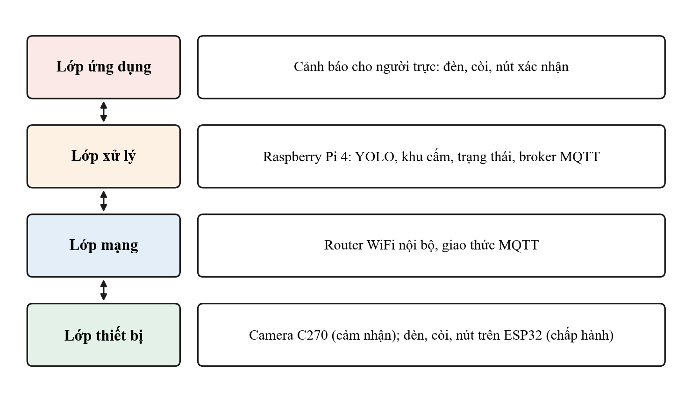
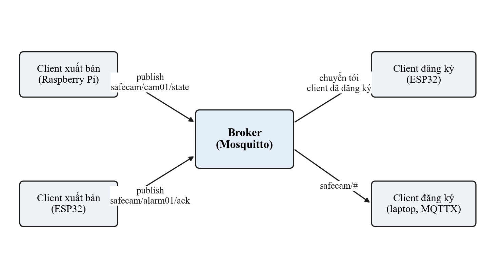
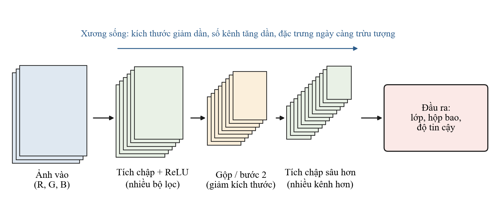
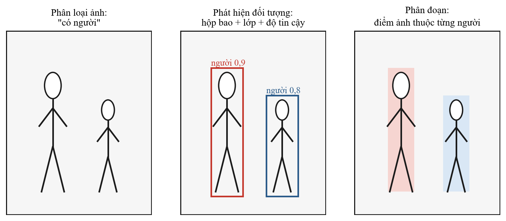
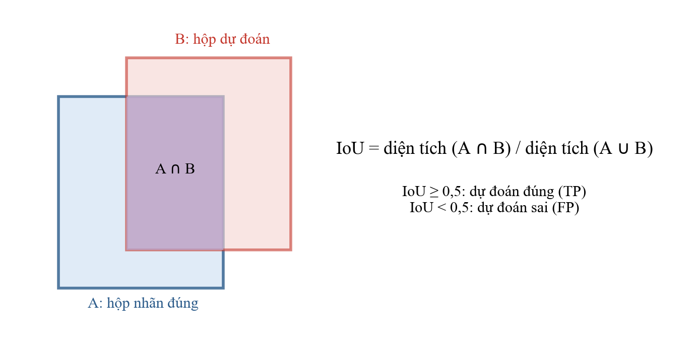
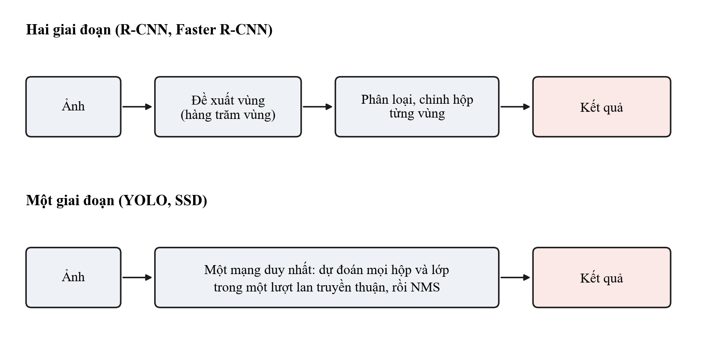

# CHƯƠNG 1: TỔNG QUAN VỀ KIẾN TRÚC IoT, HỌC MÁY VÀ NỀN TẢNG RASPBERRY PI VÀ ESP32

Chương này trình bày các kiến thức nền mà hệ thống của nhóm dựa vào. Phần đầu nêu bài toán giám sát phát hiện người xâm nhập và các giải pháp đang được dùng. Tiếp theo là kiến trúc IoT, xử lý tại biên và giao thức MQTT, phục vụ việc truyền cảnh báo. Phần sau trình bày học máy, học sâu, bài toán phát hiện đối tượng và mô hình YOLO, phục vụ việc phát hiện người. Cuối chương giới thiệu ba thiết bị phần cứng chính: Raspberry Pi 4, ESP32 và camera Logitech C270.

## 1.1 Bài toán giám sát phát hiện người xâm nhập

### 1.1.1 Nhu cầu và hạn chế của camera giám sát truyền thống

Camera giám sát được lắp đặt rộng rãi ở nhà ở, văn phòng, kho bãi và các khu vực cần bảo vệ. Phần lớn hệ thống camera hiện nay vẫn hoạt động theo kiểu ghi hình và hiển thị: camera quay liên tục, hình ảnh được lưu lại hoặc đưa lên màn hình, còn việc phát hiện có người lạ hay không do con người đảm nhận.

Cách làm này có ba hạn chế. Thứ nhất, hệ thống phụ thuộc hoàn toàn vào sự chú ý của người theo dõi. Một người trực phải nhìn nhiều màn hình trong nhiều giờ sẽ mệt mỏi và dễ bỏ sót những sự kiện chỉ kéo dài vài giây. Thứ hai, khi không có người trực, đoạn ghi hình chỉ có giá trị tra cứu sau khi sự việc đã xảy ra, không giúp ngăn chặn kịp thời. Thứ ba, nếu hình ảnh được truyền liên tục lên máy chủ ở xa để xử lý, hệ thống tiêu tốn nhiều băng thông và ngừng cảnh báo khi mất kết nối Internet.

Bài toán của đồ án là tự động hóa bước phát hiện: hệ thống tự nhận ra khi có người đi vào một vùng cấm trong khung hình, phát cảnh báo bằng đèn và còi tại chỗ người trực, và chờ người trực xác nhận đã biết. Việc xử lý diễn ra ngay tại chỗ, không phụ thuộc vào Internet.

### 1.1.2 Các giải pháp hiện có

Có bốn nhóm giải pháp thường gặp cho bài toán phát hiện người xâm nhập.

**Cảm biến hồng ngoại thụ động (PIR).** Cảm biến PIR phát hiện sự thay đổi bức xạ hồng ngoại khi có vật thể ấm di chuyển trong vùng quan sát. Cảm biến rẻ, tiêu thụ ít điện năng và dễ lắp đặt. Tuy nhiên PIR không phân biệt được người với vật nuôi hay luồng khí nóng, không cho biết người ở vị trí nào trong vùng quan sát, và không phát hiện được người đứng yên.

**Camera có người trực.** Đây là cách làm truyền thống đã nêu ở mục 1.1.1. Con người phân biệt đối tượng rất tốt, nhưng chi phí nhân lực cao và chất lượng giám sát giảm theo thời gian trực.

**Camera thông minh xử lý trên đám mây.** Camera gửi hình ảnh lên máy chủ đám mây, tại đó các mô hình học sâu phát hiện người và gửi thông báo về điện thoại. Giải pháp này cho độ chính xác cao nhờ dùng mô hình lớn, nhưng cần đường truyền Internet ổn định, có độ trễ do truyền dữ liệu đi xa, và đưa hình ảnh trong nhà ra ngoài, gây lo ngại về quyền riêng tư.

**Phát hiện bằng học sâu tại biên.** Mô hình học sâu chạy ngay trên một thiết bị nhúng đặt cạnh camera. Hình ảnh không rời khỏi thiết bị, cảnh báo được phát qua mạng nội bộ. Khó khăn chính là thiết bị nhúng có năng lực tính toán hạn chế, nên phải dùng mô hình nhỏ và tối ưu cách chạy.

Bảng 1.1: So sánh các giải pháp phát hiện người xâm nhập

| Tiêu chí | Cảm biến PIR | Camera có người trực | Camera AI trên đám mây | Học sâu tại biên |
| --- | --- | --- | --- | --- |
| Phân biệt người với vật khác | Không | Có | Có | Có |
| Biết vị trí người trong vùng quan sát | Không | Có | Có | Có |
| Cần người theo dõi liên tục | Không | Có | Không | Không |
| Phụ thuộc Internet | Không | Không | Có | Không |
| Hình ảnh rời khỏi nơi lắp đặt | Không có hình ảnh | Tùy hệ thống | Có | Không |
| Chi phí thiết bị | Thấp | Trung bình | Trung bình, kèm phí dịch vụ | Trung bình |

Đồ án chọn hướng thứ tư: dùng mô hình YOLO chạy trên Raspberry Pi để phát hiện người, và truyền cảnh báo qua giao thức MQTT trong mạng nội bộ tới một trạm báo động dùng ESP32.

## 1.2 Kiến trúc IoT và xử lý tại biên

### 1.2.1 Kiến trúc IoT nhiều lớp

Internet vạn vật (Internet of Things, IoT) là mạng lưới các thiết bị vật lý có gắn cảm biến, bộ chấp hành và khả năng kết nối, có thể thu thập dữ liệu, trao đổi dữ liệu với nhau và với các hệ thống xử lý để thực hiện một chức năng chung [1]. Một hệ thống IoT thường được mô tả theo các lớp, mỗi lớp đảm nhận một nhóm chức năng:

- **Lớp thiết bị (lớp cảm nhận):** gồm cảm biến thu thập dữ liệu từ môi trường và bộ chấp hành tác động trở lại môi trường, như đèn, còi, động cơ.
- **Lớp mạng (lớp truyền thông):** chuyển dữ liệu giữa các thiết bị và tới nơi xử lý, qua các công nghệ như WiFi, Ethernet, Bluetooth, mạng di động, cùng các giao thức ứng dụng như MQTT, HTTP, CoAP.
- **Lớp xử lý và lưu trữ (lớp trung gian):** tiếp nhận, lưu trữ và xử lý dữ liệu, ra quyết định. Lớp này có thể đặt trên máy chủ đám mây, hoặc trên một thiết bị ở gần nguồn dữ liệu.
- **Lớp ứng dụng:** cung cấp dịch vụ tới người dùng, như hiển thị, cảnh báo, điều khiển.

Đối chiếu với hệ thống của đồ án: camera C270 là thiết bị cảm nhận; đèn, còi và nút bấm trên trạm ESP32 là bộ chấp hành và giao diện với người trực; mạng WiFi nội bộ cùng giao thức MQTT thuộc lớp mạng; Raspberry Pi vừa xử lý hình ảnh, vừa giữ trạng thái và chạy broker MQTT, tức đảm nhận lớp xử lý ngay tại hiện trường.

### 1.2.2 Điện toán đám mây và xử lý tại biên

Trong mô hình điện toán đám mây, dữ liệu từ thiết bị được gửi về trung tâm dữ liệu ở xa để lưu trữ và xử lý. Mô hình này có năng lực tính toán gần như không giới hạn và dễ quản lý tập trung. Đổi lại, mọi dữ liệu phải đi qua Internet, nên độ trễ phụ thuộc vào đường truyền, chi phí băng thông tăng theo lượng dữ liệu, và hệ thống ngừng hoạt động khi mất kết nối.

Xử lý tại biên (edge computing) đưa một phần việc xử lý về gần nơi dữ liệu được tạo ra, ngay trên thiết bị hoặc trên một máy tính đặt tại hiện trường [1]. Với dữ liệu hình ảnh, khác biệt này rất rõ. Một camera 640×480 điểm ảnh, 30 khung hình mỗi giây tạo ra lượng dữ liệu lớn; nếu xử lý tại biên, thiết bị chỉ cần gửi đi kết quả, ví dụ một bản tin vài trăm byte cho biết "có người ở khu 2", thay vì gửi cả luồng video.

Bảng 1.2: So sánh xử lý trên đám mây và xử lý tại biên cho bài toán của đồ án

| Tiêu chí | Xử lý trên đám mây | Xử lý tại biên |
| --- | --- | --- |
| Dữ liệu truyền đi | Luồng video | Bản tin kết quả, vài trăm byte |
| Độ trễ | Phụ thuộc đường truyền Internet | Chỉ trong mạng nội bộ |
| Khi mất Internet | Ngừng phát hiện | Vẫn hoạt động nếu mạng nội bộ còn |
| Quyền riêng tư | Hình ảnh rời khỏi nơi lắp đặt | Hình ảnh ở lại trên thiết bị |
| Năng lực tính toán | Lớn, dùng được mô hình nặng | Hạn chế, cần mô hình nhỏ |

Đồ án chọn xử lý tại biên trên Raspberry Pi. Hạn chế về năng lực tính toán được giải quyết bằng cách dùng mô hình YOLO bản nhỏ nhất, ảnh đầu vào 320 điểm ảnh và định dạng chạy NCNN tối ưu cho CPU ARM, sẽ trình bày ở mục 1.5.

## 1.3 Giao thức MQTT

### 1.3.1 Mô hình publish/subscribe và broker

MQTT (Message Queuing Telemetry Transport) là giao thức truyền bản tin nhẹ, được thiết kế cho các thiết bị có tài nguyên hạn chế và mạng có băng thông thấp hoặc không ổn định, và là một trong những giao thức phổ biến nhất trong các hệ thống IoT [1]. MQTT chạy trên nền TCP/IP; phiên bản 3.1.1 được tổ chức OASIS công bố làm tiêu chuẩn năm 2014 và hiện được hầu hết các thư viện hỗ trợ.

Khác với mô hình hỏi đáp (request/response) của HTTP, MQTT dùng mô hình **xuất bản/đăng ký** (publish/subscribe). Hệ thống có hai vai trò:

- **Client:** bất kỳ thiết bị hoặc chương trình nào kết nối tới broker. Một client có thể xuất bản (publish) bản tin, đăng ký (subscribe) nhận bản tin, hoặc làm cả hai.
- **Broker:** máy chủ trung gian nhận mọi bản tin từ các client xuất bản, rồi chuyển tới đúng những client đã đăng ký nhận.

Mỗi bản tin được gắn với một **topic**, là một chuỗi phân cấp bằng dấu gạch chéo, ví dụ `safecam/cam01/state`. Client đăng ký theo topic và có thể dùng ký tự đại diện: `+` thay cho đúng một cấp (`safecam/+/state`), `#` thay cho mọi cấp phía sau (`safecam/#`). Nội dung bản tin (payload) là một chuỗi byte tùy ý; MQTT không quy định định dạng, nên ứng dụng thường dùng JSON hoặc văn bản thuần.

Mô hình này tách rời bên gửi và bên nhận theo ba nghĩa. Bên gửi không cần biết địa chỉ hay số lượng bên nhận. Hai bên không cần chạy cùng lúc nếu broker được cấu hình giữ bản tin. Bên gửi không phải chờ bên nhận xử lý xong. Nhờ vậy, thêm một thiết bị nhận mới, ví dụ một trạm báo động thứ hai hay một máy tính theo dõi, chỉ cần đăng ký đúng topic mà không phải sửa chương trình bên gửi.

Phần mào đầu cố định của một gói tin MQTT chỉ dài 2 byte, nên MQTT phù hợp với vi điều khiển có bộ nhớ nhỏ như ESP32. Broker MQTT có nhiều lựa chọn, trong đó Eclipse Mosquitto là broker mã nguồn mở, gọn nhẹ, chạy được trên Raspberry Pi.

### 1.3.2 Các cơ chế QoS, retain, LWT và keep-alive

MQTT cung cấp một số cơ chế giúp hệ thống hoạt động tin cậy trên mạng không ổn định.

**Chất lượng dịch vụ (QoS).** Mỗi bản tin được gửi với một trong ba mức QoS, quy định mức đảm bảo giao bản tin giữa một client và broker:

Bảng 1.3: Ba mức chất lượng dịch vụ của MQTT

| Mức | Tên | Đảm bảo | Cơ chế |
| --- | --- | --- | --- |
| 0 | At most once | Gửi tối đa một lần, có thể mất | Gửi một gói PUBLISH, không chờ xác nhận |
| 1 | At least once | Đến ít nhất một lần, có thể trùng | Bên gửi lưu bản tin và gửi lại cho tới khi nhận được PUBACK |
| 2 | Exactly once | Đến đúng một lần | Bắt tay bốn bước PUBLISH, PUBREC, PUBREL, PUBCOMP |

Mức QoS càng cao càng tin cậy nhưng càng tốn thêm gói tin và độ trễ. Mức QoS thực tế giữa bên gửi và bên nhận là mức nhỏ hơn trong hai mức: mức bên gửi dùng khi xuất bản và mức bên nhận chọn khi đăng ký. Với bản tin lặp lại đều đặn như tín hiệu "còn sống", mất một bản không ảnh hưởng nên QoS 0 là đủ. Với bản tin trạng thái hay sự kiện, QoS 1 đảm bảo bản tin đến nơi; ứng dụng chỉ cần chịu được việc nhận trùng.

**Bản tin giữ lại (retain).** Khi một bản tin được gửi với cờ retain, broker lưu bản tin cuối cùng của topic đó. Client nào đăng ký topic về sau sẽ nhận ngay bản tin đã lưu, không phải chờ lần xuất bản tiếp theo. Cơ chế này phù hợp với các topic mang trạng thái hiện tại: một thiết bị vừa khởi động hoặc vừa kết nối lại biết ngay trạng thái mới nhất.

**Di chúc (Last Will and Testament, LWT).** Khi kết nối, client có thể đăng ký trước với broker một bản tin di chúc gồm topic, nội dung, QoS và cờ retain. Nếu client mất kết nối đột ngột, không gửi gói DISCONNECT, broker sẽ tự xuất bản bản tin di chúc đó thay cho client. Các thiết bị khác nhờ vậy biết một thiết bị đã rớt mạng. Cách dùng thông dụng là cho mỗi thiết bị một topic trạng thái: thiết bị tự gửi `online` khi kết nối, và đăng ký di chúc `offline` cho cùng topic.

**Keep-alive.** Khi kết nối, client khai báo khoảng thời gian keep-alive tính bằng giây. Nếu trong khoảng đó client không gửi gói tin nào, nó phải gửi gói PINGREQ để báo còn sống. Nếu broker không nhận được gói tin nào từ client trong 1,5 lần khoảng keep-alive, broker coi client đã mất kết nối, đóng kết nối và phát bản tin di chúc.

**Phiên làm việc và xác thực.** Client có thể yêu cầu broker giữ phiên (persistent session) để nhận lại các bản tin QoS 1, QoS 2 bị lỡ trong lúc mất kết nối. Về bảo mật, MQTT cho phép gửi tên đăng nhập và mật khẩu trong gói CONNECT; broker như Mosquitto còn hỗ trợ danh sách phân quyền (ACL) quy định mỗi tài khoản được đọc, ghi những topic nào.

### 1.3.3 So sánh MQTT với HTTP và CoAP

HTTP là giao thức của web, dùng mô hình hỏi đáp trên TCP. Mỗi yêu cầu HTTP mang phần mào đầu dạng văn bản dài hàng trăm byte, và máy chủ không chủ động gửi dữ liệu xuống thiết bị được nếu thiết bị không hỏi trước. Để nhận cảnh báo tức thời qua HTTP, thiết bị phải hỏi liên tục (polling) hoặc giữ kết nối dài, gây tốn tài nguyên.

CoAP (Constrained Application Protocol) cũng dùng mô hình hỏi đáp kiểu REST như HTTP, nhưng chạy trên UDP, mào đầu nhị phân chỉ 4 byte, được thiết kế cho thiết bị rất hạn chế. CoAP có cơ chế quan sát (observe) để nhận thông báo khi tài nguyên thay đổi, nhưng không có broker trung gian, nên mỗi bên phải biết địa chỉ của nhau.

Bảng 1.4: So sánh MQTT, HTTP và CoAP

| Tiêu chí | MQTT | HTTP | CoAP |
| --- | --- | --- | --- |
| Mô hình | Xuất bản/đăng ký qua broker | Hỏi đáp | Hỏi đáp, có cơ chế quan sát |
| Tầng vận chuyển | TCP | TCP | UDP |
| Mào đầu tối thiểu | 2 byte | Hàng trăm byte (văn bản) | 4 byte |
| Đẩy dữ liệu xuống thiết bị | Có, tức thời | Không trực tiếp | Có, qua quan sát |
| Đảm bảo giao bản tin | QoS 0, 1, 2 | Dựa vào TCP | Bản tin có xác nhận (CON) |
| Phát hiện thiết bị rớt mạng | Có (LWT, keep-alive) | Không | Không sẵn có |
| Một gửi, nhiều nhận | Có | Không | Hạn chế (multicast) |

Với bài toán cảnh báo xâm nhập, Raspberry Pi cần đẩy trạng thái xuống trạm báo động ngay khi có thay đổi, trạm báo động cần gửi xác nhận ngược lên, và mỗi bên cần biết khi bên kia mất kết nối. MQTT đáp ứng cả ba yêu cầu bằng các cơ chế sẵn có, và có thư viện cho cả Python trên Raspberry Pi lẫn Arduino trên ESP32. Đó là lý do đồ án chọn MQTT.

## 1.4 Học máy, học sâu và bài toán phát hiện đối tượng

### 1.4.1 Học máy và học sâu

Học máy (machine learning) là lĩnh vực nghiên cứu cách để máy tính tự cải thiện hiệu quả thực hiện một nhiệm vụ nhờ kinh nghiệm, tức nhờ dữ liệu, thay vì được lập trình tường minh từng quy tắc [5]. Thay vì viết tay các luật như "nếu có hình dạng đầu, thân, hai chân thì là người", người làm học máy cung cấp cho thuật toán nhiều ví dụ có sẵn đáp án, và thuật toán tự tìm ra quy luật.

Theo cách học từ dữ liệu, các thuật toán học máy thường được chia thành bốn nhóm [3]:

- **Học có giám sát (supervised learning):** dữ liệu huấn luyện gồm các cặp đầu vào và nhãn đúng. Mô hình học cách ánh xạ từ đầu vào tới nhãn. Bài toán phát hiện người thuộc nhóm này: đầu vào là ảnh, nhãn là vị trí các người trong ảnh.
- **Học không giám sát (unsupervised learning):** dữ liệu không có nhãn, thuật toán tự tìm cấu trúc trong dữ liệu, ví dụ phân cụm.
- **Học bán giám sát (semi-supervised learning):** chỉ một phần dữ liệu có nhãn.
- **Học củng cố (reinforcement learning):** tác tử học cách hành động dựa trên phần thưởng nhận được từ môi trường.

Một mô hình học có giám sát được huấn luyện bằng cách tối thiểu hóa một hàm mất mát, đo mức sai khác giữa dự đoán của mô hình và nhãn đúng, thường bằng các biến thể của thuật toán hạ gradient. Mục tiêu cuối cùng không phải là dự đoán đúng trên dữ liệu đã học, mà là dự đoán đúng trên dữ liệu mới chưa từng thấy, gọi là khả năng tổng quát hóa.

Khi mô hình quá phức tạp so với lượng dữ liệu, nó có thể ghi nhớ cả những chi tiết ngẫu nhiên của tập huấn luyện: sai số trên tập huấn luyện rất nhỏ nhưng sai số trên dữ liệu mới lớn. Hiện tượng này gọi là **quá khớp** (overfitting) [3], [5]. Để phát hiện và hạn chế quá khớp, dữ liệu được chia thành ba phần tách biệt [5]:

- **Tập huấn luyện (train):** dùng để cập nhật tham số của mô hình.
- **Tập kiểm định (validation):** dùng để chọn siêu tham số, chọn thời điểm dừng huấn luyện, chọn mô hình tốt nhất. Vì được dùng để lựa chọn, kết quả trên tập này có xu hướng cao hơn thực tế.
- **Tập kiểm tra (test):** chỉ dùng một lần ở cuối để ước lượng hiệu năng thật của mô hình trên dữ liệu mới.

Các tập phải độc lập với nhau. Nếu hai mẫu gần giống hệt nhau, ví dụ hai khung hình liên tiếp của cùng một đoạn video, nằm ở hai tập khác nhau, kết quả trên tập kiểm tra sẽ cao giả. Đây là cơ sở cho cách chia dữ liệu theo phiên chụp mà nhóm áp dụng ở chương 2.

**Học sâu** (deep learning) là một nhánh của học máy, dùng mạng nơ-ron nhiều lớp để tự học cách biểu diễn dữ liệu qua nhiều cấp độ trừu tượng [5]. Mỗi nơ-ron nhân tạo tính tổng có trọng số của các đầu vào, cộng thêm hệ số điều chỉnh (bias), rồi đưa qua một hàm kích hoạt phi tuyến như ReLU hoặc sigmoid. Nhiều nơ-ron xếp thành lớp, nhiều lớp nối tiếp nhau tạo thành mạng nơ-ron nhiều lớp (multilayer perceptron, MLP). Mạng được huấn luyện bằng thuật toán lan truyền ngược (backpropagation): tính gradient của hàm mất mát theo từng trọng số, đi ngược từ lớp ra về lớp vào, rồi cập nhật trọng số theo hướng làm giảm mất mát [3].

Với ảnh, điểm khác biệt quan trọng của học sâu so với học máy truyền thống là không cần thiết kế đặc trưng bằng tay. Các phương pháp cũ như HOG kết hợp SVM yêu cầu chuyên gia chọn trước đặc trưng cần trích (hướng cạnh, biểu đồ gradient). Mạng học sâu tự học đặc trưng từ dữ liệu: các lớp đầu học được cạnh và góc, các lớp giữa học được bộ phận như đầu, tay, các lớp sâu học được cả đối tượng.

### 1.4.2 Mạng nơ-ron tích chập

Nếu dùng mạng MLP thông thường cho ảnh, mỗi nơ-ron của lớp đầu tiên phải nối với tất cả điểm ảnh. Với ảnh màu 640×480, mỗi nơ-ron có gần một triệu trọng số, quá lớn để huấn luyện. Mạng nơ-ron tích chập (convolutional neural network, CNN) giải quyết vấn đề này nhờ ba ý tưởng [5]:

- **Kết nối cục bộ (sparse interactions):** mỗi nơ-ron chỉ nhìn một vùng nhỏ của ảnh, ví dụ 3×3 điểm ảnh, gọi là trường tiếp nhận.
- **Chia sẻ trọng số (parameter sharing):** cùng một bộ lọc nhỏ (kernel) được trượt qua toàn bộ ảnh. Một bộ lọc phát hiện cạnh dọc dùng được ở mọi vị trí, nên số tham số không phụ thuộc kích thước ảnh.
- **Tính đồng biến với phép dịch (equivariance to translation):** khi đối tượng dịch chuyển trong ảnh, đặc trưng tương ứng cũng dịch chuyển theo, nên mạng nhận ra người dù người đứng ở góc nào của khung hình.

Phép tích chập hai chiều tính tại mỗi vị trí tổng các tích giữa bộ lọc và vùng ảnh tương ứng. Một lớp tích chập có nhiều bộ lọc, mỗi bộ lọc cho ra một bản đồ đặc trưng (feature map). Sau lớp tích chập thường có hàm kích hoạt phi tuyến và lớp gộp (pooling), ví dụ lấy giá trị lớn nhất trong mỗi ô 2×2. Lớp gộp làm giảm kích thước bản đồ đặc trưng và giúp mạng ít nhạy với những dịch chuyển nhỏ [5]. Trong các mạng hiện đại, việc giảm kích thước thường được thực hiện bằng tích chập với bước nhảy (stride) bằng 2.

Xếp chồng nhiều lớp tích chập, kích thước không gian của bản đồ đặc trưng giảm dần trong khi số kênh tăng dần. Lớp càng sâu thì trường tiếp nhận càng rộng và đặc trưng càng mang tính ngữ nghĩa. Phần mạng làm nhiệm vụ trích đặc trưng này gọi là **xương sống** (backbone), và là thành phần chung của hầu hết các mô hình thị giác máy tính hiện nay, kể cả YOLO.

### 1.4.3 Bài toán phát hiện đối tượng và chỉ số đánh giá

Thị giác máy tính có ba bài toán cơ bản với mức độ chi tiết tăng dần:

- **Phân loại ảnh (image classification):** trả lời ảnh chứa gì, cho một nhãn cho cả ảnh.
- **Phát hiện đối tượng (object detection):** trả lời có những đối tượng nào và ở đâu. Mỗi đối tượng được khoanh bằng một hộp bao (bounding box) chữ nhật, kèm nhãn lớp và độ tin cậy.
- **Phân đoạn (segmentation):** xác định từng điểm ảnh thuộc đối tượng nào.

Hệ thống của đồ án cần biết người đứng ở khu nào trong khung hình, nên phải dùng phát hiện đối tượng. Mỗi kết quả phát hiện gồm tọa độ hộp bao (x1, y1, x2, y2), lớp "người" và độ tin cậy từ 0 đến 1. Chỉ những kết quả có độ tin cậy lớn hơn một ngưỡng (`conf`) mới được giữ lại.

**IoU (Intersection over Union).** Để biết một hộp dự đoán có khớp với hộp nhãn đúng hay không, người ta dùng tỷ lệ giữa diện tích phần giao và diện tích phần hợp của hai hộp:

IoU = diện tích (A ∩ B) / diện tích (A ∪ B)

IoU bằng 1 khi hai hộp trùng khít, bằng 0 khi không giao nhau. Một dự đoán được tính là đúng (true positive, TP) khi IoU với một hộp nhãn chưa được ghép vượt một ngưỡng, thường là 0,5, và đúng lớp. Dự đoán không khớp hộp nhãn nào là dự đoán sai (false positive, FP). Hộp nhãn không có dự đoán nào khớp là bỏ sót (false negative, FN).

**Precision và recall.** Từ số TP, FP, FN tính được hai chỉ số [5]:

- Precision = TP / (TP + FP): trong các hộp mô hình báo là người, bao nhiêu phần đúng là người. Precision thấp nghĩa là nhiều báo nhầm.
- Recall = TP / (TP + FN): trong các người thật có trong ảnh, mô hình tìm ra được bao nhiêu phần. Recall thấp nghĩa là nhiều bỏ sót.

Hai chỉ số này đánh đổi với nhau qua ngưỡng tin cậy. Hạ ngưỡng thì mô hình giữ lại nhiều hộp hơn, recall tăng nhưng precision giảm; nâng ngưỡng thì ngược lại. Với hệ thống cảnh báo xâm nhập, bỏ sót người nguy hiểm hơn báo nhầm một lần, nên recall được ưu tiên; báo nhầm được hạn chế ở tầng sau bằng cơ chế cửa sổ thời gian trình bày ở chương 2.

**AP và mAP.** Quét ngưỡng tin cậy từ cao xuống thấp sẽ được một đường cong precision–recall. Diện tích dưới đường cong này là độ chính xác trung bình (average precision, AP) của một lớp. Trung bình AP của các lớp là mAP (mean average precision). Hai cách tính thông dụng:

- **mAP50:** tính với ngưỡng IoU 0,5, tức chỉ cần hộp dự đoán khớp tương đối.
- **mAP50-95:** trung bình mAP ở 10 ngưỡng IoU từ 0,5 đến 0,95, bước 0,05. Chỉ số này khắt khe hơn, đòi hỏi hộp dự đoán ôm sát đối tượng.

Hệ thống của đồ án chỉ có một lớp "người", nên mAP cũng chính là AP của lớp người.

**Bộ dữ liệu COCO.** Microsoft COCO (Common Objects in Context) là bộ dữ liệu chuẩn cho bài toán phát hiện đối tượng, gồm hơn 200.000 ảnh có nhãn với 80 lớp đối tượng thường gặp, trong đó lớp "người" (person) mang số thứ tự 0. Phần lớn các mô hình phát hiện đối tượng hiện nay, kể cả YOLO, được huấn luyện sẵn trên COCO, và độ chính xác mAP50-95 trên tập kiểm định của COCO là thước đo thường dùng để so sánh các mô hình.

### 1.4.4 Học chuyển giao và tinh chỉnh mô hình

Huấn luyện một mạng học sâu từ đầu cần hàng trăm nghìn ảnh có nhãn và nhiều ngày tính toán. Học chuyển giao (transfer learning) tận dụng một mô hình đã học trên một bộ dữ liệu lớn, như COCO, làm điểm xuất phát cho một bài toán mới [5]. Các lớp đầu của mạng đã học được đặc trưng chung như cạnh, góc, kết cấu, dùng lại được cho hầu hết bài toán ảnh; chỉ cần điều chỉnh mạng cho phù hợp với dữ liệu mới.

**Tinh chỉnh** (fine-tuning) là tiếp tục huấn luyện mô hình đã học sẵn trên bộ dữ liệu của bài toán mới, thường với số vòng huấn luyện ít hơn. Có thể cập nhật toàn bộ trọng số, hoặc khóa (freeze) phần xương sống và chỉ huấn luyện các lớp sau. Với bộ dữ liệu nhỏ vài trăm đến vài nghìn ảnh, tinh chỉnh cho kết quả tốt hơn nhiều so với huấn luyện từ đầu, và ít bị quá khớp hơn.

Khi dữ liệu ít, **tăng cường dữ liệu** (data augmentation) giúp mô hình tổng quát hóa tốt hơn: mỗi lần đưa ảnh vào huấn luyện, ảnh được biến đổi ngẫu nhiên như lật ngang, thay đổi độ sáng, màu sắc, phóng to thu nhỏ, cắt ghép, trong khi nhãn được biến đổi tương ứng [5]. Mô hình vì thế thấy nhiều biến thể hơn số ảnh thật sự có.

Trong đồ án, mô hình YOLO11n đã học trên COCO phát hiện người khá tốt trong điều kiện bình thường, nhưng có thể bỏ sót ở các điều kiện đặc thù của hiện trường như người ở xa, bị bàn ghế che một phần, quay lưng ở mép khung, cúi hoặc ngồi. Nhóm dùng tinh chỉnh với dữ liệu chụp tại hiện trường để cải thiện các trường hợp này (mục 2.4).

## 1.5 Mô hình YOLO

### 1.5.1 Nguyên lý phát hiện một giai đoạn

Các phương pháp phát hiện đối tượng bằng học sâu chia thành hai nhóm.

**Phát hiện hai giai đoạn** (two-stage), tiêu biểu là họ R-CNN và Faster R-CNN. Giai đoạn một đề xuất các vùng có khả năng chứa đối tượng; giai đoạn hai phân loại và tinh chỉnh hộp bao cho từng vùng. Cách này cho độ chính xác cao nhưng chậm, vì mỗi ảnh phải xử lý hàng trăm vùng đề xuất.

**Phát hiện một giai đoạn** (one-stage), tiêu biểu là YOLO và SSD. Mạng nhìn toàn bộ ảnh một lần và dự đoán trực tiếp tất cả hộp bao cùng lớp của chúng trong một lượt lan truyền thuận. Tên YOLO, viết tắt của "You Only Look Once", nói lên đúng ý tưởng này. Phiên bản YOLO đầu tiên do Joseph Redmon và cộng sự công bố năm 2016. Ảnh được chia thành lưới S×S ô; ô nào chứa tâm của đối tượng thì ô đó chịu trách nhiệm dự đoán đối tượng, gồm tọa độ hộp bao, độ tin cậy và xác suất các lớp. Vì cả mạng chỉ chạy một lần, YOLO nhanh hơn nhiều so với các phương pháp hai giai đoạn và có thể chạy theo thời gian thực.

Các phiên bản YOLO sau này giữ nguyên ý tưởng một giai đoạn nhưng cải tiến dần kiến trúc. Một mô hình YOLO hiện đại gồm ba phần:

- **Xương sống (backbone):** mạng tích chập trích đặc trưng từ ảnh, cho ra bản đồ đặc trưng ở nhiều độ phân giải.
- **Cổ (neck):** kết hợp đặc trưng từ nhiều tầng khác nhau, theo hướng từ trên xuống và từ dưới lên (cấu trúc kiểu FPN, PAN). Đặc trưng độ phân giải cao giữ chi tiết vị trí, đặc trưng độ phân giải thấp mang ngữ nghĩa; kết hợp hai loại giúp phát hiện được cả đối tượng lớn và đối tượng nhỏ.
- **Đầu (head):** dự đoán hộp bao và lớp ở nhiều tỷ lệ. Với ảnh đầu vào 640 điểm ảnh, đầu dự đoán thường làm việc trên ba lưới có bước 8, 16 và 32 điểm ảnh, tương ứng 80×80, 40×40 và 20×20 ô, lần lượt phụ trách đối tượng nhỏ, vừa và lớn.

Các phiên bản đầu dùng **hộp neo** (anchor box), tức một số hình dạng hộp định sẵn mà mạng chỉ dự đoán độ lệch so với chúng. Từ YOLOv8, Ultralytics chuyển sang cách **không dùng hộp neo** (anchor-free): mỗi ô dự đoán trực tiếp khoảng cách từ tâm ô tới bốn cạnh của hộp bao. Đầu dự đoán cũng được tách đôi (decoupled head), một nhánh cho vị trí hộp, một nhánh cho lớp, giúp mỗi nhánh học tốt hơn nhiệm vụ của mình.

**Triệt tiêu không cực đại** (non-maximum suppression, NMS). Vì mỗi đối tượng có thể được nhiều ô dự đoán cùng lúc, đầu ra thô của YOLO chứa nhiều hộp chồng lấn lên một đối tượng. Bước NMS sắp xếp các hộp theo độ tin cậy giảm dần, giữ hộp cao nhất, loại bỏ các hộp còn lại có IoU với nó vượt một ngưỡng, rồi lặp lại với các hộp chưa xét. Kết quả là mỗi đối tượng còn lại một hộp.

### 1.5.2 YOLO11 và lý do chọn bản n

YOLO11 là thế hệ mô hình do Ultralytics phát hành tháng 9 năm 2024, kế thừa YOLOv8. Theo tệp cấu hình kiến trúc của Ultralytics, YOLO11 thay khối C2f trong xương sống và cổ bằng khối C3k2 nhẹ hơn, thêm khối C2PSA có cơ chế chú ý không gian (spatial attention) sau khối gộp SPPF, và giữ đầu dự đoán tách đôi không dùng hộp neo. Theo công bố của Ultralytics, các thay đổi này giúp YOLO11 đạt độ chính xác ngang hoặc cao hơn YOLOv8 với số tham số ít hơn.

YOLO11 có năm kích cỡ: n (nano), s (small), m (medium), l (large) và x (extra large). Các bản dùng chung kiến trúc nhưng khác nhau về độ sâu (số khối) và độ rộng (số kênh). Bản càng lớn càng chính xác nhưng càng chậm.

Bảng 1.5: Các kích cỡ mô hình YOLO11 phát hiện đối tượng (theo số liệu Ultralytics công bố, ảnh 640 điểm ảnh, tập kiểm định COCO)

| Mô hình | mAP50-95 | Số tham số (triệu) | Khối lượng tính (GFLOPs) |
| --- | --- | --- | --- |
| YOLO11n | 39,5 | 2,6 | 6,5 |
| YOLO11s | 47,0 | 9,4 | 21,6 |
| YOLO11m | 51,5 | 20,1 | 68,1 |
| YOLO11l | 53,4 | 25,3 | 87,2 |
| YOLO11x | 54,7 | 56,9 | 195,3 |

Raspberry Pi 4 không có bộ tăng tốc học sâu, mọi phép tính chạy trên CPU. Khối lượng tính của YOLO11s đã gấp hơn ba lần YOLO11n, nên chỉ bản n mới đạt được tốc độ đủ cho hệ thống cảnh báo. Ngoài ra, nhóm giảm kích thước ảnh đầu vào từ 640 xuống 320 điểm ảnh. Khối lượng tính của mạng tích chập tỷ lệ với số điểm ảnh, nên ảnh 320 cần khoảng một phần tư khối lượng tính so với ảnh 640. Đổi lại, đối tượng nhỏ, như người đứng xa, chiếm ít điểm ảnh hơn và khó phát hiện hơn. Đây là một lý do nhóm tinh chỉnh mô hình cho trường hợp người ở xa.

Mô hình YOLO11 được cung cấp qua thư viện Python `ultralytics`, gồm sẵn các chức năng huấn luyện, đánh giá, suy luận và xuất mô hình sang nhiều định dạng. Khi chỉ cần phát hiện người, có thể giữ nguyên mô hình 80 lớp của COCO và lọc lấy lớp số 0, hoặc tinh chỉnh thành mô hình một lớp.

### 1.5.3 Triển khai trên thiết bị biên: định dạng NCNN

Mô hình huấn luyện bằng PyTorch được lưu ở định dạng `.pt`. Chạy trực tiếp định dạng này trên Raspberry Pi được nhưng chậm, vì PyTorch được tối ưu chủ yếu cho máy tính có GPU và CPU x86. Để chạy nhanh trên thiết bị biên, mô hình thường được chuyển sang một định dạng và một bộ chạy (inference engine) chuyên cho phần cứng đích, như ONNX Runtime, TensorFlow Lite, OpenVINO hay NCNN.

NCNN là bộ chạy mạng nơ-ron mã nguồn mở do Tencent phát triển, công bố năm 2017, viết bằng C++ và nhắm tới điện thoại di động, thiết bị nhúng. NCNN có một số đặc điểm phù hợp với Raspberry Pi:

- Không phụ thuộc thư viện bên thứ ba, kích thước nhỏ.
- Tối ưu cho CPU ARM bằng tập lệnh NEON (xử lý song song nhiều dữ liệu trong một lệnh), hỗ trợ chạy đa luồng trên nhiều nhân.
- Quản lý bộ nhớ chặt chẽ, phù hợp với thiết bị RAM hạn chế.

Một mô hình NCNN gồm hai tệp: tệp `.param` mô tả cấu trúc mạng dưới dạng văn bản, và tệp `.bin` chứa trọng số. Thư viện Ultralytics xuất trực tiếp sang NCNN bằng lệnh `model.export(format="ncnn", imgsz=320)`, tạo ra thư mục `yolo11n_ncnn_model` chứa hai tệp trên. Thư mục này được nạp lại bằng chính lớp `YOLO` của Ultralytics, nên chương trình trên Raspberry Pi gọi suy luận giống hệt như với mô hình PyTorch, chỉ đổi đường dẫn mô hình. Hướng dẫn triển khai trên Raspberry Pi của Ultralytics khuyến nghị NCNN vì cho tốc độ suy luận tốt nhất trong các định dạng được thử trên thiết bị này, nên nhóm chọn NCNN. Số đo thực tế trên Raspberry Pi của nhóm trình bày ở mục 3.2.

## 1.6 Nền tảng phần cứng

### 1.6.1 Raspberry Pi 4

Raspberry Pi là dòng máy tính đơn bo (single-board computer) kích thước bằng thẻ tín dụng do Raspberry Pi Foundation (Anh) phát triển, ban đầu phục vụ giáo dục, nay được dùng rộng rãi trong các dự án nhúng và IoT [2]. Raspberry Pi chạy hệ điều hành Linux đầy đủ, thường là Raspberry Pi OS dựa trên Debian, nên dùng được các ngôn ngữ và thư viện như trên máy tính để bàn, gồm Python, OpenCV và PyTorch.

Raspberry Pi 4 Model B, ra mắt năm 2019, có các thông số chính như Bảng 1.6 [2].

Bảng 1.6: Thông số chính của Raspberry Pi 4 Model B

| Thành phần | Thông số |
| --- | --- |
| Bộ xử lý | Broadcom BCM2711, 4 nhân ARM Cortex-A72 64 bit |
| Xung nhịp | 1,5 GHz trên các bo đời đầu; 1,8 GHz trên các bo đời sau (bo của nhóm chạy 1.800 MHz) |
| RAM | 1, 2, 4 hoặc 8 GB LPDDR4 tùy phiên bản [cần bổ sung: bo của nhóm có bao nhiêu GB] |
| Kết nối mạng | Gigabit Ethernet; WiFi 802.11ac băng tần 2,4 GHz và 5 GHz; Bluetooth 5.0 |
| Cổng USB | 2 cổng USB 3.0, 2 cổng USB 2.0 |
| Hiển thị | 2 cổng micro-HDMI |
| GPIO | Đầu cắm 40 chân |
| Lưu trữ | Khe thẻ microSD |
| Nguồn | 5 V qua cổng USB-C, khuyến nghị bộ nguồn 3 A |

Với đồ án, Raspberry Pi 4 có ba ưu điểm. CPU 4 nhân 64 bit đủ mạnh để chạy mô hình YOLO bản nhỏ ở vài khung hình mỗi giây. Cổng USB 3.0 nhận camera USB trực tiếp. WiFi tích hợp cho phép kết nối vào mạng nội bộ cùng với ESP32 mà không cần thêm mô-đun. Nhược điểm chính là CPU nóng lên nhanh khi chạy liên tục với tải cao; khi nhiệt độ vượt ngưỡng, Raspberry Pi tự hạ xung nhịp để bảo vệ chip, làm giảm tốc độ xử lý. Vì vậy hệ thống bắt buộc dùng tản nhiệt và quạt, và nhóm theo dõi cờ hạ xung trong mọi lần đo.

### 1.6.2 ESP32

ESP32 là dòng vi điều khiển hệ thống trên chip (SoC) của hãng Espressif Systems (Trung Quốc), tích hợp sẵn WiFi và Bluetooth, được dùng phổ biến cho các dự án IoT nhờ giá thành thấp và cộng đồng hỗ trợ lớn [4].

Bảng 1.7: Thông số chính của ESP32 (module ESP32-WROOM-32)

| Thành phần | Thông số |
| --- | --- |
| Bộ xử lý | Xtensa LX6 2 nhân 32 bit, xung nhịp tới 240 MHz |
| Bộ nhớ | 520 KB SRAM; module WROOM-32 có 4 MB bộ nhớ flash |
| Kết nối không dây | WiFi 802.11 b/g/n băng tần 2,4 GHz; Bluetooth 4.2 và Bluetooth Low Energy |
| Ngoại vi | GPIO, ADC 12 bit, DAC, PWM, UART, SPI, I2C, touch |
| Điện áp hoạt động | 3,3 V |

ESP32 có thể lập trình bằng bộ công cụ ESP-IDF của Espressif hoặc bằng Arduino framework [4]. Arduino framework cung cấp các hàm quen thuộc như `pinMode`, `digitalWrite`, `digitalRead`, `millis`, và dùng được kho thư viện phong phú của cộng đồng Arduino, trong đó có thư viện PubSubClient cho MQTT và ArduinoJson cho định dạng JSON. Đồ án dùng Arduino framework trên nền PlatformIO.

Một số đặc điểm phần cứng của ESP32 cần chú ý khi thiết kế mạch. Mức logic là 3,3 V, nên không được nối trực tiếp với tín hiệu 5 V. Dòng cấp ra từ một chân GPIO nhỏ, chỉ đủ cho LED; tải lớn hơn như còi phải điều khiển qua transistor. Các chân GPIO34 đến GPIO39 chỉ dùng làm đầu vào và không có điện trở kéo lên bên trong. Một số chân có vai trò đặc biệt lúc khởi động, như GPIO0 quyết định chế độ nạp chương trình.

Trong hệ thống, ESP32 không cần năng lực tính toán lớn. Nó chỉ nhận trạng thái từ Raspberry Pi qua MQTT, bật đèn và còi tương ứng, đọc nút bấm và gửi xác nhận. ESP32 phù hợp cho vai trò này nhờ có WiFi tích hợp, đủ chân cho 3 đèn, 1 còi, 4 nút, khởi động nhanh và tiêu thụ ít điện năng.

### 1.6.3 Camera USB Logitech C270

Logitech C270 là webcam USB phổ thông, độ phân giải tối đa 1280×720 (HD 720p), ống kính lấy nét cố định, góc nhìn chéo khoảng 55°. Camera tuân theo chuẩn USB Video Class (UVC), nên được Linux nhận trực tiếp qua trình điều khiển V4L2 (Video4Linux2) mà không cần cài thêm. Camera hỗ trợ hai định dạng xuất ảnh: YUYV không nén và MJPG nén theo từng khung hình. Ở độ phân giải 640×480, định dạng MJPG cho phép đạt 30 khung hình mỗi giây với băng thông USB thấp.

Đồ án dùng C270 ở chế độ MJPG, 640×480, 30 khung hình/giây, phơi sáng tự động. Độ phân giải 640×480 là đủ vì ảnh sẽ được thu về 320 điểm ảnh trước khi đưa vào YOLO. Camera có thông số chống nhấp nháy theo tần số điện lưới; ở Việt Nam điện lưới 50 Hz nên thông số này được đặt ở 50 Hz để tránh sọc sáng tối dưới đèn huỳnh quang. Hạn chế của C270 là góc nhìn hẹp và chất lượng ảnh giảm khi thiếu sáng, nên đồ án giới hạn trong điều kiện có đủ ánh sáng.

### 1.6.4 Vai trò từng thiết bị trong hệ thống

Bảng 1.8: Vai trò của từng thiết bị trong hệ thống

| Thiết bị | Lớp IoT | Vai trò |
| --- | --- | --- |
| Camera Logitech C270 | Thiết bị (cảm nhận) | Thu hình khu vực giám sát, gửi về Raspberry Pi qua USB |
| Raspberry Pi 4 | Xử lý tại biên | Chạy YOLO phát hiện người, xác định khu, giữ trạng thái xâm nhập và trạng thái quan sát, lưu trạng thái, chạy broker MQTT |
| Router WiFi | Mạng | Kết nối Raspberry Pi và ESP32 trong mạng nội bộ, không cần Internet |
| ESP32 cùng đèn, còi, nút | Thiết bị (chấp hành) và ứng dụng | Bật đèn, còi theo trạng thái Raspberry Pi gửi; nhận nút bấm xác nhận của người trực và gửi về Raspberry Pi |

Sự phân chia này đặt toàn bộ phần tính toán nặng và toàn bộ trạng thái trên Raspberry Pi, còn ESP32 chỉ làm theo. Cách phân chia giúp logic của hệ thống nằm ở một nơi, dễ kiểm thử, và trạm báo động có thể thay thế mà không ảnh hưởng tới phần phát hiện.

## 1.7 Kết luận chương 1

Chương 1 đã trình bày nền tảng lý thuyết và công nghệ của đồ án. Camera giám sát truyền thống phụ thuộc vào người theo dõi, còn giải pháp xử lý trên đám mây phụ thuộc vào Internet và đưa hình ảnh ra ngoài; xử lý học sâu tại biên khắc phục được cả hai, với điều kiện chọn được mô hình đủ nhẹ. Về truyền thông, MQTT với mô hình xuất bản/đăng ký, các mức QoS, bản tin giữ lại, di chúc và keep-alive đáp ứng nhu cầu đẩy cảnh báo tức thời, nhận xác nhận và phát hiện thiết bị mất kết nối. Về phát hiện, mạng nơ-ron tích chập và mô hình một giai đoạn YOLO cho phép phát hiện người theo thời gian thực; YOLO11n ở ảnh 320 điểm ảnh, chạy bằng NCNN, là lựa chọn phù hợp với CPU của Raspberry Pi 4, và có thể tinh chỉnh bằng học chuyển giao cho điều kiện hiện trường. Raspberry Pi 4, ESP32 và camera C270 lần lượt đảm nhận vai trò xử lý tại biên, trạm báo động và thiết bị thu hình.

Chương 2 sẽ dựa trên các nền tảng này để thiết kế chi tiết hệ thống.
