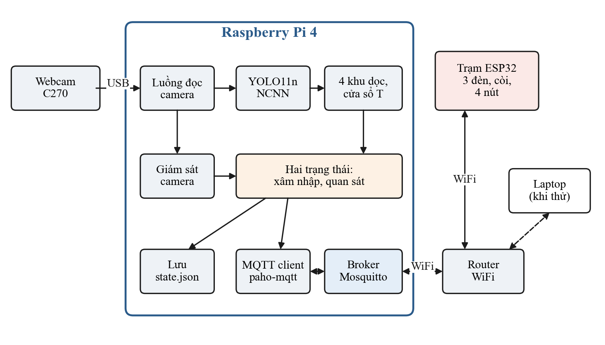
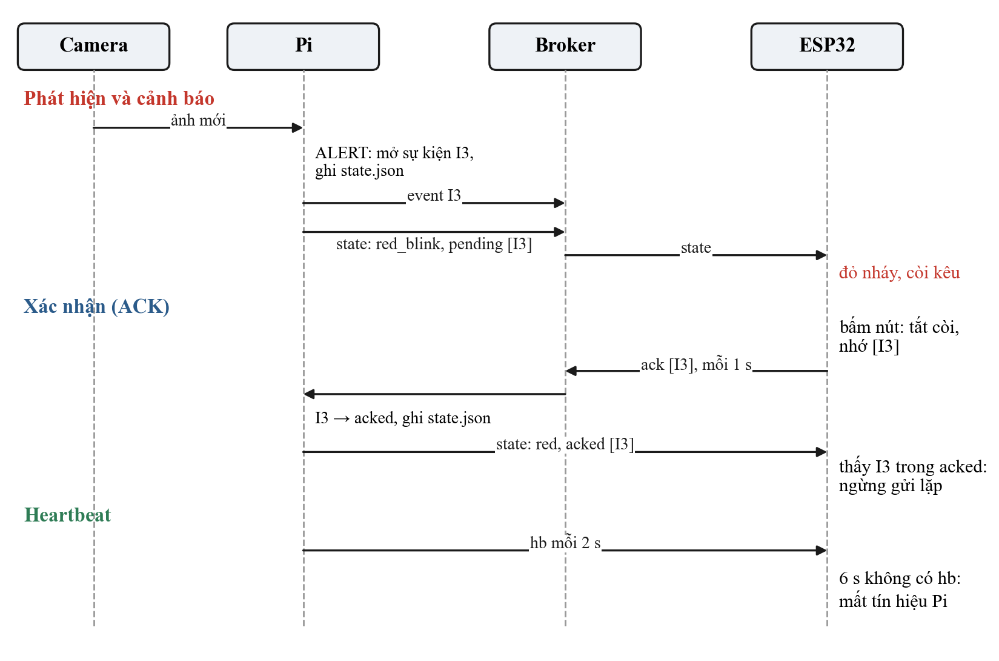
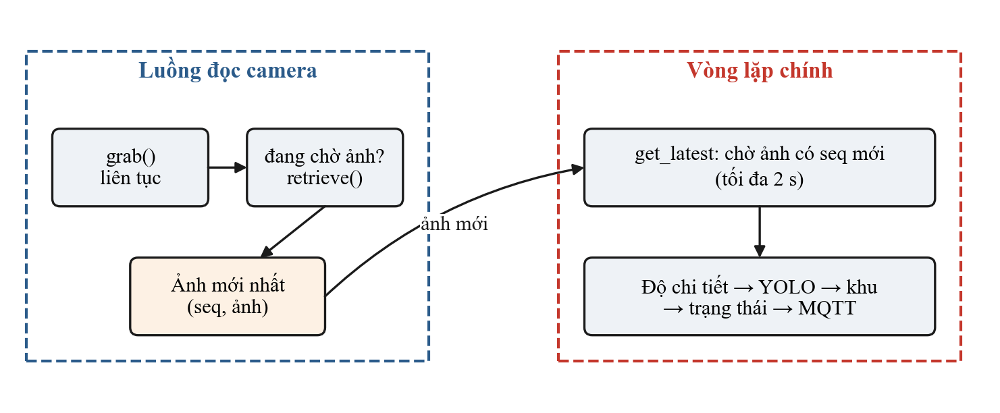
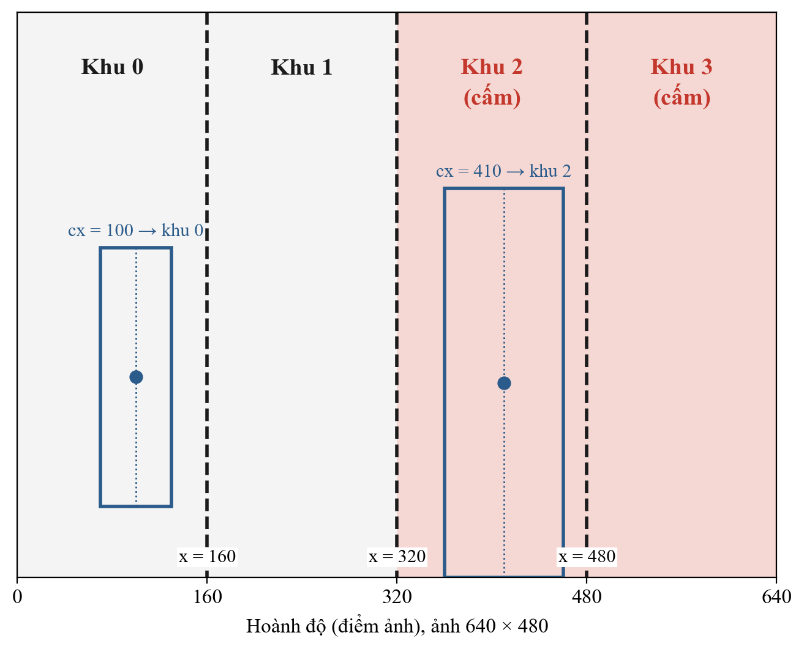
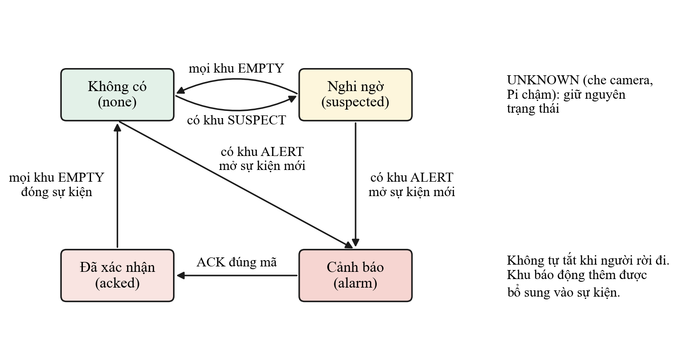
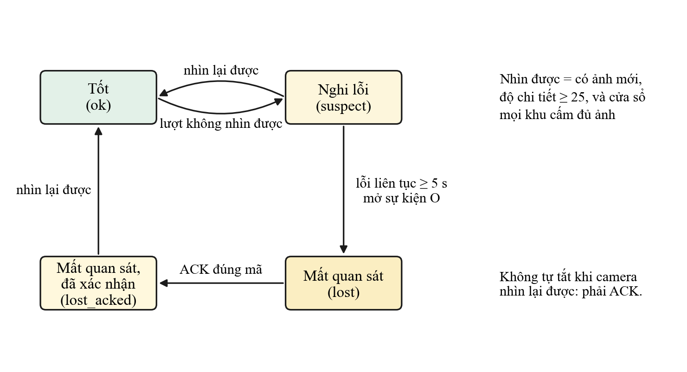
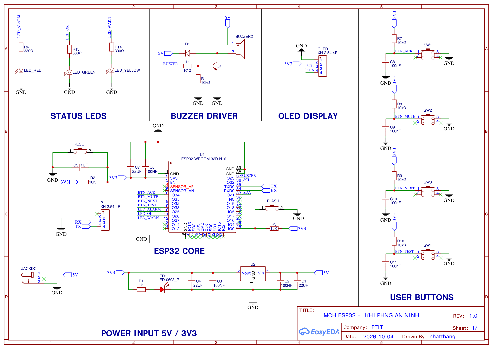
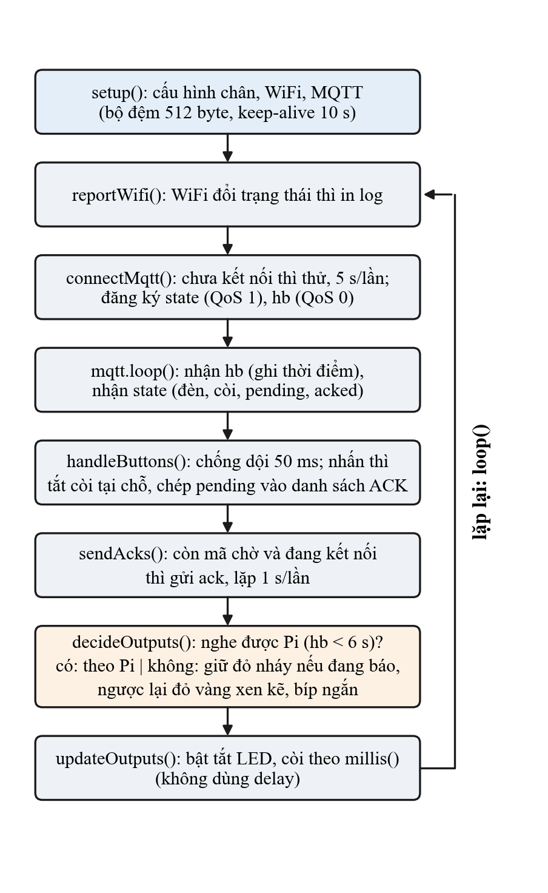

# CHƯƠNG 2: XÂY DỰNG HỆ THỐNG HỌC SÂU GIÁM SÁT PHÁT HIỆN NGƯỜI XÂM NHẬP VÀ CẢNH BÁO TRÊN NỀN TẢNG RASPBERRY PI VÀ ESP32

Chương 1 đã trình bày các kiến thức nền: giao thức MQTT, mô hình YOLO và hai nền tảng phần cứng Raspberry Pi, ESP32. Chương này đi vào thiết kế cụ thể của hệ thống. Nhóm bắt đầu từ yêu cầu, sau đó dựng kiến trúc tổng thể, rồi lần lượt mô tả từng khối: thu ảnh và phát hiện người trên Raspberry Pi, dữ liệu và quy trình tinh chỉnh mô hình, quản lý trạng thái sự kiện, giao tiếp MQTT và trạm cảnh báo ESP32. Với mỗi quyết định thiết kế, nhóm ghi lại lý do chọn và phương án đã cân nhắc nhưng không chọn.

## 2.1 Phân tích yêu cầu

### 2.1.1 Kịch bản sử dụng và tác nhân

Hệ thống phục vụ một tình huống cụ thể: một phòng hoặc một khu vực trong nhà có một phần không gian không cho phép người vào, ví dụ góc để tủ hồ sơ hoặc lối ra cửa sổ. Một camera đặt cố định quan sát cả khu vực. Người trực ngồi ở bàn riêng, có thể không nhìn màn hình camera, nên cần một thiết bị báo động đặt ngay trên bàn: đèn sáng, còi kêu khi có người bước vào khu cấm, và một nút bấm để xác nhận đã biết.

Hệ thống có ba tác nhân:

- **Người đi vào khu vực quan sát.** Đây là đối tượng mà camera cần phát hiện. Người này có thể đi thẳng, đi chéo, quay lưng, cúi, ngồi sau bàn ghế hoặc chỉ lộ một phần cơ thể ở mép khung hình.
- **Người trực.** Người trực nhận cảnh báo từ trạm ESP32 và bấm nút xác nhận (ACK). Người trực không cần thao tác gì trên máy tính.
- **Người vận hành.** Người vận hành lắp đặt camera, chọn khu cấm trong file cấu hình, bật hoặc tắt chương trình trên Raspberry Pi. Hệ thống không có chế độ canh gác riêng: chương trình đang chạy nghĩa là đang canh gác, muốn ngừng canh thì dừng chương trình.

Toàn bộ hệ thống chạy trong mạng WiFi nội bộ. Hình ảnh không rời khỏi Raspberry Pi, bản tin cảnh báo chỉ đi qua router tới ESP32, nên hệ thống vẫn hoạt động khi mất Internet.

### 2.1.2 Yêu cầu chức năng

Bảng 2.1: Yêu cầu chức năng của hệ thống

| Mã | Yêu cầu |
| --- | --- |
| CN1 | Đọc hình liên tục từ camera USB, luôn xử lý ảnh mới nhất, tự mở lại camera khi mất kết nối |
| CN2 | Phát hiện người trong ảnh bằng YOLO chạy ngay trên Raspberry Pi, không gửi ảnh ra ngoài |
| CN3 | Chia khung hình thành 4 khu dọc, cho phép chọn khu cấm trong file cấu hình |
| CN4 | Chỉ báo động khi có đủ bằng chứng có người trong khu cấm trong một khoảng thời gian, không báo theo một ảnh đơn lẻ |
| CN5 | Phát hiện khi camera không quan sát được: mất hình, bị che, Raspberry Pi xử lý quá chậm. Khi đó phát cảnh báo quan sát riêng |
| CN6 | Gửi trạng thái và sự kiện tới trạm ESP32 qua MQTT; ESP32 bật đèn, còi theo bảng ưu tiên |
| CN7 | Người trực bấm nút trên ESP32 để xác nhận; một lần bấm xác nhận mọi cảnh báo đang hiển thị lúc bấm |
| CN8 | Lưu trạng thái ra file mỗi lần thay đổi; khởi động lại thì khôi phục cảnh báo chưa xác nhận |
| CN9 | ESP32 tự phát hiện mất tín hiệu từ Raspberry Pi và báo cho người trực |

### 2.1.3 Yêu cầu phi chức năng

Các yêu cầu phi chức năng được viết thành chỉ tiêu có thể đo. Cột cuối của Bảng 2.2 cho biết nhóm kiểm chứng từng chỉ tiêu bằng cách nào; kết quả đo nằm ở chương 3.

Bảng 2.2: Yêu cầu phi chức năng và cách kiểm chứng

| Mã | Chỉ tiêu | Cách kiểm chứng |
| --- | --- | --- |
| PCN1 | Độ trễ từ lúc người bước vào khu cấm tới lúc còi kêu: 95% số lần thử dưới 2 giây | Quay video 30 khung hình/giây thấy cả vạch khu cấm và đèn ESP32, đọc từng khung để lấy thời điểm (mục 3.5.2) |
| PCN2 | Sau tinh chỉnh, recall tăng trên các điều kiện quan sát khó, cảnh bình thường không giảm | So mô hình gốc và mô hình tinh chỉnh trên tập test (mục 3.3) |
| PCN3 | Đo được số lần báo động giả mỗi giờ khi chạy liên tục | Chạy nền nhiều giờ, đối chiếu từng sự kiện với người trực (mục 3.5.3) |
| PCN4 | Xử lý đúng 7 kịch bản sự cố K1, K4, K5, K7, K10, K12, K13 | Thử trên phần cứng thật, có log (mục 3.5.4) |
| PCN5 | Raspberry Pi xử lý tối thiểu 4 ảnh/giây, không bị hạ xung khi chạy lâu | Ghi FPS, CPU, RAM, nhiệt độ, cờ hạ xung ra file CSV (mục 3.2) |
| PCN6 | Hoạt động khi không có Internet | Rút dây WAN của router, kiểm tra bản tin MQTT vẫn chạy (demo) |
| PCN7 | Chỉ thiết bị có tài khoản mới gửi, nhận được bản tin; ESP32 không giả được trạng thái của Pi, Pi không giả được ACK | Thử kết nối không mật khẩu và gửi sai topic với từng tài khoản (mục 2.6.1) |
| PCN8 | Mất điện bất kỳ lúc nào không làm hỏng file trạng thái | Kịch bản K13 và kiểm thử tự động |

Con số 4 ảnh/giây ở PCN5 không phải chọn tùy ý. Nó suy ra từ tham số cửa sổ thời gian ở mục 2.3.4: cửa sổ dài 2 giây cần ít nhất 8 ảnh mới được kết luận, tức Pi phải xử lý được ít nhất 8 / 2 = 4 ảnh mỗi giây.

## 2.2 Kiến trúc tổng thể

### 2.2.1 Sơ đồ khối và các thành phần

Hệ thống gồm bốn thiết bị: webcam Logitech C270, Raspberry Pi 4, router WiFi và trạm cảnh báo ESP32. Hình 2.1 cho thấy cách chúng nối với nhau.



Camera cắm vào Raspberry Pi qua cổng USB. Mọi xử lý hình ảnh diễn ra trên Pi: đọc camera, chạy YOLO, xét khu cấm, giữ trạng thái và lưu file. Broker MQTT Mosquitto cũng chạy ngay trên Pi. Pi và ESP32 cùng nối vào một router WiFi; router chỉ làm nhiệm vụ chuyển gói tin trong mạng nội bộ, không cần nối Internet. Laptop chỉ dùng khi phát triển, thử nghiệm và trình diễn: xem bản tin bằng MQTTX, đăng nhập SSH vào Pi và xem luồng hình từ camera (mục 2.3.5).

Chương trình trên Pi được chia thành các mô-đun nhỏ, mỗi mô-đun một việc, để kiểm thử riêng được trên laptop mà không cần camera hay mạng. Bảng 2.3 liệt kê các mô-đun trong thư mục `pi/safecam/`.

Bảng 2.3: Các mô-đun chương trình trên Raspberry Pi

| Mô-đun | Nhiệm vụ |
| --- | --- |
| `camera.py` | Luồng riêng đọc camera, giữ ảnh mới nhất, tự mở lại khi lỗi |
| `detector.py` | Chạy YOLO11n định dạng NCNN, trả danh sách người kèm tọa độ khung |
| `zones.py` | Xác định người thuộc khu nào, giữ cửa sổ T giây cho từng khu cấm |
| `intrusion.py` | Máy trạng thái xâm nhập |
| `observation.py` | Đo độ chi tiết ảnh, máy trạng thái quan sát camera |
| `outputs.py` | Chọn đèn, còi theo bảng ưu tiên, tạo nội dung bản tin |
| `persistence.py` | Ghi và đọc file trạng thái an toàn khi mất điện |
| `mqtt_client.py` | Kết nối broker, gửi `state`, `event`, `hb`, nhận ACK |
| `stream.py` | Phát luồng hình có vẽ khu và khung người để xem trên laptop, bật hoặc tắt trong cấu hình |
| `main.py` | Vòng lặp chính nối các mô-đun trên |

Các mô-đun có logic quyết định (`zones`, `intrusion`, `observation`, `outputs`, `persistence`, `mqtt_client`) và hàm vẽ của `stream` đều có kiểm thử tự động bằng pytest trong `pi/tests/`, tổng cộng 83 ca kiểm thử, chạy trên laptop trong vài giây.

### 2.2.2 Luồng dữ liệu

Hệ thống có ba luồng dữ liệu chính, minh họa trong Hình 2.2.



**Luồng phát hiện và cảnh báo.** Luồng đọc camera giữ ảnh mới nhất. Vòng lặp chính lấy ảnh, kiểm tra ảnh có bị che không, đưa ảnh qua YOLO, rồi ghi kết quả "có người hay không" vào cửa sổ của từng khu cấm. Khi cửa sổ đủ bằng chứng, máy trạng thái xâm nhập mở sự kiện mới. Pi ghi trạng thái ra file trước, sau đó mới gửi bản tin `event` và `state` lên broker. ESP32 nhận `state` và bật đèn đỏ nháy, còi kêu.

**Luồng xác nhận.** Người trực bấm nút. ESP32 tắt còi ngay tại chỗ, ghi lại các mã sự kiện đang chờ xác nhận và gửi bản tin `ack` mỗi giây. Pi nhận ACK, chuyển sự kiện sang trạng thái đã xác nhận, ghi file, rồi gửi lại `state` có mã vừa xác nhận trong trường `acked`. ESP32 thấy mã của mình trong `acked` thì ngừng gửi lặp.

**Luồng heartbeat.** Cứ 2 giây vòng lặp chính gửi một bản tin `hb`. ESP32 không nhận được `hb` trong 6 giây (tức 3 nhịp) thì coi như mất tín hiệu từ Pi và tự báo cho người trực. Bản tin `hb` được gửi từ chính vòng lặp xử lý ảnh, không phải từ một luồng riêng. Nhờ vậy, nếu vòng lặp bị treo thì `hb` cũng ngừng, ESP32 biết ngay.

### 2.2.3 Lựa chọn công nghệ

Bảng 2.4 tóm tắt các lựa chọn chính, kèm phương án thay thế mà nhóm đã cân nhắc.

Bảng 2.4: Lựa chọn công nghệ và phương án thay thế

| Thành phần | Lựa chọn | Phương án thay thế | Lý do chọn |
| --- | --- | --- | --- |
| Thiết bị xử lý | Raspberry Pi 4 | Jetson Nano, máy tính mini | Nhóm có sẵn, cộng đồng lớn, đủ chạy mô hình nhỏ ở vài ảnh/giây; Jetson mạnh hơn nhưng đắt và khó mua |
| Camera | Logitech C270 (USB) | Raspberry Pi Camera Module, camera IP | Có sẵn, cắm USB dùng ngay, dùng chung được trên laptop khi phát triển và thu dữ liệu |
| Mô hình | YOLO11n | YOLOv8n, YOLO26n | Bản nhỏ nhất của YOLO11, cân bằng tốc độ và độ chính xác; YOLO26n mới hơn nhưng nhóm đã đo YOLO11n trên Pi, đổi lúc này phải xuất và đo lại |
| Định dạng chạy | NCNN | PyTorch, ONNX Runtime, TFLite | NCNN được viết cho CPU ARM của thiết bị di động; Ultralytics xuất trực tiếp được |
| Kích thước ảnh vào | 320 px | 640 px, 416 px | 320 px đủ nhanh để đạt yêu cầu PCN5; ảnh lớn hơn chính xác hơn với người ở xa nhưng chậm hơn nhiều |
| Giao thức | MQTT | HTTP, CoAP, WebSocket | Nhẹ, có QoS, retain, LWT sẵn trong giao thức, có thư viện cho cả Python và ESP32 |
| Broker | Mosquitto trên Pi | Broker công cộng (HiveMQ, EMQX Cloud) | Không cần Internet, không đưa dữ liệu ra ngoài |
| Trạm cảnh báo | ESP32 | Arduino Uno kèm module WiFi | Có WiFi tích hợp, đủ chân cho 3 đèn, còi và 4 nút |

## 2.3 Thu ảnh và phát hiện người trên Raspberry Pi

### 2.3.1 Luồng đọc camera và cấu hình camera

Camera C270 xuất 30 ảnh mỗi giây, trong khi YOLO trên Pi chỉ xử lý được khoảng 7 ảnh mỗi giây. Nếu chương trình đọc camera và chạy YOLO tuần tự trong cùng một vòng lặp, các ảnh chưa đọc sẽ dồn lại trong bộ đệm của camera. Khi đó YOLO luôn xử lý ảnh cũ, và độ trễ tăng dần lên vài giây. Với hệ thống báo động, đây là lỗi nghiêm trọng vì người đã vào khu cấm mà hệ thống vẫn đang xem cảnh của mấy giây trước.

Nhóm giải quyết bằng một luồng riêng chỉ làm việc đọc camera (`camera.py`). Luồng này gọi `grab()` liên tục để lấy ảnh nén ra khỏi bộ đệm, đánh số thứ tự cho mỗi ảnh, nhưng chỉ gọi `retrieve()` để giải nén khi vòng lặp chính đang chờ ảnh. Cách này đỡ tốn CPU cho những ảnh không dùng tới. Hai lệnh `grab()` và `retrieve()` được gọi trong cùng một luồng vì OpenCV không đảm bảo an toàn khi hai luồng cùng dùng một đối tượng camera. Vòng lặp chính gọi `get_latest(last_seq)` để lấy ảnh có số thứ tự lớn hơn ảnh vừa xử lý; nếu sau 2 giây vẫn không có ảnh mới thì hàm trả về rỗng, và vòng lặp coi lượt đó là "không nhìn được". Nhờ số thứ tự, một ảnh không bao giờ bị xử lý hai lần.



Cấu hình camera được ghi trong `config/camera.yaml` và áp lại mỗi lần mở camera, vì C270 quên cấu hình khi bị rút ra cắm lại:

- Định dạng MJPG, độ phân giải 640×480, 30 ảnh/giây.
- Tần số điện lưới 50 Hz, để giảm hiện tượng sọc nhấp nháy dưới đèn huỳnh quang. OpenCV không đặt được thông số này nên chương trình gọi lệnh `v4l2-ctl` của Linux.
- Phơi sáng để tự động. Đề tài không xét điều kiện thiếu sáng nên nhóm không khóa phơi sáng.
- Mở camera theo đường dẫn cố định `/dev/v4l/by-id/...-video-index0` thay vì `/dev/video0`. Số thứ tự `video0`, `video1` có thể đổi sau mỗi lần cắm lại, còn đường dẫn `by-id` gắn với chính chiếc camera đó.

Khi `grab()` thất bại 30 lần liên tiếp, luồng đọc camera đóng camera và mở lại sau 2 giây; nếu không mở được thì thử lại mỗi 2 giây. Kịch bản K12 ở chương 3 kiểm tra chính cơ chế này.

Cùng một mô-đun camera được dùng cho cả chương trình chính lẫn công cụ thu dữ liệu, nên ảnh dùng để huấn luyện có đúng cấu hình như ảnh lúc chạy thật.

### 2.3.2 Mô-đun phát hiện YOLO11n NCNN 320 px

Mô-đun `detector.py` nạp mô hình YOLO11n đã xuất sang định dạng NCNN bằng thư viện Ultralytics. Mỗi lần gọi, mô-đun đưa ảnh 640×480 vào hàm `predict` với các tham số:

- `imgsz=320`: Ultralytics tự thu ảnh về cạnh 320 điểm ảnh trước khi đưa vào mạng.
- `classes=[0]`: chỉ giữ lớp người (lớp số 0 trong bộ COCO).
- `conf=0.25`: ngưỡng tin cậy, bằng giá trị mặc định của Ultralytics khi dự đoán. Nhóm giữ giá trị này cho mọi thử nghiệm (mục 3.5.1).

Kết quả trả về là danh sách người, mỗi người gồm tọa độ khung `(x1, y1, x2, y2)` trên ảnh gốc và độ tin cậy. Mô-đun tính thêm tâm ngang của khung `cx = (x1 + x2) / 2` để dùng cho việc xác định khu. Lần chạy đầu tiên của mô hình luôn chậm hơn hẳn các lần sau, nên mô-đun chạy thử một lần trên ảnh đen ngay khi nạp, để lần đầu này không rơi vào lúc hệ thống đang canh gác.

### 2.3.3 Vùng quan tâm dạng 4 khu dọc

Cách phổ biến để xét người có ở trong vùng cấm hay không là vẽ một đa giác trên mặt sàn và kiểm tra điểm chân của người (cạnh dưới của khung) có nằm trong đa giác không. Cách này chỉ đúng khi camera nhìn thấy sàn ở chỗ người đứng. Trong bố trí của nhóm, camera đặt nằm ngang ở độ cao khoảng 1,6 m và chưa có giá để nghiêng xuống. Ước tính theo góc nhìn của C270 (khoảng 55° theo đường chéo), camera đặt ngang chỉ thấy sàn từ khoảng 5 m trở ra [cần bổ sung: đo thực tế khoảng cách gần nhất thấy được sàn tại vị trí lắp]. Người đứng gần camera bị cắt mất phần chân, cạnh dưới của khung lúc đó chỉ là mép ảnh, nên cách dùng điểm chân sẽ cho kết quả sai.

Vì vậy nhóm chia khung hình thành 4 dải dọc, đánh số khu 0 đến 3 từ trái sang phải. Ba mốc chia nằm ở hoành độ 160, 320 và 480 điểm ảnh trên ảnh rộng 640. Người thuộc khu nào được xét theo tâm ngang `cx` của khung: tìm vị trí của `cx` giữa các mốc bằng tìm kiếm nhị phân (`bisect_right`). Tâm ngang vẫn đúng khi người bị cắt chân hay bị bàn ghế che phần dưới, miễn là YOLO còn thấy được người. File `config/zones.yaml` chọn khu nào là khu cấm; cấu hình mặc định là khu 2 và 3.



Chương trình kiểm tra cấu hình ngay khi khởi động và dừng lại nếu cấu hình sai: mốc không tăng dần, danh sách khu cấm rỗng, hoặc có khu cấm không tồn tại. Cấu hình sai mà chương trình vẫn chạy thì sẽ canh gác sai mà không ai biết, nên dừng sớm an toàn hơn.

Cách chia khu dọc có một giới hạn cần nói rõ: mỗi dải dọc ứng với một hướng nhìn từ camera, không phải một ô cố định trên sàn. Một người đứng ở khu 1 nhưng ở rất xa và một người đứng ngay trước camera có thể có cùng tâm ngang. Hệ thống phù hợp khi khu cấm chiếm một phía của căn phòng theo hướng nhìn của camera, như góc cửa sổ trong bố trí thử nghiệm. Nếu sau này lắp được camera nhìn chéo xuống sàn, có thể chuyển sang đa giác và điểm chân mà không phải đổi các phần khác của hệ thống.

### 2.3.4 Điều kiện xác định xâm nhập theo cửa sổ T giây

YOLO có lúc nhận nhầm một vật thành người trong một hai ảnh, và có lúc bỏ sót người trong một hai ảnh. Nếu báo động ngay khi một ảnh thấy người, hệ thống sẽ báo giả nhiều. Vì vậy nhóm chỉ kết luận sau khi xét một khoảng thời gian.

Mỗi khu cấm có một cửa sổ trượt dài T giây. Mỗi ảnh đã qua YOLO thêm vào cửa sổ một mẫu gồm thời điểm và giá trị "khu này có người hay không". Mẫu cũ hơn T giây bị bỏ ra. Gọi n là số ảnh trong cửa sổ và k là số ảnh thấy người. Cửa sổ cho một trong bốn kết luận, xét theo thứ tự:

1. **Báo động (ALERT)** khi k ≥ K_min và k / n ≥ p.
2. **Không rõ (UNKNOWN)** khi n < n_min: quá ít ảnh để kết luận.
3. **Nghi ngờ (SUSPECT)** khi k > 0: có thấy người nhưng chưa đủ bằng chứng.
4. **Vắng (EMPTY)** khi đủ ảnh và không ảnh nào thấy người.

Điều kiện báo động được xét trước điều kiện "quá ít ảnh". Như vậy, dù Pi đang chạy chậm, nếu đã đủ bằng chứng có người thì vẫn báo. Ngược lại, kết luận "vắng" chỉ được đưa ra khi có đủ ảnh. Đây là nguyên tắc xuyên suốt của hệ thống: khung hình không quan sát được thì không bao giờ được coi là không có người.

Bảng 2.5: Tham số cửa sổ thời gian đang dùng

| Tham số | Giá trị | Ý nghĩa |
| --- | --- | --- |
| T (`window_s`) | 2 s | Độ dài cửa sổ |
| K_min (`k_min`) | 5 | Số ảnh thấy người tối thiểu |
| p | 0,5 | Tỷ lệ ảnh thấy người tối thiểu |
| n_min | 8 | Số ảnh tối thiểu để được kết luận |
| conf | 0,25 | Ngưỡng tin cậy của YOLO |

Các giá trị trong Bảng 2.5 được nhóm đặt dựa trên tốc độ đo được của Pi và dùng cho mọi thử nghiệm ở chương 3; lý do giữ nguyên các giá trị này được trình bày ở mục 3.5.1. Để hình dung: với tốc độ khoảng 7,5 ảnh/giây đo được trên Pi, cửa sổ 2 giây chứa khoảng 15 ảnh; K_min = 5 nghĩa là người phải xuất hiện trong ít nhất 5 ảnh, tương đương khoảng 0,7 giây trong cửa sổ. Người chỉ thoáng qua mép khu cấm sẽ ở trạng thái nghi ngờ rồi trở về bình thường mà không gây báo động. Còn n_min = 8 trong cửa sổ 2 giây ứng với tốc độ tối thiểu 4 ảnh/giây, chính là mức yêu cầu ở PCN5.

Mỗi khu cấm có cửa sổ riêng. Nếu dùng chung một cửa sổ cho cả khu 2 và 3, một người đi dọc ranh giới giữa hai khu có thể bị cộng dồn số lần thấy từ cả hai phía. Dù vậy, hệ thống chỉ giữ **một** sự kiện xâm nhập: khi khu 2 báo động rồi khu 3 cũng báo động, sự kiện đang mở được bổ sung khu 3 vào danh sách khu, không mở sự kiện thứ hai. Cách này giữ máy trạng thái đơn giản, người trực chỉ cần bấm nút một lần.

### 2.3.5 Luồng hình theo dõi trên máy tính

Khi trình diễn và khi lắp đặt, người vận hành cần thấy Raspberry Pi đang nhìn gì: khu cấm nằm ở đâu trên khung hình, YOLO có thấy người hay không, hệ thống đang ở trạng thái nào. Mô-đun `stream.py` phát một luồng hình để xem bằng trình duyệt trên laptop nối cùng mạng WiFi, tại địa chỉ `http://<IP của Pi>:8080`. Trên mỗi ảnh, mô-đun vẽ thêm một lớp đỏ nhạt phủ các khu cấm, vạch ranh giới và số thứ tự khu, khung người kèm độ tin cậy, và một dòng ở đáy ảnh ghi trạng thái xâm nhập, trạng thái quan sát cùng mã sự kiện đang mở. Khi chuyển hệ thống sang phòng khác, nhóm xem luồng hình để đặt lại các mốc chia khu trong `config/zones.yaml`.

Luồng hình dùng định dạng MJPEG: máy chủ gửi liên tiếp các ảnh JPEG trong cùng một phản hồi HTTP (kiểu nội dung `multipart/x-mixed-replace`), trình duyệt nhận được ảnh nào thì hiện ảnh đó. Máy chủ viết bằng mô-đun `http.server` có sẵn trong Python, không phải cài thêm thư viện.

Yêu cầu quan trọng nhất là luồng hình không được làm chậm việc phát hiện. Vì vậy vòng lặp chính chỉ làm một việc: sau khi cập nhật trạng thái, gọi `publish()` để cất ảnh mới nhất cùng danh sách người và dòng trạng thái, rồi báo cho các luồng đang chờ. Việc vẽ và nén JPEG (chất lượng 70) chạy ở luồng riêng của từng trình duyệt đang xem; khi không ai xem thì không có luồng nào vẽ. Ảnh được đưa sang sau khi trạng thái đã cập nhật, nên chữ trên hình khớp với log của chương trình. Khi camera bị che, vòng lặp không chạy YOLO, nên ảnh trên luồng hình không có khung người. Lỗi ở phía luồng hình không làm dừng chương trình chính: cổng 8080 đang bận thì chương trình chạy tiếp mà không có luồng hình, laptop đóng trang thì chỉ lượt xem đó kết thúc. Luồng hình được bật, tắt và chọn cổng trong `config/stream.yaml`. Ảnh hưởng của luồng hình tới tốc độ được đo ở mục 3.2.3.

Luồng hình có hai giới hạn. Thứ nhất, luồng hình không yêu cầu mật khẩu, nên mọi máy trong cùng mạng WiFi đều xem được; vì vậy luồng hình chỉ dùng trong mạng nội bộ khi trình diễn và lắp đặt, và được tắt trong cấu hình khi không cần xem. Thứ hai, dòng trạng thái viết không dấu, vì hàm vẽ chữ của OpenCV chỉ vẽ được ký tự ASCII.

## 2.4 Dữ liệu và quy trình tinh chỉnh mô hình

### 2.4.1 Các điều kiện quan sát khó cần cải thiện

Mô hình YOLO11n gốc học trên bộ dữ liệu COCO, trong đó phần lớn ảnh người là người đứng, nhìn rõ, cỡ trung bình. Tại hiện trường, camera đặt ngang trong một căn phòng có bàn ghế, nên thường gặp bốn tình huống khó:

- **Người ở xa:** người đứng cuối phòng chỉ chiếm một vùng nhỏ của ảnh, nhất là khi ảnh đã thu về 320 px.
- **Người bị che một phần:** đứng hoặc ngồi sau bàn ghế, chỉ thấy nửa trên.
- **Góc nhìn lạ:** đi chéo hoặc quay lưng sát mép khung, chỉ lộ một phần cơ thể.
- **Tư thế cúi, ngồi:** cúi người, ngồi xổm, dáng người khác hẳn tư thế đứng.

Nhóm không đưa điều kiện thiếu sáng vào phạm vi. Xử lý ảnh tối cần thay đổi cả phần cứng (đèn hồng ngoại, camera không lọc hồng ngoại) và cách đặt phơi sáng, vượt quá thời gian của đồ án.

### 2.4.2 Thu thập dữ liệu theo phiên

Dữ liệu được chụp bằng chính chiếc C270, đặt đúng vị trí triển khai. Nhóm viết công cụ `tools/capture_frames.py` để tự chụp 2 ảnh mỗi giây trong 110 giây, tức khoảng 220 ảnh cho mỗi lần chạy. Mỗi lần chạy gọi là một **phiên**. Công cụ mở camera qua đúng mô-đun `camera.py` của chương trình chính, nên ảnh thu được có cùng định dạng, độ phân giải và tần số điện lưới như lúc chạy thật.

Nhóm chọn tự chụp theo nhịp thay vì quay video rồi tách ảnh, vì ba lý do. Thứ nhất, không cần thêm bước tách ảnh. Thứ hai, 2 ảnh/giây cho ít ảnh gần trùng hơn so với video 30 ảnh/giây, đỡ công gán nhãn. Thứ ba, chụp tự động theo nhịp thay vì bấm phím giúp tránh việc chỉ chụp lúc người đứng yên tạo dáng.

Mỗi phiên đi theo cùng một trình tự: vài giây đầu không có người (làm mẫu nền), sau đó đứng ở xa, đi chéo hoặc quay lưng sát mép khung, ngồi hoặc đứng sau bàn ghế, cúi hoặc ngồi xổm. Giữa các phiên, nhóm đổi ánh sáng (bật tắt bớt đèn, mở đóng rèm) và đổi trang phục. Bảng 2.6 mô tả các phiên.

Bảng 2.6: Các phiên chụp dữ liệu

| Phiên | Vị trí camera | Ghi chú |
| --- | --- | --- |
| s01, s02, s03 | Góc bàn máy tính | Ánh sáng và trang phục khác nhau |
| s04, s05 | Góc cửa sổ (vị trí chạy thật) | Ánh sáng và trang phục khác nhau |
| s06 | Góc cửa sổ | Cố ý để ánh sáng yếu |
| s07 | Góc cửa sổ | Chụp ngày khác, xê dịch đồ đạc, đổi góc camera nhẹ, gồm các tư thế khó nhất [cần bổ sung: ngày chụp, mô tả thực tế của phiên s07] |

Ảnh đầu tiên của mỗi phiên bị đen do camera vừa mở chưa kịp chỉnh phơi sáng, nên bị bỏ; mỗi phiên còn 219 ảnh. Người xuất hiện trong ảnh đều là thành viên nhóm hoặc người có giấy đồng ý, và khuôn mặt được làm mờ khi đưa ảnh vào quyển báo cáo.

### 2.4.3 Gán nhãn và chia tập theo phiên

Nhóm gán nhãn trên CVAT với một nhãn duy nhất là `person`, xuất ra định dạng YOLO 1.1. Nhóm không dùng Roboflow vì bản miễn phí công khai bộ dữ liệu, trong khi ảnh có người thật. Quy trình gán nhãn gồm hai bước: chạy chức năng gán nhãn tự động của CVAT, sau đó soát và sửa tay từng ảnh. Bước soát tay là bắt buộc vì gán tự động bỏ sót đúng những ca khó mà đề tài cần: người quay lưng, người ở mép khung, ảnh bị nhòe.
Khi soát, nhóm bỏ 12 ảnh hỏng: 11 ảnh của phiên s02 lúc camera bị cầm lên xoay, và 1 ảnh của phiên s04 bị nhòe. Camera chạy thật đặt cố định nên ảnh camera bị xoay không đại diện cho thực tế.

Điểm quan trọng nhất của bước này là **chia tập theo phiên chứ không chia theo từng ảnh**. Hai ảnh liên tiếp trong một phiên chỉ cách nhau nửa giây, gần như giống hệt nhau. Nếu chia ngẫu nhiên từng ảnh, ảnh gần trùng sẽ rơi vào cả tập train lẫn tập test, mô hình gần như "đã thấy đáp án", và điểm số trên test sẽ cao giả. Nhóm chia 7 phiên thành ba tập như Bảng 2.7 và khóa cách chia từ trước khi huấn luyện.

Bảng 2.7: Chia tập dữ liệu theo phiên

| Tập | Phiên | Số ảnh | Dùng để |
| --- | --- | --- | --- |
| train | s01, s02, s04, s06 | 864 (có 25 ảnh nền) | Huấn luyện |
| val | s03 | 219 | Chọn mô hình tốt nhất, chọn ngưỡng và tham số cửa sổ |
| test | s05, s07 | 219 + [cần bổ sung: số ảnh s07] | Đánh giá cuối cùng, chỉ chạy một lần |

Cách chia có chủ đích: tập train có cả hai vị trí camera; phiên ánh sáng yếu s06 chỉ nằm trong train vì đề tài không đánh giá thiếu sáng; tập test đặt ở góc cửa sổ, nơi hệ thống chạy thật, và có một phiên chụp ngày khác để kiểm tra mô hình có học thuộc riêng một buổi chụp hay không. Nhóm kiểm tra thêm bằng mã băm ảnh (dHash) và không thấy ảnh trùng giữa các tập. Tuy vậy, s05 có cùng phông nền với s04 và s06, nên kết quả trên s05 có thể cao hơn thực tế; đó là lý do phiên s07 khác ngày được thêm vào tập test.

Công cụ `tools/build_dataset.py` gộp ảnh gốc và nhãn xuất từ CVAT thành cấu trúc thư mục `images/` và `labels/` theo từng tập, tạo file `data.yaml` và nén thành một file zip để tải lên Google Drive.

### 2.4.4 Cấu hình huấn luyện và phương pháp đánh giá

Nhóm huấn luyện trên Google Colab, xuất phát từ trọng số `yolo11n.pt` đã học trên COCO (học chuyển giao), với ảnh 320 px và một lớp `person`. Với lượng dữ liệu nhỏ như của nhóm, tinh chỉnh từ mô hình đã học sẵn cho kết quả tốt hơn nhiều so với huấn luyện từ đầu.

Nhóm giữ nguyên các phép tăng cường dữ liệu mặc định của Ultralytics: thay đổi độ sáng, màu, lật ngang, phóng to thu nhỏ, ghép 4 ảnh (mosaic). Các phép này chỉ áp lên ảnh train trong lúc huấn luyện, không sinh thêm file. Phép ghép ảnh và phóng thu tạo ra người nhỏ và người bị cắt mép, hợp với điều kiện người xa và người bị che. Hai phép xoay ảnh (`degrees`) và lật dọc (`flipud`) mặc định đã tắt, phù hợp với camera đặt ngang cố định.

Trước khi huấn luyện, nhóm kiểm tra dữ liệu bằng hàm `check_det_dataset` của Ultralytics và xem ảnh `train_batch0.jpg` để chắc chắn nhãn khớp với người trong ảnh. Các tham số huấn luyện khác: [cần bổ sung: số epoch, batch, loại GPU Colab, thời gian huấn luyện].

Kết quả huấn luyện có tính ngẫu nhiên, nên mô hình tinh chỉnh được huấn luyện 3 lần với 3 seed khác nhau; báo cáo dùng giá trị trung bình và độ lệch chuẩn. Mô hình tốt nhất được chọn theo tập val. Phép đánh giá cuối cùng chạy `model.val(split="test")` đúng một lần cho cả mô hình gốc và mô hình tinh chỉnh, với các chỉ số precision, recall, mAP50 và mAP50-95. Mô hình được chọn sau đó xuất sang NCNN và đo lại tốc độ trên Pi.

## 2.5 Quản lý trạng thái sự kiện

### 2.5.1 Hai trạng thái độc lập: xâm nhập và quan sát camera

Hệ thống phải theo dõi cùng lúc hai câu hỏi khác nhau: "có người trong khu cấm không" và "camera có đang nhìn được không". Nếu gộp hai câu hỏi vào một máy trạng thái, một sự cố có thể xóa mất sự cố kia. Ví dụ, đang báo động xâm nhập mà camera bị che, một máy trạng thái chung dễ chuyển sang "mất quan sát" và quên mất rằng vẫn còn một cảnh báo xâm nhập chưa xác nhận.

Vì vậy nhóm tách thành hai máy trạng thái độc lập: máy trạng thái xâm nhập (`intrusion.py`) và máy trạng thái quan sát (`observation.py`). Mỗi máy có bộ đếm mã sự kiện riêng: sự kiện xâm nhập mang mã `I1`, `I2`..., sự kiện quan sát mang mã `O1`, `O2`... Chỉ vòng lặp chính `main.py` nhìn thấy cả hai, và nó dùng trạng thái quan sát để quyết định khi nào được tin kết luận "vắng" của các cửa sổ khu.

Raspberry Pi là nơi duy nhất giữ trạng thái. ESP32 không tự suy luận gì về xâm nhập hay quan sát, chỉ làm theo đèn và còi mà Pi yêu cầu. Thiết kế này tránh việc hai thiết bị giữ hai phiên bản trạng thái khác nhau sau khi mất kết nối.

### 2.5.2 Máy trạng thái xâm nhập

Máy trạng thái xâm nhập có bốn trạng thái, như Hình 2.5 và Bảng 2.8.



Bảng 2.8: Chuyển trạng thái xâm nhập

| Trạng thái hiện tại | Điều kiện | Trạng thái mới |
| --- | --- | --- |
| Không có (`none`) hoặc Nghi ngờ (`suspected`) | Có khu cấm báo ALERT | Cảnh báo (`alarm`), mở sự kiện mới |
| Không có | Có khu SUSPECT, không khu nào ALERT | Nghi ngờ |
| Nghi ngờ | Mọi khu cấm EMPTY | Không có |
| Cảnh báo | Người trực ACK đúng mã sự kiện | Đã xác nhận (`acked`) |
| Đã xác nhận | Mọi khu cấm EMPTY | Không có, đóng sự kiện |

Có hai quy tắc đáng chú ý. Thứ nhất, cảnh báo **không tự tắt** khi người đã rời đi. Chỉ người trực bấm nút mới đưa sự kiện sang "đã xác nhận". Một người lẻn vào rồi ra nhanh vẫn để lại cảnh báo cho người trực biết. Thứ hai, sự kiện chỉ kết thúc khi mọi khu cấm có kết luận EMPTY, tức camera nhìn đủ ảnh và không thấy ai. Kết luận UNKNOWN (camera bị che, Pi chạy chậm) giữ nguyên sự kiện. Trong lúc sự kiện còn mở, khu nào báo động thêm thì được bổ sung vào danh sách khu của sự kiện.

Sau khi sự kiện kết thúc, nếu người quay lại khu cấm thì máy trạng thái mở một sự kiện mới với mã mới, còi kêu lại dù trước đó đã bấm nút. Đây là kịch bản K10 ở chương 3.

### 2.5.3 Máy trạng thái quan sát camera

Máy trạng thái quan sát cần trả lời mỗi vòng lặp một câu hỏi đơn giản: lượt này camera có nhìn được không. Lượt được coi là nhìn được (`good`) khi thỏa đồng thời hai điều kiện: có ảnh mới và ảnh không bị che; cửa sổ của mọi khu cấm có đủ ảnh (không UNKNOWN). Điều kiện thứ hai bắt luôn trường hợp Pi xử lý quá chậm: khi đó camera vẫn có hình nhưng hệ thống không đủ ảnh để kết luận, nên cũng là lỗi quan sát.

Để phát hiện camera bị che, nhóm dùng một đại lượng đơn giản gọi là **độ chi tiết** của ảnh: chuyển ảnh sang ảnh xám, thu nhỏ về 64×48 điểm ảnh, rồi tính độ lệch chuẩn của độ sáng. Ảnh bị lòng bàn tay che gần như một màu nên độ lệch chuẩn nhỏ. Ảnh phòng bình thường có cạnh bàn, cửa sổ, đồ vật nên độ lệch chuẩn lớn. Bước thu nhỏ giúp loại bớt nhiễu hạt khi phòng tối, vốn có thể làm độ lệch chuẩn tăng giả. Nhóm đo độ chi tiết trên laptop bằng công cụ `tools/measure_detail.py` cho bốn cảnh (Bảng 2.9) và chọn ngưỡng 25.

Bảng 2.9: Độ chi tiết ảnh đo ở các cảnh khác nhau (đo trên laptop, 21/11)

| Cảnh | Độ chi tiết |
| --- | --- |
| Tay che kín camera | 3 – 14 |
| Người đứng sát camera | 19 – 51 |
| Tắt bớt đèn | từ 47 trở lên |
| Phòng bình thường | khoảng 74 |

Ảnh có độ chi tiết dưới ngưỡng không được đưa vào cửa sổ khu, giống hệt trường hợp mất hình. Như vậy cửa sổ của các khu cấm không nhận thêm mẫu "không thấy người" từ những ảnh bị che, và không thể đi tới kết luận "vắng".



Máy trạng thái quan sát có bốn trạng thái (Hình 2.6):

- **Tốt (`ok`)**: camera nhìn được. Gặp một lượt không nhìn được thì chuyển sang nghi lỗi.
- **Nghi lỗi (`suspect`)**: vừa có lỗi, chờ xem có kéo dài không. Nhìn lại được thì về tốt. Lỗi kéo dài liên tục 5 giây (`lost_after_s`) thì chuyển sang mất quan sát.
- **Mất quan sát (`lost`)**: mở sự kiện quan sát mới, ESP32 nháy vàng và bíp chậm. Trạng thái này không tự tắt khi camera nhìn lại được; người trực phải bấm nút.
- **Mất quan sát, đã xác nhận (`lost_acked`)**: đèn vàng sáng, còi tắt. Khi camera nhìn lại được thì về tốt.

Ngưỡng 5 giây được chọn từ thực tế: mỗi lần mở camera mất khoảng 3,5 giây không có ảnh dùng được. Ngưỡng ngắn hơn sẽ làm hệ thống báo mất quan sát ngay mỗi lần khởi động.

Riêng ngưỡng độ chi tiết chưa đủ để bảo vệ kết luận "vắng". Trong lúc camera đang bị che dần hoặc vừa được bỏ che, có những ảnh chỉ bị che một nửa: độ chi tiết vẫn trên 25 nên ảnh vẫn vào cửa sổ, trong khi YOLO không thấy người vì người đã bị che khuất. Nếu chỉ dựa vào ngưỡng, cửa sổ có thể kết luận "vắng" và đóng sai một sự kiện đang mở. Vì vậy hệ thống có thêm quy tắc: **chỉ tin kết luận "vắng" khi camera đã nhìn tốt liên tục ít nhất T giây**. Máy trạng thái quan sát ghi lại thời điểm cuối cùng không nhìn được; nếu chưa qua đủ T giây kể từ thời điểm đó, vòng lặp chính đổi mọi kết luận EMPTY thành UNKNOWN trước khi đưa sang máy trạng thái xâm nhập.

Hai máy trạng thái còn liên hệ với nhau ở một điểm nữa. Khi một sự kiện xâm nhập được mở lúc trạng thái quan sát không phải "tốt", bản tin `event` mang cờ `after_blind: true`, nghĩa là "xâm nhập sau mất quan sát". Cờ này cho người trực biết người đó có thể đã vào khu cấm trong lúc camera bị che (kịch bản K4).

So với bản đề xuất, nhóm chưa làm phần phát hiện camera bị che ngắn nhưng lặp lại nhiều lần trong 30 – 60 giây; trường hợp này (kịch bản K3) được ghi vào hướng phát triển. Phương pháp độ chi tiết cũng có giới hạn: vật che mỏng hoặc che một phần có thể không bị phát hiện, và người đứng sát camera có thể làm độ chi tiết xuống dưới ngưỡng.

### 2.5.4 Quy tắc xác nhận và bảng ưu tiên đèn, còi

Quy tắc xác nhận gồm ba điểm:

1. Một lần bấm nút xác nhận **mọi** cảnh báo đang hiển thị trên ESP32 lúc bấm. Pi gửi danh sách mã đang chờ xác nhận trong trường `pending` của bản tin `state`; khi bấm nút, ESP32 chép đúng danh sách đó vào bản tin ACK.
2. Cảnh báo phát sinh sau lúc bấm không có trong danh sách nên vẫn tiếp tục báo. Hai máy trạng thái chỉ chấp nhận ACK khi mã trong ACK trùng mã sự kiện đang mở.
3. Pi ghi mọi mã ESP32 gửi về vào danh sách `acked`, kể cả mã cũ đã xác nhận từ trước. Nếu Pi bỏ qua mã cũ, chẳng hạn sau khi khởi động lại, ESP32 sẽ không bao giờ thấy mã của mình được xác nhận và gửi lặp mãi. Danh sách `acked` giữ tối đa 5 mã gần nhất để bản tin `state` không vượt quá bộ đệm 512 byte của ESP32.

Đèn và còi do Pi tính sẵn theo bảng ưu tiên (Bảng 2.10). Hàm `pick_light_buzzer` trong `outputs.py` xét từ dòng ưu tiên cao xuống thấp, gặp dòng nào khớp thì dừng. Riêng dòng ưu tiên 2 do ESP32 tự xử lý vì khi mất tín hiệu thì Pi không gửi được gì.

Bảng 2.10: Bảng ưu tiên đèn và còi

| Ưu tiên | Tình huống | Đèn | Còi |
| --- | --- | --- | --- |
| 1 | Đang cảnh báo xâm nhập | Đỏ nháy | Kêu liên tục |
| 2 | ESP32 mất tín hiệu từ Pi | Đỏ và vàng nháy xen kẽ | Bíp ngắn |
| 3 | Cảnh báo quan sát chưa xác nhận | Vàng nháy | Bíp chậm |
| 4 | Xâm nhập đã xác nhận, chờ vắng người | Đỏ sáng | Tắt |
| 5 | Mất quan sát, đã xác nhận | Vàng sáng | Tắt |
| 6 | Bình thường | Xanh lá | Tắt |

Cảnh báo xâm nhập đứng trên cả mất tín hiệu: đang báo động mà mất mạng thì ESP32 vẫn giữ đèn đỏ nháy và còi. Trạng thái nghi ngờ và nghi lỗi không làm đổi đèn, vì đó là trạng thái tạm, thường tự hết sau vài giây.

### 2.5.5 Lưu trạng thái và khôi phục sau khởi động lại

Nếu Pi khởi động lại trong lúc đang có cảnh báo chưa xác nhận, cảnh báo đó không được phép biến mất. Pi lưu trạng thái của cả hai máy vào một file JSON duy nhất `data/state.json`, gồm hai phần `intr` và `obs`. Mỗi phần lưu trạng thái, sự kiện đang mở (mã, thời điểm bắt đầu, danh sách khu) và bộ đếm `next_id`. Giữ `next_id` qua các lần khởi động lại để không bao giờ đặt trùng mã sự kiện.

Ghi file khi đang có thể mất điện cần cẩn thận. Nếu mất điện đúng lúc đang ghi, file có thể chỉ còn một nửa và không đọc được. Hàm `save_state` ghi theo kiểu nguyên tử qua bốn bước:

1. Ghi nội dung ra một file tạm `state.json.tmp`.
2. Gọi `fsync` để ép dữ liệu thật sự xuống thẻ nhớ, không chỉ nằm trong bộ đệm của hệ điều hành.
3. Đổi tên file tạm thành `state.json` bằng `os.replace`. Trên Linux, phép đổi tên này diễn ra trọn vẹn trong một bước: sau đó chỉ có thể là file cũ hoặc file mới, không có trạng thái nửa vời.
4. Gọi `fsync` trên thư mục để ghi luôn việc đổi tên xuống thẻ nhớ.

Khi đọc, nếu file hỏng (không phải JSON hợp lệ), chương trình đổi tên nó thành `state.json.bad` để giữ lại xem sau, rồi bắt đầu với trạng thái mới thay vì dừng lại.

Khi khởi động, Pi khôi phục các trạng thái cần người trực xử lý: xâm nhập ở `alarm` hoặc `acked`, quan sát ở `lost` hoặc `lost_acked`. Các trạng thái tạm (nghi ngờ, nghi lỗi) không được khôi phục; hệ thống xét lại từ đầu. Thời điểm bắt đầu sự kiện được lưu theo đồng hồ hệ thống `time.time()`, không theo `time.monotonic()`, vì đồng hồ monotonic quay về 0 sau mỗi lần khởi động lại.

Hai chi tiết giúp hạn chế ghi thẻ nhớ và giữ đúng thứ tự:

- Trạng thái quan sát chỉ được ghi khi vào hoặc ra khỏi `lost`, `lost_acked`. Chuyển qua lại giữa `ok` và `suspect` có thể xảy ra liên tục, ghi mỗi lần sẽ làm mòn thẻ SD mà không có ích gì vì hai trạng thái này không được khôi phục.
- Pi luôn ghi file trước rồi mới gửi bản tin `event`. Nếu mất điện ở giữa, ESP32 chỉ biết sự kiện trễ vài giây, còn Pi không bao giờ quên sự kiện hay đặt trùng mã.

## 2.6 Thiết kế giao tiếp MQTT

### 2.6.1 Broker Mosquitto cục bộ, tài khoản và ACL

Broker Mosquitto cài trực tiếp trên Raspberry Pi, nghe ở cổng 1883 trên mọi giao diện mạng để ESP32 và laptop kết nối được. Nhóm đặt cấu hình trong file `deploy/mosquitto/safecam.conf` với ba điểm chính: tắt kết nối ẩn danh (`allow_anonymous false`), dùng file mật khẩu tạo bằng `mosquitto_passwd`, và dùng file phân quyền ACL. Chế độ `persistence` đã bật sẵn trong cấu hình mặc định của Mosquitto, giúp broker giữ các bản tin retain qua lần khởi động lại.

Mỗi thiết bị có một tài khoản riêng và chỉ được đọc, ghi các topic của mình (Bảng 2.11). Nhờ vậy ESP32 không thể giả bản tin trạng thái của Pi, và Pi không thể giả ACK của người trực.

Bảng 2.11: Tài khoản và quyền trên broker

| Tài khoản | Thiết bị | Được ghi | Được đọc |
| --- | --- | --- | --- |
| `safecam_pi` | Raspberry Pi | `safecam/cam01/#` | `safecam/alarm01/#` |
| `safecam_esp32` | ESP32 | `safecam/alarm01/#` | `safecam/cam01/#` |
| `safecam_dev` | Laptop (MQTTX), chỉ dùng khi thử | `safecam/#` | `safecam/#` |

Mật khẩu không nằm trong mã nguồn: trên Pi, mật khẩu đặt trong file `.env` (đọc bằng thư viện `python-dotenv`); trên ESP32, mật khẩu đặt trong file `secrets.h`. Cả hai file đều bị loại khỏi git, kho mã chỉ có file mẫu.
### 2.6.2 Danh sách topic

Tên topic theo dạng `safecam/<thiết bị>/<loại>`: `cam01` là camera và Pi, `alarm01` là trạm cảnh báo. Cách đặt tên này cho phép thêm camera hoặc trạm cảnh báo khác về sau mà không phải đổi các topic cũ.

Bảng 2.12: Danh sách topic MQTT

| Topic | Chiều | QoS | Retain | Khi nào gửi |
| --- | --- | --- | --- | --- |
| `safecam/cam01/state` | Pi → ESP32 | 1 | Có | Mỗi khi trạng thái đổi, sau khi nhận ACK, sau khi kết nối lại |
| `safecam/cam01/event` | Pi → ESP32 | 1 | Không | Khi mở sự kiện mới |
| `safecam/cam01/hb` | Pi → ESP32 | 0 | Không | Mỗi 2 giây |
| `safecam/alarm01/ack` | ESP32 → Pi | 0 | Không | Khi bấm nút, gửi lại mỗi giây tới khi Pi xác nhận |
| `safecam/cam01/status`, `safecam/alarm01/status` | Thiết bị → broker | 1 | Có | `online` khi kết nối; broker tự gửi `offline` khi thiết bị rớt (LWT) |

Bản tin `state` dùng retain để ESP32 vừa kết nối (hoặc kết nối lại sau khi mất mạng) nhận được ngay trạng thái hiện tại mà không phải chờ lần thay đổi tiếp theo. Bản tin `event` không dùng retain vì sự kiện cũ không cần phát lại. Bản tin `hb` dùng QoS 0 vì mất một nhịp không sao, chỉ cần các nhịp sau tới đều.

### 2.6.3 Cấu trúc bản tin

Mọi bản tin dùng định dạng JSON. Bản tin `state` là bản tin quan trọng nhất:

```
{"seq":120,"light":"red_blink","buzzer":"on",
 "intr":{"st":"alarm","id":"I3","zones":[2,3]},
 "obs":{"st":"ok","id":null},
 "pending":["I3"],"acked":["I2"]}
```

Bảng 2.13: Các trường của bản tin state

| Trường | Ý nghĩa |
| --- | --- |
| `seq` | Số thứ tự tăng dần của bản tin |
| `light` | Đèn cần bật: `red_blink`, `red`, `yellow_blink`, `yellow`, `green` |
| `buzzer` | Còi: `on` (kêu liên tục), `slow` (bíp chậm), `off` |
| `intr` | Trạng thái xâm nhập (`none`, `suspected`, `alarm`, `acked`), mã sự kiện, danh sách khu |
| `obs` | Trạng thái quan sát (`ok`, `suspect`, `lost`, `lost_acked`) và mã sự kiện |
| `pending` | Các mã sự kiện đang chờ xác nhận |
| `acked` | Vài mã vừa được xác nhận |

ESP32 chỉ cần đọc ba trường `light`, `buzzer` và `pending`. Các trường còn lại phục vụ việc theo dõi và ghi log khi thử nghiệm. Pi tính sẵn đèn và còi để ESP32 không phải biết bảng ưu tiên; muốn đổi cách báo thì chỉ sửa một chỗ trên Pi.

Các bản tin còn lại ngắn hơn:

- `event` xâm nhập: `{"id":"I3","type":"intrusion","zones":[2],"after_blind":false}`
- `event` quan sát: `{"id":"O1","type":"observation","reason":"lost"}`
- `ack`: `{"ids":["I3","O1"]}`
- `hb`: `{"seq":4521}`

Mã sự kiện dùng chữ cái đầu để phân biệt loại (`I` xâm nhập, `O` quan sát) vì hai loại có bộ đếm riêng; nếu chỉ dùng số thì sự kiện xâm nhập số 1 và sự kiện quan sát số 1 sẽ trùng nhau. Phía Pi kiểm tra định dạng của mọi ACK nhận được; ACK sai định dạng bị bỏ qua và ghi log, không làm dừng chương trình.

### 2.6.4 Cơ chế ACK gửi lặp, heartbeat và LWT

Thư viện PubSubClient trên ESP32 chỉ gửi được bản tin QoS 0, tức không có xác nhận từ broker. Một bản tin ACK có thể bị mất trên đường đi mà ESP32 không biết. Nhóm bù lại ở tầng ứng dụng: ESP32 gửi lại ACK mỗi giây, cho tới khi thấy mã của mình xuất hiện trong trường `acked` của bản tin `state` từ Pi. Pi nhận cùng một ACK nhiều lần cũng không sao, vì xác nhận một sự kiện đã xác nhận không làm thay đổi gì. Mỗi lần nhận ACK, Pi luôn gửi lại `state`, kể cả khi trạng thái không đổi, để ESP32 có cơ hội thấy trường `acked`.

Heartbeat được gửi mỗi 2 giây từ vòng lặp chính. ESP32 chỉ dùng `hb` để biết Pi còn sống, không dùng `state`, vì `state` có retain: broker có thể gửi lại bản `state` cũ dù Pi đã dừng từ lâu. ESP32 chưa nhận được nhịp `hb` nào kể từ khi khởi động cũng coi là mất tín hiệu từ Pi.

Cả Pi và ESP32 đều đăng ký "di chúc" (Last Will and Testament, LWT) khi kết nối: nếu thiết bị rớt mạng đột ngột, broker tự gửi `offline` lên topic `status` của thiết bị đó. Thời gian keep-alive đặt là 10 giây, nên broker phát hiện thiết bị mất kết nối sau khoảng 15 giây (1,5 lần keep-alive). Khi Pi dừng chương trình một cách bình thường, broker không gửi di chúc, nên Pi tự gửi `offline` trước khi ngắt kết nối.

### 2.6.5 Xử lý mất kết nối và kết nối lại

Phía Pi dùng thư viện paho-mqtt với chế độ kết nối nền (`connect_async` và `loop_start`). Nếu broker chưa chạy hoặc mạng chưa sẵn sàng, chương trình vẫn chạy bình thường và thư viện tự thử kết nối lại sau 1 đến 10 giây. Mỗi lần kết nối lại, Pi đăng ký lại topic ACK và gửi lại bản `state` cuối cùng, phòng trường hợp broker đã mất bản retain. Bản tin ACK được nhận trên luồng của thư viện paho, nên Pi chỉ đưa ACK vào một hàng đợi (`queue.Queue`); vòng lặp chính lấy ra và xử lý. Như vậy chỉ một luồng được phép thay đổi trạng thái, tránh lỗi tranh chấp dữ liệu giữa hai luồng.

Phía ESP32 bật chế độ tự kết nối lại WiFi và thử kết nối lại broker mỗi 5 giây. Trong lúc mất kết nối, ESP32 giữ nguyên báo động đang có. Người trực vẫn bấm nút được: còi tắt ngay tại chỗ, các mã đang chờ được ghi nhớ, và khi có mạng lại thì ESP32 gửi ACK như bình thường (kịch bản K5). Khi có sự kiện mới chưa được bấm nút, ESP32 bỏ trạng thái tắt còi tại chỗ để còi kêu lại.

Trường `seq` tăng dần theo từng bản tin `state` và bắt đầu lại từ 1 mỗi khi Pi khởi động lại. Trong thiết kế, `seq` dùng để nhận ra bản tin cũ đến trễ, và `seq` nhỏ đi là dấu hiệu Pi vừa chạy lại. Firmware hiện tại chỉ in `seq` ra cổng Serial để đối chiếu log, chưa dùng nó để lọc bản tin; với một broker duy nhất và một luồng gửi trên Pi, các bản tin `state` đến ESP32 theo đúng thứ tự gửi.

Thiết kế còn một giới hạn: khi WiFi vẫn còn nhưng Pi tắt hẳn, hàm `mqtt.connect()` của PubSubClient chặn vài giây ở mỗi lần thử (5 giây một lần), làm đèn ngừng nháy trong chốc lát.

## 2.7 Thiết kế trạm cảnh báo ESP32

### 2.7.1 Sơ đồ nguyên lý và đấu nối

Trạm cảnh báo dùng module ESP32-WROOM-32 hàn trực tiếp lên bo mạch in do nhóm thiết kế. Bo có 3 đèn LED (đỏ, vàng, xanh lá), 1 còi, 4 nút bấm và một đầu cắm dành cho màn hình OLED (chưa dùng). Sơ đồ nguyên lý ở Hình 2.7.



**Đèn LED** nối theo chuỗi: chân GPIO, điện trở 330 Ω, LED, xuống GND. LED sáng khi chân GPIO ở mức cao. Điện trở 330 Ω giới hạn dòng qua LED ở mức an toàn cho chân ESP32 [cần bổ sung: tính dòng qua LED theo điện áp rơi của LED đang dùng].

**Còi** không nối thẳng vào chân ESP32 vì dòng còi lớn hơn khả năng cấp dòng của chân GPIO. Chân GPIO23 điều khiển còi qua transistor Q1: điện trở R12 (1 kΩ) nối từ GPIO vào cực gốc của transistor để giới hạn dòng gốc, điện trở R11 (10 kΩ) kéo cực gốc xuống GND để transistor tắt hẳn khi ESP32 đang khởi động và chân chưa được cấu hình. Còi kêu khi GPIO23 ở mức cao [cần bổ sung: mã transistor Q1, loại còi và điện áp còi].

**Nút bấm** nối giữa chân GPIO và GND, tích cực mức thấp: không nhấn đọc 1, nhấn đọc 0. Mỗi nút có điện trở kéo lên 10 kΩ và tụ 100 nF để chống dội. Hai chân GPIO34 và GPIO35 chỉ là chân vào và không có điện trở kéo lên bên trong chip, nên hai điện trở kéo lên R7, R8 trên bo là bắt buộc, và trong firmware các chân nút được khai báo `INPUT` chứ không phải `INPUT_PULLUP`.

**Nguồn và nạp chương trình.** Bo được cấp nguồn qua jack DC [cần bổ sung: điện áp nguồn cấp và mạch ổn áp 3,3 V]. Đầu cắm P1 chỉ có các chân TX0, RX0, GND, không có chân DTR, RTS, nên công cụ nạp không tự đưa chip vào chế độ nạp được. Khi nạp, người dùng giữ nút FLASH (GPIO0) rồi nhấn RESET.

### 2.7.2 Bảng linh kiện và phân bố chân

Bảng 2.14: Phân bố chân ESP32 trên bo cảnh báo

| Khối | Linh kiện | GPIO | Ghi chú |
| --- | --- | --- | --- |
| Nút | SW1 | 34 | Chỉ vào, kéo lên ngoài R7 10 kΩ, tụ C8 100 nF |
| Nút | SW2 | 35 | Chỉ vào, kéo lên ngoài R8 10 kΩ, tụ C9 100 nF |
| Nút | SW3 | 32 | Kéo lên R9 10 kΩ, tụ C10 100 nF |
| Nút | SW4 | 33 | Kéo lên R10 10 kΩ, tụ C11 100 nF |
| Đèn | LED đỏ | 25 | R4 330 Ω |
| Đèn | LED xanh lá | 26 | R13 330 Ω |
| Đèn | LED vàng | 27 | R14 330 Ω |
| Còi | Còi qua Q1 | 23 | R12 1 kΩ vào cực gốc, R11 10 kΩ kéo xuống |
| Màn hình (chưa dùng) | OLED I2C | 21 (SDA), 22 (SCL) | Đầu cắm 4 chân |
| Nạp chương trình | Đầu cắm P1 | 1 (TX0), 3 (RX0) | Nối mạch USB–UART |

Theo tên đường mạch trên bo, bốn nút được dự kiến cho bốn việc: xác nhận, tắt còi, chuyển trang màn hình, thử đèn còi. Vì bản đề xuất không có các chức năng tắt còi riêng hay màn hình, nhóm cho cả bốn nút cùng làm chức năng xác nhận. Bấm nút nào cũng được, người trực không phải nhớ nút nào làm gì.

[cần bổ sung: bảng linh kiện đầy đủ (BOM) với giá trị, số lượng, mã linh kiện]

### 2.7.3 Lưu đồ firmware

Firmware viết bằng Arduino framework trên PlatformIO, dùng hai thư viện PubSubClient (MQTT) và ArduinoJson (đọc, ghi JSON). Nguyên tắc chính là **không dùng hàm chờ `delay`** trong vòng lặp. Mọi việc định thời (nháy đèn, bíp còi, gửi lặp ACK, chống dội nút) đều so sánh với `millis()`, nên nút bấm luôn được đọc kịp thời và đèn nháy đều. Hình 2.8 là lưu đồ của vòng lặp chính.



Mỗi vòng `loop()` gọi lần lượt bảy hàm:

1. `reportWifi`: in ra cổng Serial mỗi khi WiFi đổi trạng thái, phục vụ ghi log khi thử.
2. `connectMqtt`: nếu có WiFi mà chưa kết nối broker thì thử kết nối, tối đa 5 giây một lần. Khi kết nối được, đăng ký topic `state` (QoS 1) và `hb` (QoS 0), gửi `online` lên topic `status`.
3. `mqtt.loop`: giữ kết nối và nhận bản tin. Bản tin `hb` chỉ cập nhật thời điểm nhận nhịp cuối. Bản tin `state` được đọc để lấy đèn, còi Pi yêu cầu, danh sách `pending`, và bỏ khỏi danh sách gửi lặp các mã đã có trong `acked`.
4. `handleButtons`: đọc 4 nút, chống dội 50 ms, chỉ xử lý lúc vừa nhấn xuống. Khi nhấn: tắt còi tại chỗ và chép các mã trong `pending` vào danh sách chờ gửi ACK.
5. `sendAcks`: nếu danh sách chờ gửi không rỗng và đang kết nối thì gửi ACK, lặp lại mỗi giây.
6. `decideOutputs`: chọn đèn, còi thật sự bật. Nếu nghe được Pi (đang kết nối, đã có `hb`, nhịp cuối cách đây dưới 6 giây) thì làm theo Pi. Nếu mất tín hiệu mà Pi đang yêu cầu đỏ nháy thì giữ đỏ nháy và còi; còn lại thì chuyển sang đỏ vàng xen kẽ, bíp ngắn. Nếu người trực đã bấm nút thì còi tắt, đèn giữ nguyên.
7. `updateOutputs`: bật tắt LED và còi theo kiểu đã chọn.

Bảng 2.15: Các mốc thời gian trong firmware

| Thông số | Giá trị |
| --- | --- |
| Đèn nháy | Sáng 0,5 s, tắt 0,5 s |
| Còi bíp chậm (cảnh báo quan sát) | Kêu 200 ms mỗi 2 s |
| Còi bíp ngắn (mất tín hiệu Pi) | Kêu 80 ms mỗi 1 s |
| Mất tín hiệu Pi | Không nhận `hb` trong 6 s |
| Gửi lặp ACK | Mỗi 1 s |
| Thử kết nối lại broker | Mỗi 5 s |
| Chống dội nút | 50 ms |
| Bộ đệm bản tin MQTT | 512 byte |

Bộ đệm bản tin của PubSubClient mặc định chỉ 256 byte. Bản tin `state` dài hơn mức này sẽ bị bỏ mà không báo lỗi, nên firmware tăng bộ đệm lên 512 byte. Đây cũng là lý do Pi giới hạn trường `acked` ở 5 mã.

## 2.8 Kết luận chương 2

Chương 2 đã trình bày thiết kế của hệ thống từ yêu cầu tới từng khối. Raspberry Pi 4 đọc camera bằng một luồng riêng để luôn xử lý ảnh mới nhất, chạy YOLO11n định dạng NCNN ở ảnh 320 px, xác định người theo 4 khu dọc và chỉ báo động khi cửa sổ 2 giây có đủ bằng chứng. Hai máy trạng thái độc lập theo dõi xâm nhập và khả năng quan sát của camera, với nguyên tắc khung hình không nhìn được thì không bao giờ được coi là vắng người. Trạng thái được ghi nguyên tử ra file để khôi phục sau khi khởi động lại. Pi và trạm cảnh báo ESP32 trao đổi qua broker Mosquitto cục bộ có tài khoản và phân quyền; ESP32 chỉ làm theo đèn, còi Pi gửi, tự phát hiện mất tín hiệu qua heartbeat và gửi lặp ACK cho tới khi Pi xác nhận. Song song, nhóm chuẩn bị bộ dữ liệu 7 phiên chụp tại hiện trường, chia theo phiên, để tinh chỉnh mô hình cho các điều kiện quan sát khó.

Chương 3 trình bày việc triển khai thiết kế này trên phần cứng thật và các kết quả đo: hiệu năng trên Pi, kết quả tinh chỉnh mô hình, báo động giả khi chạy liên tục và kết quả thử các kịch bản sự cố.
