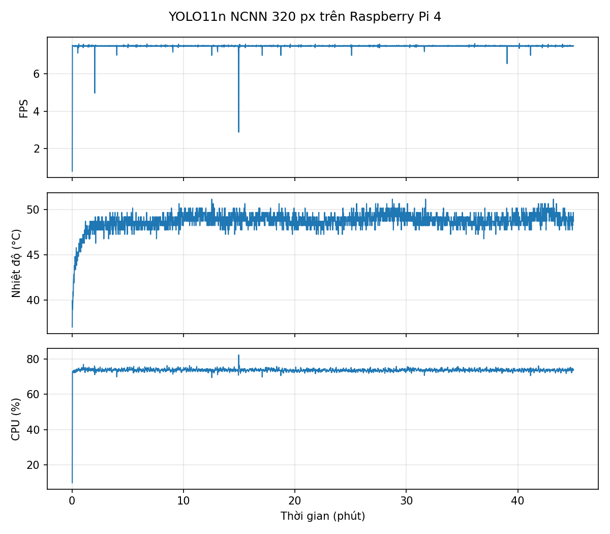

# CHƯƠNG 3: TRIỂN KHAI VÀ ĐÁNH GIÁ HOẠT ĐỘNG HỆ THỐNG

Chương 3 trình bày việc triển khai thiết kế ở chương 2 lên phần cứng thật và các kết quả đo. Trừ phần đánh giá mô hình ở mục 3.3, mọi thử nghiệm trên phần cứng trong chương này dùng **mô hình YOLO11n gốc** (chưa tinh chỉnh) với các tham số tạm ở Bảng 2.5. Với mỗi kết quả, nhóm ghi rõ điều kiện đo và giới hạn của phép đo.

## 3.1 Mô hình thực nghiệm

### 3.1.1 Bố trí hiện trường

Hệ thống được lắp trong một phòng ở, camera đặt ở góc cửa sổ, nằm ngang, cao khoảng 1,6 m. Khung hình chia 4 khu dọc theo các mốc 160, 320, 480 điểm ảnh; khu 2 và 3 là khu cấm. Trạm cảnh báo ESP32 đặt trên bàn người trực, Raspberry Pi và router WiFi đặt gần camera.

[cần bổ sung: ảnh hiện trường; ảnh khung hình có vẽ 4 khu và khung người (làm mờ mặt); kích thước phòng, khoảng cách từ camera tới tường đối diện]

### 3.1.2 Phần cứng và phần mềm

Bảng 3.1: Phần cứng dùng trong thử nghiệm

| Thiết bị | Thông số |
| --- | --- |
| Máy tính nhúng | Raspberry Pi 4, có tản nhiệt và quạt, nguồn 5 V 3 A, thẻ nhớ 32 GB [cần bổ sung: dung lượng RAM] |
| Camera | Logitech C270, USB, MJPG 640×480 30 fps |
| Trạm cảnh báo | Bo mạch tự thiết kế, module ESP32-WROOM-32, 3 LED, còi, 4 nút |
| Mạng | Router WiFi [cần bổ sung: tên router hoặc ghi "hotspot điện thoại"] |

Bảng 3.2: Phần mềm và phiên bản

| Thành phần | Phiên bản |
| --- | --- |
| Hệ điều hành Pi | Raspberry Pi OS (Debian GNU/Linux 13 "trixie") |
| Ultralytics | 8.4.194 |
| NCNN | 1.0.20261020 |
| PyTorch (CPU) | 2.15.0 |
| OpenCV | 5.0.0.93 khi đo hiệu năng ngày 31/10; 4.14.0.94 từ ngày 23/11 (xem mục 3.2) |
| Broker MQTT | Mosquitto [cần bổ sung: phiên bản, lấy bằng `mosquitto -h`] |
| Thư viện MQTT trên Pi | paho-mqtt [cần bổ sung: phiên bản] |
| Firmware ESP32 | Arduino framework trên PlatformIO, PubSubClient 2.8, ArduinoJson 7 |
## 3.2 Triển khai trên Raspberry Pi và đo hiệu năng

### 3.2.1 Chương trình chính

[cần bổ sung: ảnh chụp màn hình log `main.py` khi chạy, gồm các dòng `Sẵn sàng`, `Xâm nhập: alarm khu [2]`, `ACK: ...`, `Quan sát: lost ...`]

Chương trình chính được chạy bằng lệnh `python -m safecam.main` từ thư mục `pi/`, trong một phiên `tmux` để không bị dừng khi mất kết nối SSH. Hiện chương trình chưa được cài thành dịch vụ systemd, nên sau mỗi lần Pi khởi động lại phải chạy tay [cần bổ sung nếu kịp làm `deploy/safecam.service`].

### 3.2.2 Hiệu năng YOLO11n trên Raspberry Pi 4

Nhóm đo hiệu năng bằng công cụ `tools/bench_pi.py`, ghi mỗi giây một dòng vào file CSV gồm: số ảnh xử lý được mỗi giây (FPS), thời gian suy luận của mô hình, phần trăm CPU, RAM đang dùng, nhiệt độ CPU, xung nhịp và cờ hạ xung (`vcgencmd get_throttled`).

Điều kiện đo: ngày 31/10/2026, từ 23:58 tới 00:43 hôm sau (2.522 mẫu, khoảng 45 phút); mô hình YOLO11n gốc định dạng NCNN, ảnh 320 px; phòng khoảng 25 °C; Pi có tản nhiệt và quạt, nguồn 5 V 3 A, đang chạy giao diện desktop.

Bảng 3.3: Hiệu năng YOLO11n NCNN 320 px trên Raspberry Pi 4 (31/10)

| Chỉ số | Nhỏ nhất | Trung bình | Lớn nhất |
| --- | --- | --- | --- |
| FPS | 2,88 (một lần, phút thứ 15) | 7,47 | 7,61 |
| Thời gian suy luận (ms) | 96,3 | 98,5 | 301,7 (cùng lần trên) |
| CPU (%) | 10,0 | 73,6 | 82,2 |
| RAM đang dùng (MB) | 731 | 739 | 771 |
| Nhiệt độ CPU (°C) | 37,0 | 48,7 | 51,1 |
| Xung nhịp CPU (MHz) | 1.800 | 1.800 | 1.800 |

Bỏ qua 5 giây đầu, 99% số mẫu có FPS từ 7,38 trở lên và thời gian suy luận không quá 101,6 ms. Chỉ 9 trên 2.522 mẫu có FPS dưới 7; thấp nhất là 2,88 ở phút thứ 15, khi một lần suy luận kéo dài 301,7 ms. Nhóm chưa xác định nguyên nhân của lần chậm này, có thể do một tiến trình khác của hệ điều hành chạy cùng lúc. Một giây chậm như vậy chưa làm cửa sổ 2 giây thiếu ảnh: cửa sổ lúc đó vẫn còn khoảng 10 ảnh, trên mức tối thiểu n_min = 8. Xung nhịp giữ nguyên 1.800 MHz và cờ hạ xung luôn bằng `0x0` trong suốt thời gian đo, tức Pi không bị giảm hiệu năng vì nóng. Tốc độ khoảng 7,5 ảnh/giây cao gần gấp đôi mức tối thiểu 4 ảnh/giây mà tham số cửa sổ đòi hỏi (PCN5).

Phép đo này có hai giới hạn. Thứ nhất, chỉ chạy riêng YOLO, chưa chạy đủ các thành phần (luồng camera, tính độ chi tiết ảnh, MQTT, ghi file). Thứ hai, phép đo dùng OpenCV 5.0, trong khi hệ thống chạy thật dùng OpenCV 4.14 (Bảng 3.2). Số liệu nhiệt độ trong 6,4 giờ chạy đầy đủ hệ thống (mục 3.5.3) bổ sung một phần cho giới hạn thứ nhất: nhiệt độ cao nhất 48,7 °C và không hạ xung. [cần bổ sung: đo lại bằng `bench_pi.py` khi `main.py` chạy đủ thành phần, hoặc giữ nguyên và ghi giới hạn]

## 3.3 Huấn luyện và đánh giá mô hình

### 3.3.1 Bộ dữ liệu

Sau khi gán nhãn và loại 12 ảnh hỏng, bộ dữ liệu gồm 864 ảnh train (có 25 ảnh không có người), 219 ảnh val và 219 ảnh test của phiên s05 [cần bổ sung: số ảnh và số khung người của s07; tổng số khung người mỗi tập].

[cần bổ sung: Hình 3.3, ví dụ ảnh của từng điều kiện khó (người xa, bị che, quay lưng ở mép khung, cúi/ngồi), làm mờ mặt]

### 3.3.2 Kết quả huấn luyện trên tập val

Bảng 3.4: Kết quả trên tập val (phiên s03, 18/11)

| Mô hình | mAP50 | mAP50-95 | Recall |
| --- | --- | --- | --- |
| YOLO11n gốc | 0,995 | 0,831 | [cần bổ sung] |
| YOLO11n tinh chỉnh (3 seed) | [cần bổ sung] | 0,870 ± 0,006 | 1,0 |

Mô hình tinh chỉnh với seed 2 cho kết quả tốt nhất trên val và được chọn làm mô hình tinh chỉnh chính. Với mô hình này, mAP50-95 trên tập train là 0,926 và trên tập val là 0,880; khoảng cách không lớn nên chưa thấy dấu hiệu học thuộc (overfitting) rõ ràng.

Cần đọc các con số trên val một cách thận trọng. Mô hình gốc đã đạt mAP50 0,995 trên val, sát mức tối đa 1,0, vì phiên s03 tương đối dễ: mỗi ảnh chỉ có một người, cao khoảng 85% khung hình. Ngoài ra, tập val được dùng để chọn trọng số tốt nhất nên điểm của mô hình tinh chỉnh trên val bị thiên lệch lên. Kết luận về tác dụng của tinh chỉnh phải lấy từ tập test.

[cần bổ sung: đường cong loss và mAP theo epoch của seed 2]

### 3.3.3 So sánh mô hình gốc và mô hình tinh chỉnh trên tập test

[cần bổ sung: chạy `model.val(split="test")` một lần cho mô hình gốc và mô hình tinh chỉnh sau khi có phiên s07]

Bảng 3.5: Kết quả trên tập test (s05, s07)

| Mô hình | Precision | Recall | mAP50 | mAP50-95 |
| --- | --- | --- | --- | --- |
| YOLO11n gốc | [cần bổ sung] | [cần bổ sung] | [cần bổ sung] | [cần bổ sung] |
| YOLO11n tinh chỉnh | [cần bổ sung] | [cần bổ sung] | [cần bổ sung] | [cần bổ sung] |

[cần bổ sung: Hình so sánh kết quả phát hiện của hai mô hình trên cùng ảnh cho từng điều kiện khó; phân tích các ca vẫn bỏ sót]

[cần bổ sung: FPS của mô hình tinh chỉnh xuất NCNN trên Pi]

## 3.4 Triển khai broker và trạm cảnh báo ESP32

Broker Mosquitto được cài trên Pi bằng gói `mosquitto` của hệ điều hành, chép file cấu hình `deploy/mosquitto/safecam.conf` vào `/etc/mosquitto/conf.d/` và file phân quyền `safecam.acl` vào `/etc/mosquitto/`. Ba tài khoản `safecam_pi`, `safecam_esp32`, `safecam_dev` được tạo bằng `mosquitto_passwd`. Các bước cài đặt chi tiết nằm trong `deploy/README.md`.

Khi thử nghiệm, nhóm theo dõi đồng thời ba nguồn log: log của `main.py` trên Pi, cửa sổ `mosquitto_sub` đăng nhập bằng tài khoản `safecam_dev` để xem mọi bản tin, và cổng Serial của ESP32 trên laptop.

[cần bổ sung: ảnh log `mosquitto_sub` hoặc MQTTX khi có một sự kiện hoàn chỉnh: `event`, `state` alarm, `ack`, `state` acked]

[cần bổ sung: ảnh bo ESP32 đã hàn và lắp; ảnh ba trạng thái đèn: xanh, đỏ nháy, vàng nháy]

[cần bổ sung: kết quả thử phân quyền: kết nối không mật khẩu bị từ chối; `safecam_esp32` gửi lên `safecam/cam01/state` bị chặn]

Ngày 23/11/2026, nhóm chạy lõi hệ thống đầu cuối trên phần cứng thật với mô hình gốc. Người đi vào khu 2 hoặc 3 làm ESP32 nháy đỏ và còi kêu; bấm nút thì ESP32 gửi ACK một lần, Pi xác nhận, ESP32 ngừng gửi; người rời khu thì đèn về xanh. Nhóm lặp lại chu trình này nhiều lần trước khi thử các kịch bản sự cố. Người chỉ thoáng qua khu cấm thì trạng thái lên nghi ngờ rồi về bình thường, không báo động. Che camera làm ESP32 nháy vàng, bấm nút thì đèn vàng sáng, bỏ che thì về xanh. Dừng `main.py` làm ESP32 chuyển sang đỏ vàng xen kẽ, chạy lại thì về xanh.

## 3.5 Đánh giá hoạt động hệ thống

### 3.5.1 Phát hiện ở mức sự kiện và chọn tham số trên tập val

[cần bổ sung: chọn `conf`, T, K_min, p trên tập val (phiên s03); bảng các tổ hợp đã thử và tổ hợp được chọn; tỷ lệ bỏ sót sự kiện tương ứng. Nếu không kịp làm thì ghi rõ: mọi thử nghiệm dùng tham số tạm T = 2 s, K_min = 5, p = 0,5, n_min = 8, conf = 0,25]

### 3.5.2 Độ trễ cảnh báo

Phép đo này xác định thời gian từ lúc người bước vào khu cấm tới lúc trạm ESP32 báo động (PCN1). Nó cũng cho biết luật cửa sổ T giây làm hệ thống báo chậm đi bao nhiêu. Luật này chờ đủ bằng chứng rồi mới báo để chống báo giả, nên hệ thống không thể báo ngay khi người vừa bước vào khu. Phép đo này đi cặp với phép chạy liên tục ở mục 3.5.3: chạy liên tục kiểm tra hệ thống không báo nhầm, còn đo độ trễ kiểm tra hệ thống không báo quá chậm.

**Cách làm.** Ngày 24/11/2026, nhóm dán một băng dính dọc trên tường, đúng cột x = 320 điểm ảnh, là ranh giới giữa khu 1 và khu 2 (khu cấm). Vị trí băng dính được kiểm tra trên ảnh chụp từ C270. Một điện thoại đặt cố định sát C270, cùng hướng nhìn, quay video thường 30 khung hình/giây; khung hình thấy cả băng dính, đường đi và đèn đỏ của ESP32. Mỗi lượt, một người đứng ở khu 1 rồi đi bình thường sang khu 2. Khi đèn đỏ sáng, người trực bấm nút xác nhận; người thử rời khu, chờ đèn về xanh thêm 5 giây rồi làm lượt sau. Toàn bộ các lượt nằm trong một video liền. Nhóm đọc video từng khung bằng phần mềm Avidemux để lấy hai thời điểm:

- tA: khung đầu tiên mà đường giữa thân người (giữa hai vai) đã qua băng dính. Nhóm lấy giữa thân thay cho tay chân vì Pi xét khu theo tâm ngang của khung người (mục 2.3.3).
- tB: khung đầu tiên đèn đỏ của ESP32 sáng.

Độ trễ của mỗi lượt là tB − tA. Mỗi thời điểm lệch tối đa một khung hình (1/30 giây), nên sai số mỗi lượt khoảng ±0,07 giây, nhỏ so với mức 2 giây của chỉ tiêu. Log có gắn giờ của `main.py` được dùng để kiểm tra mỗi lượt đều có báo động và xác nhận. Phép đo dùng mô hình gốc và các tham số tạm ở Bảng 2.5: conf = 0,25, T = 2 s, K_min = 5, p = 0,5, n_min = 8, khu cấm 2 và 3. [cần bổ sung: khoảng cách từ người tới camera lúc thử]

Bảng 3.6: Độ trễ cảnh báo của 8 lượt đo (24/11, mô hình gốc)

| Lượt | tA (phút:giây) | tB (phút:giây) | Độ trễ (s) |
| --- | --- | --- | --- |
| 1 | 0:15,335 | 0:16,301 | 0,97 |
| 2 | 0:29,003 | 0:30,470 | 1,47 |
| 3 | 0:41,470 | 0:42,969 | 1,50 |
| 4 | 0:52,904 | 0:53,805 | 0,90 |
| 5 | 1:06,873 | 1:07,540 | 0,67 |
| 6 | 1:21,908 | 1:24,208 | 2,30 |
| 7 | 1:33,008 | 1:34,234 | 1,23 |
| 8 | 1:48,909 | 1:50,376 | 1,47 |

Bảng 3.7: Tổng hợp độ trễ cảnh báo

| Chỉ số | Giá trị |
| --- | --- |
| Trung bình ± độ lệch chuẩn | 1,31 ± 0,50 s |
| Trung vị | 1,35 s |
| Nhỏ nhất / lớn nhất | 0,67 s / 2,30 s |
| Số lượt dưới 2 s | 7/8 (87,5%) |
| Bỏ sót (đi vào khu mà không báo động) | 0 |

**So với ước tính theo từng khâu.** Để biết độ trễ nằm chủ yếu ở đâu, nhóm ước tính thời gian của từng khâu trên đường đi từ camera tới ESP32 (Bảng 3.8).

Bảng 3.8: Ước tính độ trễ theo từng khâu

| Khâu | Ước tính | Cơ sở |
| --- | --- | --- |
| Camera chụp, nén MJPG, truyền USB, luồng đọc camera | 0,1–0,2 s | Giả định |
| Chờ ảnh đầu tiên có người và YOLO xử lý ảnh đó | 0,13–0,27 s | 7,47 ảnh/giây đo trên Pi (mục 3.2.2) |
| Luật cửa sổ: đủ 50% số ảnh thấy người trong cửa sổ 2 s | khoảng 1,0 s | ≈ p × T; điều kiện K_min = 5 ảnh chỉ cần khoảng 0,67 s nên điều kiện tỷ lệ p quyết định |
| MQTT trong mạng nội bộ, ESP32 nhận bản tin | 0,01–0,05 s | |
| **Tổng, tới lúc còi kêu** | **1,2–1,5 s** | Còi bật ngay khi ESP32 nhận `state` |
| Đèn đỏ | thêm 0–0,5 s | Đèn nháy theo đồng hồ của ESP32 (sáng 0,5 s, tắt 0,5 s); bản tin tới đúng nửa tắt thì đèn phải chờ |

Độ trễ trung bình đo được 1,31 giây nằm trong khoảng ước tính, nên không khâu nào chậm bất thường. Phần lớn độ trễ đến từ luật cửa sổ: trong cửa sổ 2 giây phải có ít nhất một nửa số ảnh thấy người, tức người phải được thấy liên tục khoảng p × T ≈ 1 giây. Thời gian suy luận của YOLO chỉ khoảng 0,1 giây mỗi ảnh. Vì vậy độ trễ do cấu hình cửa sổ quyết định, không do tốc độ mô hình: giảm T hoặc p thì báo nhanh hơn nhưng dễ báo giả hơn.

Hai lượt lệch xa trung bình:

- **Lượt 6 (2,30 s)**: có thể bản tin tới ESP32 đúng lúc đèn đang ở nửa tắt của nhịp nháy, khi đó còi có thể đã kêu từ khoảng 1,8 giây; hoặc YOLO bỏ sót vài ảnh lúc người đang đi.
- **Lượt 5 (0,67 s)**, nhanh hơn mức khoảng 1 giây của luật cửa sổ: có thể tâm khung người đã sang khu 2 trước khi giữa thân qua băng dính (tay chân vung ra, hoặc người đứng sát vạch), nên cửa sổ đã có sẵn vài ảnh thấy người.

**So với chỉ tiêu PCN1.** Độ trễ trung bình 1,31 giây và 7/8 lượt dưới 2 giây. Chỉ tiêu PCN1 yêu cầu 95% số lần thử dưới 2 giây. Với 8 lượt, muốn kết luận như vậy thì cả 8 lượt đều phải dưới 2 giây, nên kết quả hiện tại **chưa chứng minh được PCN1**. Mặt khác, số đo tính tới lúc đèn đỏ sáng là cận trên của độ trễ tới lúc còi kêu, thời điểm mà PCN1 dùng.

Giới hạn của phép đo:

- Chỉ có 8 lượt, ít hơn mức 10–15 lượt dự kiến, vì chỉ 8 lượt có video quay đủ cả hai thời điểm tA và tB. Các lượt đều do một người thực hiện, trong một buổi, một phòng, đi cùng một hướng từ khu 1 sang khu 2.
- Video không ghi được thời điểm còi kêu nên phải đo tới đèn; nhịp nháy của đèn làm số đo dài thêm tới 0,5 giây.
- tA được chọn bằng mắt theo giữa thân người, có thể lệch với tâm khung người mà YOLO tính.
- Ở môi trường khác (người ở xa hơn, bị che, ánh sáng khác), mô hình bỏ sót nhiều ảnh hơn nên cần thêm thời gian mới đủ 50% số ảnh thấy người, và độ trễ sẽ tăng. Tăng T hoặc p để giảm báo giả cũng làm độ trễ tăng theo (≈ p × T). Khi triển khai ở nơi khác hoặc đổi tham số sau khi chọn trên val, cần đo lại tại chỗ.

### 3.5.3 Chạy liên tục và báo động giả

Mục đích của phép thử là đếm số lần báo động giả mỗi giờ khi hệ thống chạy liên tục (PCN3), đồng thời xem chạy lâu có bị treo, mất kết nối, quá nóng hay hạ xung không.

**Cách làm.** Ngày 23/11/2026, nhóm chạy `main.py` trong `tmux`, mỗi dòng log được gắn giờ và lưu ra file. Một phiên `tmux` khác ghi nhiệt độ CPU và cờ hạ xung mỗi phút. Phòng bật đèn, sinh hoạt bình thường; người trực ngồi gần ESP32, còi kêu thì xem ai đang ở khu cấm rồi bấm nút. Số sự kiện được đếm bằng bộ đếm `next_id` trong `state.json` lúc bắt đầu và lúc dừng, rồi đối chiếu từng mã với log. Sự kiện có người thật trong khu cấm không tính là báo giả. Giờ trên Pi đã đồng bộ NTP.

Bảng 3.9: Kết quả chạy liên tục 6,4 giờ

| Mục | Kết quả |
| --- | --- |
| Thời gian chạy | 23/11 19:15:15 → 24/11 01:39:50 (6 giờ 24 phút) |
| Bộ đếm `next_id` | Xâm nhập 22 → 24, quan sát 10 → 10 |
| Sự kiện xâm nhập | 2 (I22, I23), cả hai có người thật trong khu 3 |
| Báo động giả | 0 |
| Nghi ngờ nhưng không báo động | 3 lần, mỗi lần trở về bình thường sau khoảng 2 giây |
| Cảnh báo quan sát | 0 (một lần nghi lỗi 1 giây rồi về tốt) |
| Ảnh JPEG hỏng | 1 lần, chương trình chạy tiếp |
| Mất kết nối MQTT | 0 |
| Treo hoặc tự dừng | Không |
| Nhiệt độ CPU cao nhất | 48,7 °C |
| Hạ xung | Không (`throttled=0x0` suốt buổi) |

Sự kiện I22 xảy ra 3 giây sau khi chương trình khởi động, vì lúc đó có người đang ở trong khu 3. Sự kiện I23 xảy ra khi một thành viên nhóm đi vào khu 3. Cả hai được người trực xác nhận trong vòng 10 giây. Ba lần nghi ngờ cho thấy cửa sổ 2 giây đã làm đúng việc của nó: có những lần YOLO thấy người trong vài ảnh nhưng không đủ K_min ảnh, nên không gây báo động.

Kết quả 0 báo động giả trong 6,4 giờ không có nghĩa là tỷ lệ báo giả bằng 0. Theo quy tắc "ba chia n" dùng cho trường hợp không quan sát thấy sự kiện nào, với độ tin cậy 95%, tỷ lệ báo giả thật không quá khoảng 3 / 6,4 ≈ 0,47 lần mỗi giờ. Phép thử cũng chỉ diễn ra một buổi tối, trong một phòng, ít người qua lại, và nguyên nhân từng sự kiện dựa vào lời người trực vì hệ thống chưa lưu ảnh bằng chứng.

Trong một lần thử khác ngày 23/11, nhóm ghi nhận một lần báo động khi người đã rời khu, có thể do người đứng sát vạch giữa khu 1 và khu 2 hoặc do mô hình nhận nhầm vật [cần bổ sung: nếu lặp lại thì ghi nguyên nhân đã xác định].

### 3.5.4 Kịch bản sự cố

Nhóm thử 7 kịch bản sự cố trên phần cứng thật ngày 23/11/2026 với mô hình gốc. Mỗi kịch bản thử một lần; riêng K7 thử hai lần, lần đầu dừng chương trình bằng Ctrl+C, lần sau khởi động lại cả Pi bằng `sudo reboot`. Nhóm chỉ thử một lần vì các kịch bản như rút điện, khởi động lại lặp nhiều lần có nguy cơ làm hỏng thẻ nhớ của Pi. Bảng kết quả chỉ ghi những lần có log làm bằng chứng, và mã sự kiện ghi trong bảng phải khớp với bộ đếm `next_id` trong `state.json`. Các nhánh phụ không thử được trên phần cứng được kiểm bằng giả lập vòng lặp chính trên laptop hoặc bằng kiểm thử tự động.

Bảng 3.10: Kết quả thử 7 kịch bản sự cố (23/11, mô hình gốc)

| Kịch bản | Mô tả | Kết quả đúng | Kết quả thử | Số đo |
| --- | --- | --- | --- | --- |
| K1 | Đang cảnh báo → che camera → ACK → bỏ che | Sự kiện vẫn mở, chỉ kết thúc khi thấy khu cấm vắng đủ T giây | Đạt (I4, O4): rời khu lúc còn che, chờ 10 s sự kiện không bị đóng | – |
| K4 | Che camera, đi vào khu, bỏ che | Cảnh báo ngay, nhãn xâm nhập sau mất quan sát | Đạt (I8, O6): `after_blind: true`, một lần bấm xác nhận cả I8 và O6 | Bỏ che → còi kêu: khoảng 2 s |
| K5 | Đang cảnh báo → tắt router → bấm nút → bật router | Còi tắt tại chỗ, kết nối lại thì ACK được đồng bộ | Đạt (I19): log Pi nhận một ACK I19 | Cắm router → đèn đỏ sáng: 45 s |
| K7 lần 1 | Đang cảnh báo → dừng chương trình (Ctrl+C) → chạy lại | Sự kiện được khôi phục, ESP32 báo tiếp | Đạt: khôi phục `alarm` I12, sự kiện sau là I13; khôi phục `lost` O7, xác nhận được, che lại ra O8 | – |
| K7 lần 2 | Đang cảnh báo → `sudo reboot` → chạy lại | Như trên | Đạt: khôi phục `alarm` I15, sự kiện sau là I16 | Chạy `main.py` → ESP32 nghe được Pi: 3,5 s |
| K10 | Người vẫn trong khu sau khi sự kiện kết thúc | Mở sự kiện mới | Đạt: I9 → kết thúc → I10, còi kêu lại | – |
| K12 | Rút cáp camera rồi cắm lại | Cảnh báo quan sát, camera tự mở lại | Đạt (O2): Pi tự mở lại camera, tần số điện lưới được đặt lại 50 Hz, vào khu sau đó ra I2 | Cắm cáp → quan sát tốt: 9,48 s |
| K13 | Mất điện ngay sau khi trạng thái đổi | File trạng thái không bị hỏng | Đạt: rút điện ngay sau `alarm` I20; `state.json` đọc được, không có file `.bad`, khôi phục `alarm` I20, `next_id` = 21 | – |

Kết quả: 8/8 lần thử đạt. Một số quan sát rút ra từ các lần thử:

- **K1** xác nhận quy tắc chỉ tin kết luận "vắng" khi camera nhìn tốt liên tục T giây (mục 2.5.3): trong suốt thời gian camera bị che, kể cả khi người đã rời khu, sự kiện không bị đóng.
- **K5** có thời gian khôi phục 45 giây, tính từ lúc cắm điện router, gồm cả thời gian router khởi động và ESP32 kết nối lại WiFi, broker. Trong lúc đó ESP32 vẫn giữ đèn đỏ nháy, và nút bấm vẫn tắt được còi tại chỗ.
- **K7** khôi phục đúng đồng thời cả trạng thái xâm nhập và trạng thái quan sát, và mã sự kiện tiếp theo không bị trùng.
- **K12**: camera tự mở lại sau 9,48 giây kể từ lúc cắm cáp, và tần số điện lưới được đặt lại 50 Hz, đúng như thiết kế ở mục 2.3.1.

Các nhánh phụ đã kiểm bằng giả lập hoặc kiểm thử tự động: K1 khi bỏ che lúc người vẫn còn trong khu (sự kiện phải giữ ở trạng thái đã xác nhận cho tới khi người rời khu); K12 khi cắm lại cáp trước lúc bấm nút; K13 ở các thời điểm đổi trạng thái khác, qua các ca kiểm thử trong `pi/tests/test_persistence.py` như ghi bị ngắt giữa chừng thì file cũ còn nguyên, file hỏng không làm dừng chương trình, khôi phục đúng từng trạng thái.

Giới hạn của phép thử: mỗi kịch bản chỉ thử một lần nên chưa có số liệu thống kê; số đo thời gian ở K4 được ước lượng bằng đồng hồ, độ trễ chính thức đo riêng ở mục 3.5.2. Lần thử K5 chỉ lưu được log Serial của ESP32 tới dòng `Mat WiFi` [cần bổ sung: một lần thử K5 lưu đủ log Serial từ lúc bấm nút tới lúc nhận `state` đã xác nhận].

## 3.6 Đánh giá chung

[cần bổ sung sau khi có đủ số liệu 3.3, 3.5.1. Dự kiến gồm: bảng đối chiếu từng yêu cầu ở Bảng 2.2 với kết quả đo và mức đạt; hạn chế của hệ thống; hướng phát triển]

Bảng 3.11: Đối chiếu yêu cầu và kết quả (bản nháp)

| Mã | Chỉ tiêu | Kết quả | Đạt |
| --- | --- | --- | --- |
| PCN1 | Độ trễ, 95% số lần dưới 2 s | Trung bình 1,31 s, 7/8 lượt dưới 2 s | Chưa chứng minh được (8 lượt, đo theo đèn) |
| PCN2 | Recall tăng trên điều kiện khó | [cần bổ sung] | [cần bổ sung] |
| PCN3 | Đo báo động giả mỗi giờ | 0 lần trong 6,4 giờ (≤ khoảng 0,47 lần/giờ, độ tin cậy 95%) | Đã đo |
| PCN4 | 7 kịch bản sự cố | 8/8 lần thử đạt | Đạt |
| PCN5 | ≥ 4 ảnh/giây, không hạ xung | 7,47 ảnh/giây (chỉ YOLO); không hạ xung trong 45 phút đo và 6,4 giờ chạy | Đạt |
| PCN6 | Hoạt động khi không có Internet | [cần bổ sung: thử rút WAN] | [cần bổ sung] |
| PCN7 | Tài khoản và phân quyền broker | [cần bổ sung: kết quả thử quyền] | [cần bổ sung] |
| PCN8 | Mất điện không hỏng file trạng thái | K13 đạt, kiểm thử tự động đạt | Đạt |

## 3.7 Kết luận chương 3

[cần bổ sung sau khi hoàn thành 3.6]
