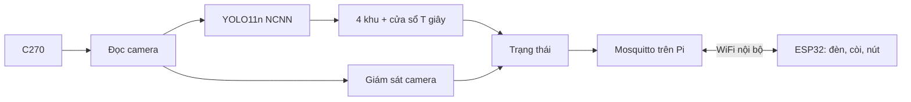

# Đề xuất triển khai ĐATN Nhóm 17 – Hệ thống giám sát phát hiện người xâm nhập

31/10/2026 · Hoàng Trung Anh, Nguyễn Nhật Thăng

## 1. Mục tiêu

Camera quan sát một khu vực. Khi có người đi vào khu cấm, Raspberry Pi 4 phát hiện bằng YOLO rồi gửi cảnh báo qua MQTT tới ESP32. ESP32 bật đèn và còi cho tới khi người trực bấm nút xác nhận. Toàn bộ hệ thống chạy trong mạng WiFi nội bộ, không cần Internet.

So với đề cương, đồ án bổ sung ba điểm:

- **Fine-tune YOLO11n** cho các điều kiện quan sát khó tại hiện trường: người ở xa, người bị che một phần, góc nhìn lạ, người cúi hoặc ngồi.
- **Đo hiệu năng thực tế** của YOLO11n (định dạng NCNN, ảnh 320 px) trên Pi 4.
- **Giám sát camera:** phát hiện khi mất hình, chương trình bị treo hoặc camera bị che.

| Chỉ tiêu | Mục tiêu |
| --- | --- |
| Độ trễ từ lúc người vào khu cấm tới lúc còi kêu | 95% số lần thử dưới 2 giây |
| Fine-tune | Recall tăng trên các điều kiện khó, cảnh bình thường không giảm |
| Báo động giả | Đo số lần mỗi giờ khi chạy liên tục |
| Xử lý sự cố | Đạt các kịch bản K1–K13 (mục 7) |

## 2. Kiến trúc

| Thiết bị | Vai trò |
| --- | --- |
| Logitech C270 (USB) | Quay hình 640×480, 30 fps |
| Raspberry Pi 4 | Chạy YOLO, xác định khu, giữ trạng thái, chạy broker MQTT (Mosquitto) |
| Router WiFi hoặc hotspot | Nối Pi và ESP32 vào cùng một mạng, không cần Internet |
| ESP32 + đèn + còi + nút | Trạm báo động đặt ở bàn người trực: làm theo trạng thái Pi gửi, gửi ACK khi bấm nút |

Broker đặt ngay trên Pi, nên mất Internet hệ thống vẫn cảnh báo được. Hệ thống chỉ ngừng cảnh báo khi router mất điện.

## 3. Phát hiện trên Pi

**Đọc camera.** Một luồng riêng đọc camera liên tục và chỉ giữ ảnh mới nhất. Nhờ vậy YOLO luôn xử lý cảnh hiện tại, không bị dồn ảnh cũ làm trễ dần. Mỗi ảnh mang một số thứ tự để không bị xử lý hai lần. Cấu hình camera: MJPG 640×480 30 fps, phơi sáng tự động, tần số điện lưới 50 Hz, mở camera theo `/dev/v4l/by-id/...`. Cấu hình được áp lại mỗi lần mở camera và dùng chung cho cả lúc thu dữ liệu lẫn lúc chạy thật. Camera mất kết nối thì tự mở lại.

**Mô hình.** YOLO11n xuất sang NCNN, ảnh đầu vào 320 px, chỉ lấy lớp người. Tuần đầu đo trên Pi trong 30–60 phút, chạy đủ mọi thành phần: FPS, CPU, RAM, nhiệt độ, có bị hạ xung hay không. Pi bắt buộc có tản nhiệt và quạt. Số FPS thấp nhất đo được quyết định các tham số T và K_min bên dưới.

**4 khu dọc.** Camera đặt ngang ở độ cao khoảng 1,6 m nên không thấy rõ chân người ở gần. Vì vậy khung hình được chia thành 4 dải dọc (khu 0–3), và người thuộc khu nào thì xét theo tâm ngang của bbox. File cấu hình chọn khu nào là khu cấm, ví dụ khu 2 và 3. Mỗi dải ứng với một hướng nhìn từ camera, không phải một ô cố định trên sàn. Đây là giới hạn của cách đặt camera hiện tại, sẽ ghi rõ trong báo cáo.

**Điều kiện báo động.** Pi không báo ngay khi một ảnh thấy người, vì có thể là nhận nhầm. Mỗi khu cấm có một cửa sổ T giây (ví dụ 2–3 giây). Pi chỉ báo khi trong cửa sổ có ít nhất K_min lần thấy người và tỷ lệ thấy người đạt từ p trở lên. Nếu cửa sổ có quá ít ảnh được xử lý, nghĩa là Pi chạy quá chậm, thì Pi báo lỗi quan sát chứ không im lặng. Ngưỡng tin cậy, T, K_min và p chọn trên tập val, không chọn trên tập test.

## 4. Fine-tune mô hình

1. **Thu dữ liệu** bằng chính C270, đặt đúng vị trí triển khai. Quay theo kịch bản cho từng điều kiện: đứng ở vị trí xa nhất; ngồi hoặc đứng sau bàn ghế; quay lưng, đi chéo, đi sát mép khung; cúi, ngồi ghế, ngồi xổm. Có cả cảnh bình thường và cảnh không người. Mỗi đoạn quay gắn nhãn điều kiện (`far`, `occluded`, `angle`, `pose`, `normal`). Mục tiêu khoảng 10 buổi quay ngắn trên nhiều ngày, sau khi lọc còn 1.000–2.000 ảnh. Chỉ quay người có giấy đồng ý (Luật 91/2025/QH15, Nghị định 356/2025/NĐ-CP), làm mờ mặt khi đưa vào quyển.
2. **Bổ sung dữ liệu công khai:** vài trăm ảnh người từ COCO, ưu tiên người nhỏ hoặc bị che, để mô hình không quên kiến thức chung.
3. **Gán nhãn:** cho YOLO11m gán nhãn sơ bộ rồi sửa tay trên CVAT hoặc Label Studio. Riêng tập test thì gán tay toàn bộ.
4. **Chia tập theo buổi quay**, không chia theo từng ảnh. Tập test gồm `test_normal`, `test_hard` (báo kết quả theo từng nhãn điều kiện) và `test_external` (COCO val2017 đã lọc người nhỏ hoặc bị che). Tập test bị khóa, chỉ dùng cho lần đánh giá cuối.
5. **Train trên Colab** ở ảnh 320 px, sau đó thêm mẫu âm khó (các ảnh không người nhưng mô hình báo nhầm) rồi train lại. Xuất NCNN và đo lại trên Pi.

| Thí nghiệm | Ưu tiên |
| --- | --- |
| Mô hình gốc và fine-tune trên từng điều kiện, ở cùng mức báo động giả | Bắt buộc |
| Trước và sau khi thêm mẫu âm khó | Bắt buộc |
| Ảnh 320 px và 416 px (ảnh hưởng tới người ở xa và tốc độ) | Nên làm |
| Mô hình gốc và fine-tune trên `test_external` | Nên làm |

Mô hình fine-tune được train 3 lần với seed khác nhau, báo cáo trung bình và độ lệch chuẩn.

## 5. Quản lý trạng thái

Pi là nơi duy nhất giữ trạng thái; ESP32 chỉ làm theo. Hệ thống luôn canh gác khi chương trình đang chạy. Muốn tắt thì dừng dịch vụ trên Pi.

Trạng thái chia thành hai phần độc lập, để sự cố này không xóa mất sự cố kia:

- **Xâm nhập:** KHÔNG CÓ → NGHI NGỜ → CẢNH BÁO → ĐÃ XÁC NHẬN (sau ACK) → KẾT THÚC (khi khu cấm vắng người liên tục đủ T giây). Cảnh báo không tự tắt khi người đã rời đi; phải có người trực bấm xác nhận.
- **Quan sát camera:** TỐT → NGHI LỖI → MẤT QUAN SÁT (khi lỗi kéo dài 3–5 giây, hoặc camera bị che ngắn nhưng lặp lại nhiều lần trong 30–60 giây). Khi vào MẤT QUAN SÁT, Pi phát cảnh báo quan sát, cũng cần ACK để tắt.

Ba quy tắc quan trọng:

1. Khi camera không nhìn được thì không bao giờ coi là "không có người". Che camera không làm một cảnh báo xâm nhập đang mở bị kết thúc.
2. Một lần bấm nút xác nhận tất cả các cảnh báo đang hiển thị trên ESP32 lúc bấm. Cảnh báo phát sinh sau lúc bấm vẫn tiếp tục báo.
3. Pi ghi trạng thái ra file mỗi lần trạng thái thay đổi. Khởi động lại thì cảnh báo chưa xác nhận được khôi phục và báo tiếp.

| Ưu tiên | Tình huống | Đèn | Còi |
| --- | --- | --- | --- |
| 1 | Đang cảnh báo xâm nhập | Đỏ nháy | Kêu |
| 2 | ESP32 mất tín hiệu từ Pi | Cam và đỏ xen kẽ | Bíp ngắn |
| 3 | Cảnh báo quan sát chưa ACK | Cam nháy | Nhịp khác |
| 4 | Xâm nhập đã ACK, chờ vắng người | Đỏ sáng | Tắt |
| 5 | Mất quan sát, đã ACK | Cam sáng | Tắt |
| 6 | Bình thường | Vàng | Tắt |

Ảnh bằng chứng chỉ lưu khi có cảnh báo, tự xóa sau N ngày. Log ghi vòng để không làm hỏng thẻ SD.

## 6. MQTT

Broker Mosquitto chạy trên Pi, cổng 1883, bắt buộc có tài khoản (tắt kết nối ẩn danh), bật `persistence`. Chương trình Python trên Pi dùng `paho-mqtt`; ESP32 dùng PubSubClient; MQTTX trên laptop dùng để theo dõi và thử.

| Topic | Chiều | Nội dung |
| --- | --- | --- |
| `safecam/cam01/event` | Pi → ESP32 | Mã sự kiện, loại (xâm nhập/quan sát), khu (`zones`), thời gian |
| `safecam/cam01/state` | Pi → ESP32 (retain) | Trạng thái hiện tại, đèn và còi cần bật |
| `safecam/cam01/hb` | Pi → ESP32 | Tín hiệu "còn sống" mỗi 2 giây |
| `safecam/alarm01/ack` | ESP32 → Pi | Danh sách mã sự kiện được xác nhận |
| `safecam/cam01/status`, `safecam/alarm01/status` | LWT | Thiết bị online hay offline |

- ESP32 gửi ACK lặp lại mỗi giây cho tới khi thấy Pi xác nhận đã nhận.
- ESP32 mất 3 nhịp heartbeat liên tiếp thì báo "mất giám sát".
- Khi mất kết nối, ESP32 giữ nguyên báo động đang có; nút bấm chỉ tắt còi tại chỗ.

## 7. Đánh giá

| Nội dung | Cách đo |
| --- | --- |
| Mô hình | Precision, recall, mAP50 trên 3 tập test, so mô hình gốc với fine-tune |
| Phát hiện xâm nhập | Tỷ lệ bỏ sót và số báo động giả mỗi giờ, qua video kịch bản và chạy liên tục nhiều giờ |
| Hiệu năng Pi | FPS, CPU, RAM, nhiệt độ, hạ xung (log CSV) |
| Độ trễ | Quay slow-motion thấy cả vạch khu cấm và đèn ESP32, đếm số khung hình; mỗi điều kiện khoảng 30 lần thử |
| Giám sát camera | Rút cáp, che bằng tay, giả lập chương trình treo, tắt bớt đèn (để kiểm tra không báo nhầm) |
| Độ ổn định | Tắt router, khởi động lại Pi, rút nguồn ESP32; đo thời gian khôi phục |

Kịch bản sự cố (mỗi kịch bản thử ít nhất 5 lần):

| # | Kịch bản | Kết quả đúng |
| --- | --- | --- |
| K1 | Đang cảnh báo → che camera → ACK → bỏ che | Sự kiện vẫn mở, chỉ kết thúc khi thấy khu cấm vắng đủ T giây |
| K2 | Đã ACK, người còn đứng trong khu → che vài phút → bỏ che | Sự kiện không kết thúc |
| K3 | Che camera ngắn lặp lại trong lúc người đi vào | Có cảnh báo xâm nhập hoặc cảnh báo quan sát, không im lặng |
| K4 | Che camera, đi vào khu, bỏ che | Cảnh báo ngay, nhãn "xâm nhập sau mất quan sát" |
| K5 | Đang cảnh báo → tắt router → bấm nút → bật router | Còi tắt tại chỗ, kết nối lại thì ACK được đồng bộ |
| K6 | Mất kết nối, bấm nút, trong lúc đó có sự kiện mới | Chỉ sự kiện cũ được xác nhận |
| K7 | Đang cảnh báo → khởi động lại Pi | Sự kiện được khôi phục, ESP32 tiếp tục báo |
| K8 | Khởi động lại Pi rồi che camera ngay | Sau 60 giây khởi động có cảnh báo quan sát |
| K9 | Khởi động lại khi không có Internet | Vẫn chạy đúng, log đánh dấu giờ chưa đồng bộ |
| K10 | Người vẫn trong khu sau khi sự kiện kết thúc | Mở sự kiện mới |
| K11 | Vòng YOLO treo nhưng MQTT vẫn sống | ESP32 báo mất giám sát, watchdog khởi động lại chương trình |
| K12 | Rút cáp camera rồi cắm lại | Cảnh báo quan sát, camera tự mở lại |
| K13 | Mất điện ngay sau khi trạng thái đổi | File trạng thái không bị hỏng |

## 8. Demo (5–7 phút)

Dàn dựng: camera và Pi đặt trên giá, ranh giới 4 khu dán băng dính dọc trên tường, khu 2 và 3 là khu cấm. ESP32 đặt ở bàn người trực. Laptop xem luồng hình có vẽ khu và khung người.

1. Bật hệ thống. Rút dây Internet của router, `ping 8.8.8.8` báo lỗi, MQTTX vẫn thấy bản tin chạy.
2. Đi trong khu 0 và 1: không báo động.
3. Bước sang khu 2: đèn đỏ, còi kêu, ESP32 báo khu 2.
4. Bấm nút: còi tắt. Rời đi, sau T giây sự kiện kết thúc.
5. Điều kiện khó: ngồi sau bàn, cúi người, đứng ở xa. So mô hình gốc với mô hình fine-tune.
6. Đang báo động thì lấy tay che camera: có thêm cảnh báo quan sát, sự kiện xâm nhập không bị mất.
7. Rút điện router: ESP32 giữ báo động. Cắm lại: hệ thống tự khôi phục.

Có video quay sẵn để dự phòng.

## 9. Phân công và tiến độ

| Phần | Trung Anh | Thăng |
| --- | --- | --- |
| Phát hiện | Camera, YOLO NCNN, 4 khu, cửa sổ T giây | – |
| Dữ liệu, huấn luyện | Thu dữ liệu, train, thí nghiệm | Gán nhãn phần lớn |
| Trạng thái | Hai trạng thái, lưu bền | ESP32 làm theo `state`, ACK, xử lý mất kết nối |
| Giám sát camera | Cung cấp ảnh và kết quả YOLO | Module giám sát, watchdog |
| MQTT, ESP32 | Publish sự kiện | Broker, bảo mật, firmware |
| Đánh giá | Mô hình, hiệu năng Pi | Độ trễ, độ ổn định, kịch bản K1–K13 |

| Mốc | Cần có |
| --- | --- |
| 03/11 | YOLO11n NCNN chạy trên Pi, có số đo FPS; broker chạy |
| 10/11 | Lõi chạy đầu-cuối: camera → 4 khu → MQTT → ESP32 kêu → ACK (mô hình gốc) |
| 17/11 | Có dữ liệu đã gán nhãn, fine-tune lần đầu; giám sát camera chạy |
| 24/11 | Kiểm thử K1–K13, đo độ trễ, chạy nền 24 giờ; có số liệu chương 3 |
| 01/12 | Hoàn thiện báo cáo, slide, video demo |
| 06/12 | Nộp quyển |

Các mốc 13/10 và 27/10 trong bản trước đã trễ, nên lịch trên là lịch mới. Báo cáo viết song song: làm xong module nào thì viết phần chương 2 tương ứng.

## 10. Phạm vi

**Làm:** một camera, 4 khu dọc, YOLO11n NCNN, cửa sổ T giây, MQTT–ESP32, ACK, fine-tune cho điều kiện khó, giám sát camera cơ bản (mất hình, treo, bị che).

**Làm nếu còn thời gian sau 10/11:** chế độ canh gác theo lịch (arm/disarm, cần thêm RTC DS3231), phát hiện camera bị mờ hoặc bị xoay, thông báo Telegram.

**Không làm:** thiếu sáng và bóng tối, nhận diện khuôn mặt, nhận diện hành động, web dashboard hoặc cloud, lượng tử hóa INT8.

## 11. Phần cứng (bổ sung sau)

Cần có sơ đồ nguyên lý toàn hệ thống (Pi, camera, ESP32, đèn, còi, nút), nguồn 5V/3A cho Pi, mạch điều khiển còi qua transistor, mức logic 3,3 V. File PCB hiện có nằm trong `hardware/PCB_Layout/`.
